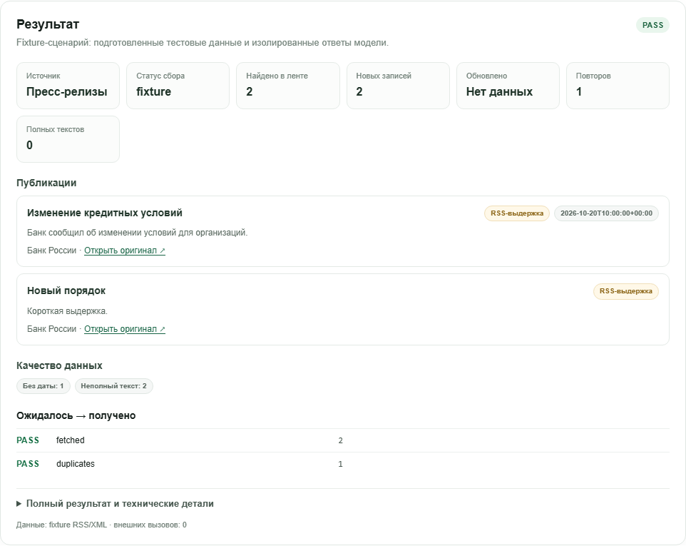

# 01 — News Collector: повторный пользовательский отчёт

**Проверка:** 22 октября 2026 г., Chromium / Playwright CLI. Повторная проверка исправлений выполнена на телефоно-подобном viewport 390×844.
**Итоговый статус:** **PASS** для проверенных пользовательских сценариев. Два ранее найденных дефекта Studio исправлены и повторно проверены в браузере.
**Режим AI:** сборщик не использует AI. T08/T09 принадлежат модулю News Intelligence. В этом проходе AI-вызовов не было.

## 1. Назначение, владелец и поток данных

Модуль загружает разрешённую RSS-ленту, извлекает публикации, нормализует ссылки и даты, определяет полноту текста, сохраняет записи и подавляет точные повторы. Это реальный RSS-клиент и парсер, не генеративный ответ. В Fixture-режиме алгоритм разбирает переданный XML тем же кодом, но временная БД изолирована.

Владелец алгоритма — `modules/01-news-collector/backend/news_collector.py`. Старый путь `drive_data_analysis_2026-10-20/news_collector.py` служит совместимой обёрткой. Studio-адаптер — `modules/01-news-collector/backend/adapter.py`; экран — `modules/01-news-collector/frontend/ModulePage.tsx`.

Поток:

1. Экран загружает реестр разрешённых источников и журнал локальных запусков. При открытии страницы RSS автоматически не запрашивается.
2. В Fixture пользователь выбирает готовый RSS XML либо вводит свой. Алгоритм разбирает XML и выполняет upsert/дедупликацию во временной SQLite-БД; временная папка удаляется после запроса.
3. В Live RSS пользователь выбирает источник allowlist и вручную запускает запрос. Сервис выполняет один GET с тайм-аутом 25 секунд и лимитом ответа 8 МБ.
4. Ключ записи строится из источника и GUID либо нормализованного URL. Ограничения уникальности и upsert учитывают повторы.
5. UI показывает статус, найденные/новые/обновлённые/повторные записи, дату, качество текста, оригинальную ссылку, контроль качества и историю запусков.

Разрешённый единственный Live RSS сбор ниже записал только в локальную БД копии Studio:

`data/news_collector_studio.sqlite3` in the local working clone (this workspace-local path is not included in Git).

Исходные `drive_data_analysis_2026-10-20/news.sqlite3` и CSV не изменялись. Клиентские сведения не передавались.

## 2. API и подготовленные сценарии

Используется общий API контракта v1:

- `GET /api/modules/news-collector/health`
- `GET /api/modules/news-collector/scenarios`
- `GET /api/modules/news-collector/sources`
- `POST /api/modules/news-collector/run`
- `POST /api/modules/news-collector/tests`

Live-запрос принимает ключ источника из allowlist, не произвольный URL. Сборщик не запускает T08/T09 и не отправляет текст публикаций во внешний AI.

| Fixture-сценарий | Ожидаемое поведение | Результат браузерного запуска |
|---|---|---|
| RSS и повтор | Две публикации и повтор первой | PASS: найдено 2, добавлено 2, повторов 1 |
| Пустой RSS | Корректная пустая лента | PASS в исходном проходе: 0 публикаций |
| Без даты | Сохранить публикацию и отметить пропущенную дату | PASS в исходном проходе: 1 публикация без даты |
| Свои данные, malformed XML | Понятная ошибка ввода, без traceback | PASS после исправления: HTTP 400 и безопасное сообщение |

## 3. Реальные действия в браузере и результаты

Открыл `http://127.0.0.1:5173/studio/news-collector` в Chromium. Проверил реальный интерфейс на 390×844. Backend отображается доступным. В исходном проходе на широком экране также проверялись 1440×1050 и отсутствие горизонтального переполнения.

### Fixture: нормальная лента, повторы и смена сценария

- В режиме Fixture выбрал **RSS и повтор** и нажал **«Запустить алгоритм»**. Получено 2 записи, 2 новых, 1 повтор; полных текстов 0, обе публикации корректно помечены как RSS-выдержки.
- После успешного результата выбрал **Пустой RSS**. Теперь старый результат сразу исчезает, отображается ожидаемый ввод `<rss><channel/>` и описание пустого сценария, а правая панель говорит о готовности фикстуры. Устаревшие две записи и PASS не остались на экране.
- Это проверяет переход между сценариями непосредственно после выполненного запуска; повторный Live RSS не выполнялся.

### Некорректный XML и восстановление

- Выбрал **Свои данные**, ввёл `<rss><channel>` и запустил сбор.
- API ответил HTTP 400. UI показал: **«Не удалось прочитать RSS/XML. Проверьте структуру ленты.»** Панель результата сообщает, что запуск завершился ошибкой; предыдущий успешный результат не остаётся.
- В видимом UI нет `ParseError` или traceback. DevTools записывает HTTP 400 как ошибочный сетевой ответ; это ожидаемый статус для некорректного пользовательского ввода и не мешает отображению безопасной ошибки.
- Снова выбрал **RSS и повтор**. Сообщение ошибки очистилось, XML вернулся к содержимому выбранного сценария, панель показала готовность. Запустил алгоритм повторно: снова PASS, 2 найдено / 2 новых / 1 повтор.

### Независимый запуск тестов и реальные RSS-данные

В исходном проходе в интерфейсе была нажата кнопка **«Запустить 3 теста»**: результат **PASS 3/3**. Также в Chromium были вручную выполнены сценарии **Пустой RSS** и **Без даты**, оба с ожидаемыми результатами.

В том же исходном проходе выполнил ровно один разрешённый Live RSS GET к Банку России: `https://www.cbr.ru/rss/RssPress`. Получено `ok`: 13 публикаций в ответе, 0 новых, 0 обновлённых, 13 повторов; локальная БД Studio показывала 14 записей. Ошибок источника не было. Открыл первую запись: новая вкладка Банка России показала исходную публикацию и полный текст; при возврате Studio осталась доступной. После этого live-запросы не повторялись.

Источник и тексты видны пользователю: выдержки маркируются **RSS-выдержка**, оригинальная публикация открывается ссылкой. Полный текст не был ошибочно заявлен для fixture-публикаций.

## 4. Дефекты и повторная проверка исправлений

### P2 — старый результат оставался после смены Fixture-сценария — ИСПРАВЛЕНО

**Исходное воспроизведение:** запустить «RSS и повтор», затем выбрать «Пустой RSS», не запуская его. Ранее оставались видны две записи и один повтор при уже сменившихся полях.

**Исправление проверено в UI:** после выбора «Пустой RSS» предыдущий результат очистился немедленно, поля и описание соответствовали новой фикстуре. После переключения обратно на «RSS и повтор» отображались правильные XML и состояние готовности.

### P2 — некорректный XML показывался как техническая ошибка — ИСПРАВЛЕНО

**Исходное воспроизведение:** Fixture → «Свои данные» → `<rss><channel>` → «Запустить алгоритм». Ранее ответ был HTTP 503 с `ParseError`, а справа оставалось вводящее в заблуждение ready-состояние.

**Исправление проверено в UI:** ответ HTTP 400, текст говорит о некорректной структуре RSS/XML, предыдущее состояние результата очищено/помечено как ошибка. Traceback и технический класс исключения пользователю не показаны.

### Замечание — HTTP 400 отображается в консоли браузера

При ожидаемом отрицательном тесте Chromium DevTools отмечает HTTP 400 как неуспешный сетевой запрос. Пользовательский экран при этом корректно показывает безопасное пояснение и остаётся работоспособным. Это не дефект парсинга и не серверный traceback.

## 5. UX и ограничения

- На viewport 390×844 горизонтального переполнения нет. На основном результате карточки и действия идут одной колонкой и читаемы; форма с XML требует прокрутки, ожидаемой для длинного текста.
- Режим Fixture отделён от Live RSS; указано, что Live RSS делает сетевой запрос и пишет в локальную БД Studio.
- Ручной сбор не запускается при открытии экрана.
- Источники отображают тип полноты текста; ссылка на оригинал доступна в каждой записи.
- В Live RSS список из 14 записей увеличивает вертикальную прокрутку. Для частого использования можно добавить фильтр/сворачивание, но это не препятствует текущему сценарию.
- Live RSS проверен только для Банка России и ровно одним GET. КонсультантПлюс не запрашивался.
- Timeout/ошибка сетевого источника в UI вручную не воспроизводились. Проверка такого поведения опирается на имеющийся unit-тест fetcher; в этом проходе внешний источник повторно не вызывался.
- Fixture поведение проверено через UI, отдельные unit/API проверки из предыдущего отчётного прохода: `npm run test:module -- news-collector`, сообщалось 6 unit/API проверок и 3 сценария. В этой повторной проверке код не менялся.

## 6. Свидетельства

- Скриншот реального успешного запуска `RSS и повтор` на viewport 390×844: [01-news-collector-retest.png](assets/01-news-collector-retest.png). Он сделан после повторной проверки исправлений.
- Предыдущий успешный fixture-скриншот: [01-news-collector-fixture.png](assets/01-news-collector-fixture.png).
- Live RSS: один GET к CBR в исходном проходе, результат `ok`, 13 найдено / 13 повторов, локально отображалось 14 публикаций.
- Открытая публикация: [Банк России — «Отозвана лицензия на осуществление банковских операций у ООО НКО „Тайдон“»](https://www.cbr.ru/press/PR/?file=639282394585722382BANK_SECTOR.htm).

## Повторный Chromium-проход — 2026-10-22, Fixture only

Проверен актуальный маршрут `http://127.0.0.1:5173/studio/news-collector` в отдельном Chromium-контексте. Vite отвечает на `5173`, его API proxy ведёт на `127.0.0.1:8097`; health и каталоги отвечали HTTP 200. По правилам этого прохода Live RSS не запускался повторно: ранее разрешённый запрос уже есть в истории отчёта. При открытии экран выбрал `Live RSS — ручной сбор`, но до нажатия кнопки сетевой сбор не начинался; я переключил режим на `Fixture`.

### Владелец, исполнение и контракты

Единственный владелец сбора/разбора/дедупликации — `modules/01-news-collector/backend/news_collector.py`; старый `drive_data_analysis_2026-10-20/news_collector.py` — тонкая совместимая обёртка. `adapter.py` в Fixture передаёт XML в `parse_rss`, создаёт SQLite во временной папке, запускает тот же `_upsert_item` и возвращает список, качество и происхождение до удаления временной папки. Внешний вызов Live RSS отделён в `run_live`; T08/T09 здесь не вызываются.

Использованные API: `GET /health`, `/scenarios`, `/sources`, `POST /run` и `/tests` под `/api/modules/news-collector/`. На run передаются `mode`, необязательный `scenarioId` и XML/параметры в `input`; успех возвращает `contractVersion`, `mode`, `status`, `data`, `provenance` и `validation`. Источники Live RSS ограничены allowlist; они не могут быть заменены произвольным URL.

### Фактические результаты

- Fixture «RSS и повтор»: `POST /run` → HTTP 200, `validation=PASS`, 2 публикации, 2 новых, 1 повтор. В UI видны даты/отсутствие даты, обе записи маркированы RSS-выдержками, есть переход к оригиналу. Provenance указывает временную SQLite и `externalCalls=0`.
- Кнопка `Запустить 3 теста`: HTTP 200, общий `PASS`; `success`, `empty`, `missing-date` — все PASS.
- Сразу после результата сменил сценарий: результат очистился. Перешёл в Live RSS и обратно в Fixture: состояние осталось чистым.
- В «Своих данных» отправил malformed XML `<rss><channel><item>`: HTTP 400 `INVALID_INPUT`; UI показал короткое сообщение о структуре RSS/XML, без traceback. Прямой вызов неизвестного scenario ID вернул HTTP 400 `SCENARIO_NOT_FOUND`.
- На ширинах 1440, 1280 и 390 px `documentElement.scrollWidth` совпал с шириной viewport; ошибок страницы нет.
- `npm run test:module -- news-collector`: PASS, 8 Python-тестов и 3 prepared scenarios. Публичный RSS в ходе этого повторного прохода не запрашивался.

### Обнаружение и исправление provenance

В первом HTTP-ответе Fixture поля `kind=synthetic RSS` и `externalCalls=0` сопровождались `sources=[https://www.cbr.ru/rss/RssPress]`, хотя XML был fixture-вводом и сетевого запроса не было. Это могло создать неверное впечатление о происхождении данных. Исправлено только описание provenance в `modules/01-news-collector/backend/adapter.py`: Fixture теперь называет payload источником и не приписывает ему реальный URL; добавлен unit-тест. Парсер, дедупликация и feed-профиль не менялись. После изменения модульные 8 Python-тестов прошли. Дополнительный свежий Chromium POST подтвердил HTTP 200 и новое тело: `kind=fixture RSS/XML`, `sources=["RSS XML payload supplied to Fixture adapter"]`, `writes=temporary SQLite only`, `externalCalls=0`; footer UI отображает тот же тип. Перезапуск backend не потребовался, поскольку API динамически загружает адаптер.

