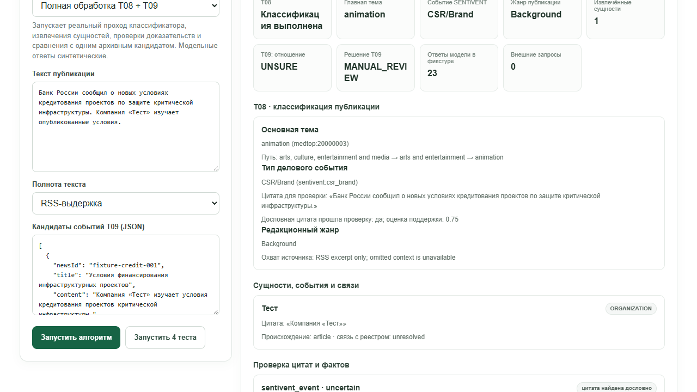
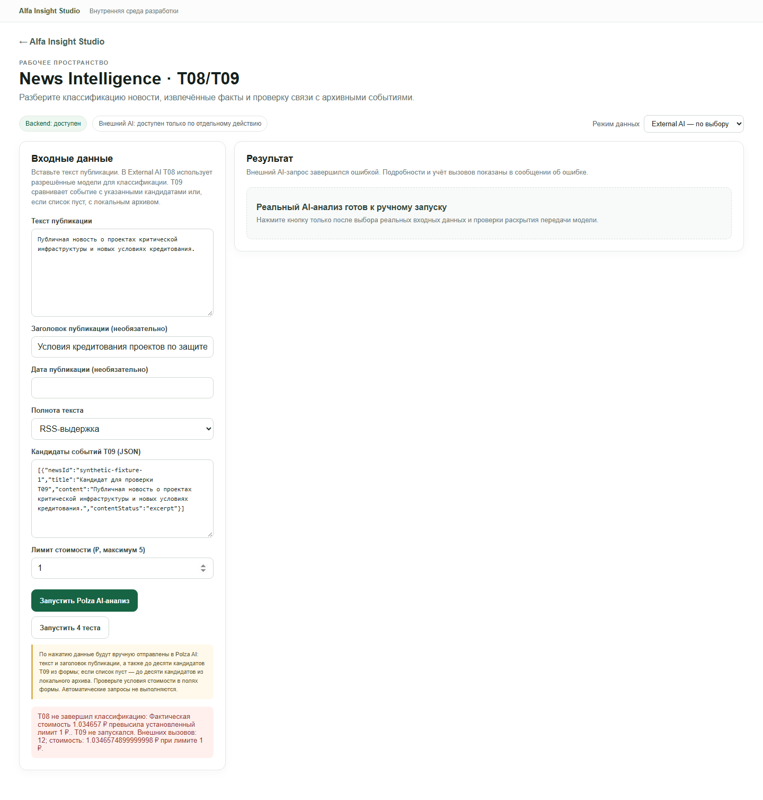
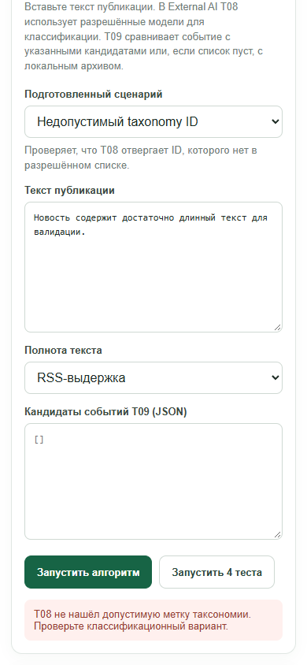
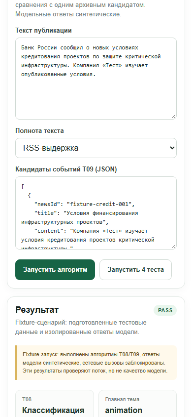
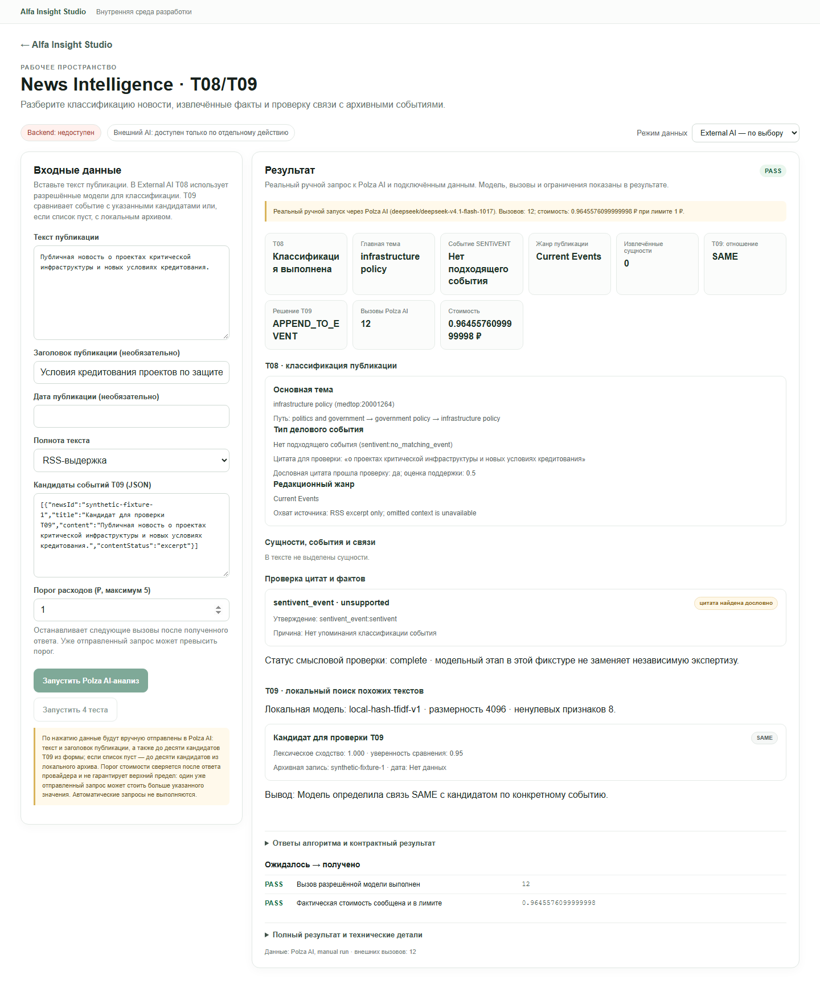
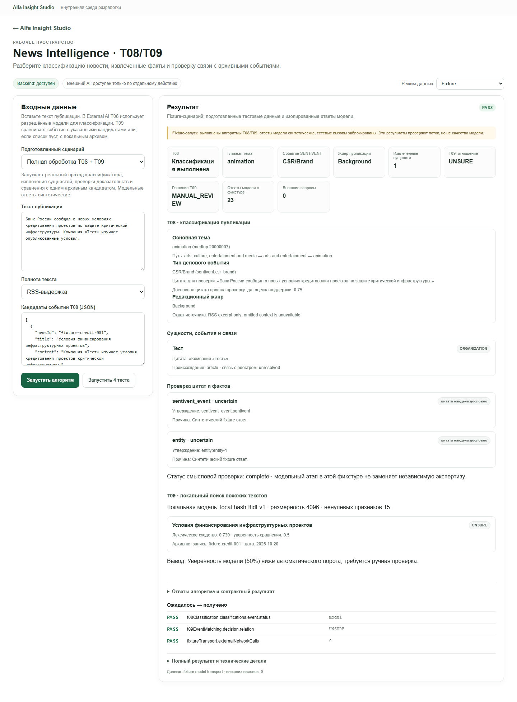
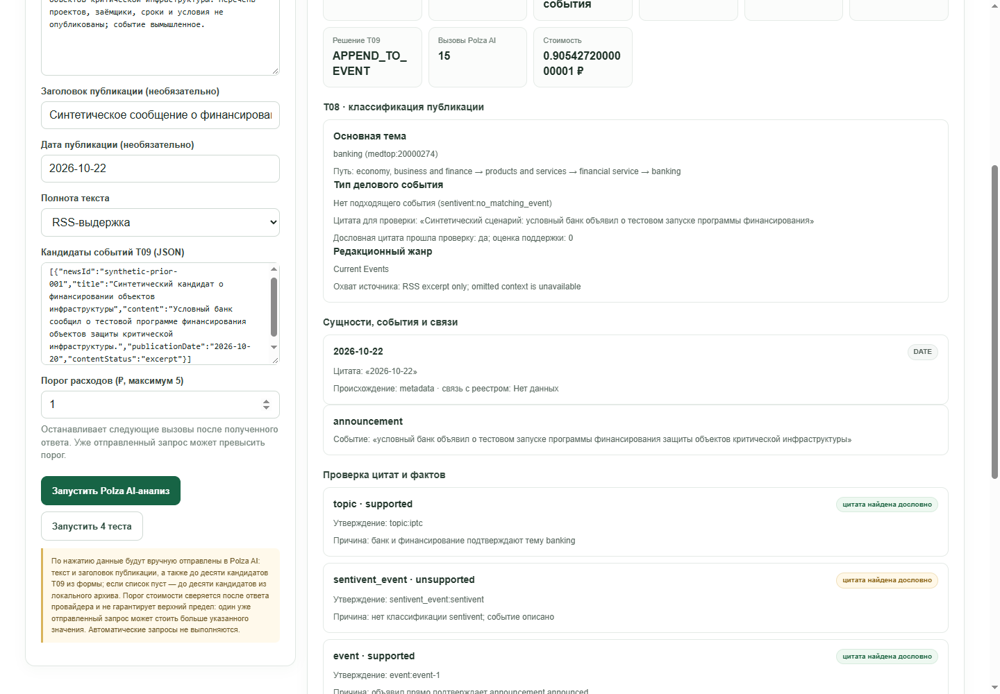
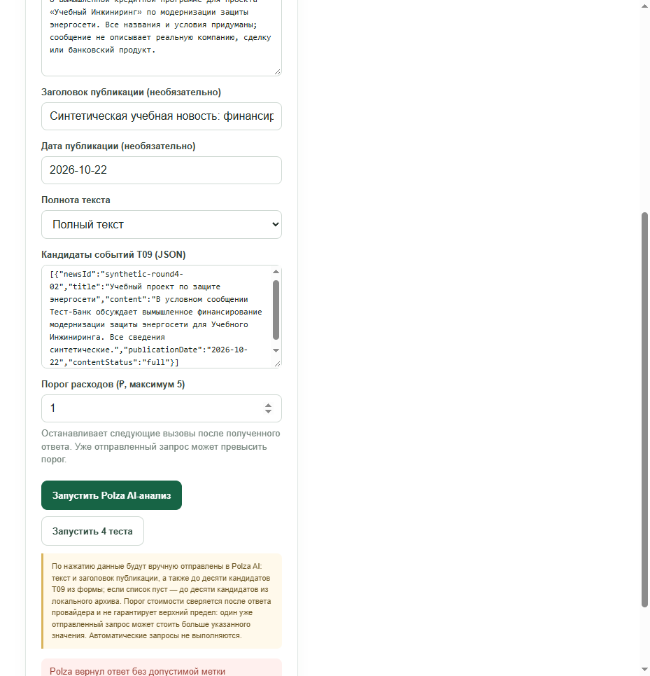
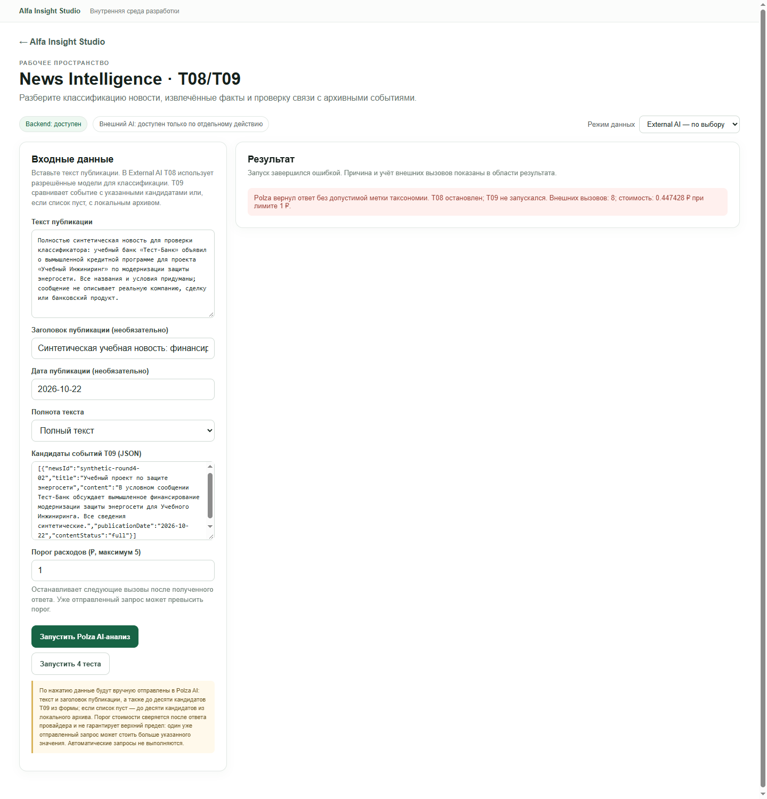

# Повторный QA: 02 — News Intelligence (T08/T09)

**Актуальный статус: PARTIAL.** Fixture T08/T09 и Local Data T09 выполняются. В повторном ручном запуске внешний путь действительно завершил T08 и T09, а Polza сообщил 0,96455761 ₽ при пороге 1 ₽. Вывод T08 по событию остался неподтверждённым; `SAME` в T09 получен для синтетического кандидата с практически идентичным текстом, поэтому качество классификации и дедупликации этим прогоном не доказано. В предыдущем отдельном запросе порог был превышен; стоимость сверяется после ответа и не является жёстким лимитом. В fixtures/UI исправлены утечка Node traceback и устаревшее состояние при переключении сценария.

## Назначение и владелец кода

Модуль принимает текст новости, классифицирует её через существующий T08, проверяет цитаты и сравнивает с кандидатами событий через T09. Модульная папка владеет адаптером, fixture runner и UI; алгоритмы T08/T09 остаются в их существующих каталогах.

- API-адаптер, длина входа, синтетический/локальный/внешний режимы и происхождение: `modules/02-news-intelligence/backend/adapter.py:48-71,73-128,130-146`.
- Runner импортирует существующие `classifyNews`, локальный векторизатор и `classifyEventRelation`: `modules/02-news-intelligence/backend/run.mjs:191-195`.
- Fixture-путь проходит T08/T09, но заменяет транспорт модели синтетическим и блокирует исходящие запросы: `run.mjs:10-18,207-247,258-264`.
- Сходство кандидатов рассчитывается локально косинусом векторов T09; решение отношения вызывает существующий T09: `run.mjs:220-245`.
- Local Data выполняет T09 hash-TFIDF поиск и возвращает только ненулевые лексические совпадения, без T08/AI: `modules/02-news-intelligence/backend/local-t09.mjs:8-23`, `adapter.py:130-146`.
- Экран явно отделяет фикстуру, локальный поиск и внешний запуск; показывает цитаты, сущности, проверку фактов и кандидатов: `modules/02-news-intelligence/frontend/ModulePage.tsx:20-86,91-114`.

## API и формат данных

Общий контракт `1.0`: `GET /api/modules/news-intelligence/health` и `/scenarios`, `POST /run` и `/tests`; оболочка ответа и ошибки определены в `shared/backend/modules_api.py:162-190,228-301`.

Вход `/run`: `mode`, `scenarioId` и/или `input` с `text` (не менее 20 символов), при наличии — `title`, `date`, `content_status` (`full|excerpt|missing`) и массивом `t09_candidates`. Fixture возвращает T08/T09, `fixtureTransport` и provenance с `externalCalls: 0`. Local Data возвращает статус T08 `requires_external_ai`, локальные совпадения T09 и provenance с `writes: none`. External AI принимает `max_cost_rub` в пределах 0.05–5 ₽, отправляет публикацию и максимум 10 кандидатов T09 провайдеру при ручном запуске (`adapter.py:73-103`).

Внешний режим блокируется API, если нет разрешённого режима/провайдера; общий API не считает отсутствие эталонных проверок PASS (`modules_api.py:234-242,279-291`).

## Проверка интерфейса в Chromium

Проверка выполнена через Playwright в Chromium, `1440×1100`, адрес `http://127.0.0.1:5173/studio/news-intelligence`.

1. При открытии режим по умолчанию был `External AI`, но запрос автоматически не отправлялся. Экран предупреждал, что данные уйдут в Polza только после ручного нажатия.
2. Переключил на `Fixture`, вставил синтетическую публикацию и нажал `Запустить алгоритм`. Ответ API — HTTP 200, `validation=PASS`; на UI указаны синтетические ответы и 0 внешних запросов.
3. Результат показал выполнение T08, дословное присутствие цитаты, пустой список выделенных сущностей и T09 `UNSURE` / `MANUAL_REVIEW`. В фикстуре было 23 синтетических ответа модели. Это число явно расположено под подписью «Ответы модели в фикстуре».
4. Нажал `Запустить 4 теста`: UI показал PASS для всех четырёх подготовленных сценариев.
5. Переключил на `Local Data`, повторно использовал только синтетический текст и нажал запуск. Ответ API — HTTP 200, внешние вызовы 0, `writes=none`, status/validation `NOT_EVALUATED`. По локальному архиву вернулось 10 лексических кандидатов; размерность вектора — 4096, у верхнего результата сходство около 0.326. UI обозначил их как лексические кандидаты, отдельно предупредив, что это не AI-классификация и не доказательство связи событий.
6. В fixture-режиме ввёл короткий текст: запуск остановил клиентский валидатор с сообщением о минимуме 20 символов; traceback и общая ошибка не появились.

Семантика `NOT_EVALUATED` для локального поиска уместна: для произвольного текста нет ожидаемого эталона. UI поясняет это состояние, а не выдаёт его за PASS.

## Команда тестирования

```text
npm run test:module -- news-intelligence
```

**Результат: PASS**, exit code 0 после исправлений; 7 Python unit/API-тестов и 3 Node-теста ограничителей провайдера. Все 4 подготовленных сценария PASS. Дополнительно `node --test backend/T08/test/taxonomy-choice.test.mjs` — PASS, 8 тестов. Проверены локальное сходство, неопределённое отношение, минимальная длина ввода, сохранение обоих timeout signals и безопасная обработка ошибки провайдера без утечки ключа. Внешний API тестовые команды не вызывают.

## Режимы и ограничения

| Режим | Что подтверждено |
|---|---|
| Fixture | Алгоритмический поток T08/T09 с синтетическими ответами; 0 сетевых вызовов. Не оценивает точность модели. |
| Local Data | Локальный hash-TFIDF поиск по архиву, без T08 и без AI; только кандидаты с лексическим пересечением. Пустой список не означает `DIFFERENT`. |
| External AI | Три ручных запуска были только на синтетических данных; профиль и клиентские сведения не отправлялись. Первый: 8 вызовов, известна только часть стоимости — 0,25234689 ₽, итог неизвестен. Второй: HTTP 503 / `POLZA_COST_LIMIT_REACHED`, 12 вызовов, 13 062 input и 8 704 output tokens, сообщено 1,03465749 ₽ при пороге 1 ₽; T09 не запускался. Третий: T08 и T09 завершились в 12 вызовах, 12 847 input / 8 348 output tokens, сообщено 0,96455761 ₽ при пороге 1 ₽; содержательная точность не доказана. Ещё один ранний timeout не сообщил итоговую стоимость; суммарный счёт неизвестен. Порог проверяется после ответа, а не является жёстким потолком. |

## Первый живой ручной запуск Polza — до исправления timeout/error UI

- Действие: `External AI` → ручной запуск; автоматического запроса при открытии страницы не было.
- Ввод: только синтетическая публикация и синтетический кандидат T09; профиль компании не прикладывался.
- Наблюдаемое поведение: UI оставался в процессе около 82 секунд после клика и затем показал понятную ошибку таймаута, без traceback и без утечки ключа. Ответ API — HTTP 503, `POLZA_REQUEST_TIMEOUT`; T08 не выдал классификацию, T09 не стартовал.
- Метаданные ошибки: модель `deepseek/deepseek-v4.1-flash-1017` через Polza, 8 вызовов, 6 763 входных и 4 768 выходных токенов, известная сумма только для вызовов с репортом стоимости — 0,25234689 ₽; `costReported=false`, `budgetRub=1`, `budgetExceeded=false`. Последняя сумма не является полной стоимостью запроса: полный итог неизвестен.
- Причина в коде: модульная обёртка накладывала 25-секундное прерывание на каждый запрос и заменяла более длинный сигнал T08. Исправлено: объединение сигналов, предел одного запроса увеличен до 90 секунд, предел runner-процесса — до 180 секунд. **На момент первого отчёта** после исправления новый платный запрос ещё не выполнялся; последующий повтор записан в отдельном разделе ниже.
- В конце живого запроса выяснилась ещё одна ошибка T08: ответ для единственной запрошенной ветви таксономии мог быть отвергнут, если модель не возвращала служебный ключ `branch_0`. Добавлен безопасный fallback только при ровно одной запрошенной и одной возвращённой ветви; реальный ID категории по-прежнему проверяется. Добавлены unit-тесты. Успешный live T08/T09 после этих изменений пока не подтверждён.
- Скриншот ошибки: `docs/module-reports/assets/02-news-intelligence-polza-timeout.png`.

## Проблемы и приоритеты

**P2 — PASS фикстуры не следует трактовать как семантическое качество.** В UI fixture на текст о финансировании вернул синтетические метки темы `animation` и события `CSR/Brand`, не соответствующие смыслу тестового текста. Это синтетический транспорт и UI прямо сообщает, что результат проверяет поток, а не качество модели. Однако рядом стоит PASS по контрактным ожиданиям, поэтому при демонстрации без внимательного чтения предупреждения результат можно принять за проверку классификации. Рекомендация: визуально сильнее отделить статус контрактных проверок от синтетических меток, например подписать итог «Поток проверен; точность AI не оценивалась».

**P1 — бюджет External AI может быть превышен одним уже отправленным запросом.** При повторном запуске с порогом 1 ₽ провайдер вернул сумму 1,03465749 ₽. Контроль суммирует полученную после каждого ответа стоимость и блокирует будущие вызовы; текущий запрос, пересёкший порог, уже тарифицируется. Нельзя представлять этот параметр как гарантированный лимит. Рекомендация: показывать честное предупреждение до запуска; для жёсткого потолка использовать поддерживаемое провайдером ограничение/резервирование расходов либо не запускать многовызовные цепочки при отсутствии гарантированного контроля.

Историческое содержимое локального архива в отчёт не включено. Ошибки 400 при пустом вводе и недопустимой таксономии были проверены отдельно; после исправления Node stderr не раскрывает пути и фрагменты кода.

## Свидетельства

- UI: `http://127.0.0.1:5173/studio/news-intelligence`, ручной Playwright-сеанс Chromium.
- Live: HTTP 503 `POLZA_REQUEST_TIMEOUT`, 8 вызовов, 0,25234689 ₽ известной стоимости; полная стоимость не сообщена. Не отправлялись профиль компании или банковские сведения.
- Скриншот первой live-ошибки: `docs/module-reports/assets/02-news-intelligence-polza-timeout.png`.
- Фактический HTTP статус и безопасные метаданные локального запуска: `200`, `local_data`, `NOT_EVALUATED`, `externalCalls=0`, `writes=none`; исходное содержимое архива в отчёт не копировалось.
- Команда и покрытие тестов перечислены выше.

## Повторный пользовательский прогон — 2026-10-22

Повторно открыт настоящий Chromium на `http://127.0.0.1:5173/studio/news-intelligence`. Проверялись только фикстурный и локальный режимы; внешний AI не запускался, поэтому в этом прогоне нет новых расходов и передачи данных провайдеру.

### Фактически пройденные действия

1. При прямом открытии страницы выбран режим `External AI`; автоматического POST-запроса не было. Экран предупреждает о ручной передаче текста и кандидатов в Polza.
2. Переключился в `Fixture` и запустил подготовленный нормальный пример про кредитование инфраструктурных проектов. `POST /api/modules/news-intelligence/run` ответил `200`; UI показал выполнение T08 и T09, точное совпадение цитаты с исходным текстом, `UNSURE` и `MANUAL_REVIEW`. Ответы модели помечены как синтетические, внешних запросов — `0`.
3. На этом же примере нажал `Запустить 4 теста`: все четыре контракта получили `PASS` — полный проход, пустой текст/пустые choices, пустой архив T09 и неизвестный taxonomy ID. Эти PASS подтверждают ожидаемые ветви контрактов, а не семантическую точность фикстурной классификации.
4. Выбрал сценарий `Пустой текст и нет кандидата T08` и нажал `Запустить алгоритм`. Поле текста осталось пустым; браузер показал понятную валидацию `Введите не менее 20 символов в поле «Текст публикации»`. Эта кнопка не выполняет указанный пустой сценарий; он проверяется только через `Запустить 4 теста`.
5. В `Local Data` ввёл синтетический текст о кредитовании инфраструктурных проектов и запустил поиск. API вернул `200`, `validation=NOT_EVALUATED`, `externalCalls=0`, `writes=none`; T08 честно обозначен как требующий ручного AI-запуска. T09 вернул десять лексических кандидатов из локального архива. Первый — материал о снижении капитала банков при кредитовании защиты критической инфраструктуры, сходство `0.209`; следующие результаты имели `0.106`, `0.090` и ниже. UI называет их лексическими кандидатами, а не доказанной связью.
6. Повторил тот же локальный запуск: снова `200`, тот же топ-кандидат и score `0.209`, внешних вызовов `0`. Повтор не создаёт внешний запрос или запись в архив.
7. В `Fixture` выбрал `Недопустимый taxonomy ID` и нажал `Запустить алгоритм`. API вернул `400 INVALID_INPUT`, но сообщение начинается с абсолютного URI и части строки исходного кода: `file:///…/backend/T08/src/classifier.mjs:174\n throw new Error(Разрешённая модель не выбрала ни одного допустимого ID таксономии; ответ: ${JSON.stringi…`. Пользовательский алерт показывает эту техническую строку вместо короткого объяснения. Это отличается от результата кнопки набора тестов: suite ожидаемо помечает такое исключение PASS, но прямая UI-ветвь раскрывает его.
8. Переключил страницу в мобильный размер `390×844`. На ошибочном состоянии `document.documentElement.scrollWidth` равен `559 px`; элемент `.module-error` имеет `clientWidth=328 px`, `scrollWidth=528 px`. Переполнение вызвано длинным техническим сообщением ошибки.

### Выводы по пользовательскому сценарию

- **P1 — API/Frontend раскрывают внутреннюю ошибку и нарушают мобильную ширину.** Воспроизведение: `Fixture` → `Недопустимый taxonomy ID` → `Запустить алгоритм`, затем resize до `390×844`. Отдаётся `400 INVALID_INPUT`, сообщение начинается с абсолютного `file:///…` и фрагмента Node source; на телефоне страница расширяется до `559 px`. Причина: `adapter.py::run` передаёт `result.stderr.strip()[:250]` в `ValueError`, а dispatcher возвращает текст `ValueError` клиенту. Рекомендация: преобразовать ожидаемую ошибку taxonomy в безопасное человекочитаемое сообщение; stderr и пути оставить только в локальном серверном журнале. После исправления повторить тот же UI-путь и проверить отсутствие горизонтального overflow на `390 px`.
- **P2 — фикстурный пример не соответствует собственному тексту.** На новость о кредитовании критической инфраструктуры синтетический transport вернул `animation`, `CSR/Brand` и `Background`. UI отдельно предупреждает, что синтетический ответ проверяет поток, поэтому это не дефект production-модели; однако отчёт о качестве по такой фикстуре оценивать нельзя. Рекомендация: согласовать синтетические метки с примером либо использовать нейтральный текст и визуально отделить `PASS` контракта от содержимого синтетической классификации.
- **P2 — нет выбора публикации из архива в UI.** На экране доступны ручное поле текста и поле JSON кандидатов T09. В Local Data пустой список кандидатов действительно приводит к поиску по локальному архиву, но пользователь не может выбрать конкретную публикацию, увидеть её полноту и затем запустить T08/T09 для этой записи. Рекомендация: добавить поиск/выбор архивной статьи с отображением источника, даты и статуса полноты; передавать выбранную запись в модуль, сохраняя возможность ручного ввода.
- **P2 — preset пустого текста нельзя исполнить кнопкой алгоритма.** Кнопка показывает валидацию минимальной длины, хотя выбранный сценарий описан как проверка пустого ответа. Набор контрактных тестов его проходит. Рекомендация: для этого preset заменить основную кнопку на действие «Проверить сценарий» с явной индикацией ожидаемой валидационной ветки либо разрешить пустой вход только в соответствующем fixture-сценарии.
- **P2 — source trace неполный.** Результат показывает точное совпадение цитаты и текст `RSS excerpt only; omitted context is unavailable`, но для локального кандидата видны только заголовок/ID/дата и лексический score. Источник и действие открытия публикации не показаны. Рекомендация: показывать источник/URL и доступное состояние текста у кандидата; ясно подписывать, что `quoteExact` — проверка буквального наличия, а не смысловая поддержка вывода.

Скриншот полного fixture-ответа (`1280×720`, только синтетические данные): . Техническая строка с локальным путём в публичный скриншот не включена; её наличие зафиксировано выше без пользовательского пути.

## Повторный внешний запуск через браузер — 2026-10-22

Открыл `/studio/news-intelligence` в Chromium, выбрал `External AI`, ввёл только синтетическую статью «Публичная новость о проектах критической инфраструктуры и новых условиях кредитования», синтетический заголовок и одного синтетического кандидата T09, указал порог `1 ₽` и нажал **«Запустить Polza AI-анализ»**. POST к `/api/modules/news-intelligence/run` завершился HTTP 503 с кодом `POLZA_COST_LIMIT_REACHED`. Provider usage сообщил модель `deepseek/deepseek-v4.1-flash-1017`, 12 вызовов, 13 062 входных токена, 8 704 выходных токена, `costReported=true`, фактические `1.03465749 ₽`, `budgetRub=1`, `budgetExceeded=true`. T08 остановился, T09 не запускался. Профиль компании и банковские документы не отправлялись.

UI показал количество вызовов, точную сумму и сообщение, что T09 не запускался; API не выдал фиктивную классификацию. Однако видимый текст до запуска называл поле лимитом, хотя один уже начавшийся запрос мог пересечь этот порог. В рабочем UI название заменено на «Порог расходов», рядом добавлено прямое предупреждение о возможности превышения; после ошибки убрано противоречивое сообщение о готовности нового запуска. Таймаут frontend увеличен до 190 секунд, чтобы он не обрывал наблюдение раньше серверного предела 180 секунд.

**Этот порог не ограничил фактическую стоимость до 1 ₽.** Одобренный ручной запуск превысил разрешённую сумму на 0,03465749 ₽. Дополнительные внешние AI-запросы после этого результата не выполнялись. До появления гарантированного предварительного контроля расходов модуль нельзя считать безопасным для заданного максимума стоимости.

Скриншот результата: . Он содержит только синтетические входы и зафиксировал состояние UI до последующей правки пустого error-state. Актуальная безопасная ошибка после правки показана на `assets/02-news-intelligence-safe-error-retest.png`.

**Итоговый статус: PARTIAL.** Локальный и фикстурный поток работает; успешное живое выполнение T08/T09 не подтверждено, а контроль расходов не обеспечивает жёсткий максимум.

## Повтор после исправления безопасной обработки ошибки — 2026-10-22

Проверено повторно в настоящем Chromium на `http://127.0.0.1:5173/studio/news-intelligence`; размеры экрана: desktop `1440×1100`, затем mobile `390×844`. Использовались только синтетические fixture inputs. **External AI/Polza не запускался**, новые расходы и передача данных провайдеру отсутствуют. Описанный выше внешний запуск и его стоимость не менялись.

### Результаты в браузере и API

- При открытии страница всё ещё выбирает `External AI` по умолчанию, но сама запрос не отправляет. Перед запуском видно предупреждение о ручной передаче текста. Для этой проверки переключил режим на `Fixture`.
- Запустил нормальный fixture `Полная обработка T08 + T09`: `POST /api/modules/news-intelligence/run` → HTTP `200`; UI показал T08/T09, `PASS`, `UNSURE` / `MANUAL_REVIEW`, 23 синтетических ответа модели и `externalCalls=0`. Результат остаётся синтетическим и не доказывает качество классификации.
- После результата сменил сценарий на `Пустой текст и нет кандидата T08`. Старый PASS/T08/T09 результат исчез; панель вернулась к состоянию «Фикстурный сценарий готов к запуску». Повторный запуск этого preset блокируется клиентской проверкой с сообщением `Введите не менее 20 символов в поле «Текст публикации».`; технический traceback/path не показан. Панель сообщает, что запуск завершился ошибкой, и не содержит текста «Реальный AI-анализ готов к ручному запуску».
- Затем выбрал `Недопустимый taxonomy ID` и нажал `Запустить алгоритм`. Запрос `POST /api/modules/news-intelligence/run` вернул HTTP `400`; безопасное тело ответа: `{"contractVersion":"1.0","error":{"code":"INVALID_INPUT","message":"T08 не нашёл допустимую метку таксономии. Проверьте классификационный вариант."}}`. Такой же короткий текст отображён в UI. В браузере видна ошибка HTTP 400 как ожидаемый отказ валидации; traceback и серверный путь в UI/API-ошибке не обнаружены.
- При `390×844`: `window.innerWidth=390`, `document.documentElement.scrollWidth=390`; `.module-error` не раздвигает страницу. В состоянии ошибки отсутствуют `file:///…`, стек и вводящее в заблуждение сообщение о готовом AI-анализе. Скриншот: .

### Исправление ранее найденного дефекта

Предыдущее наблюдение в разделе «Повторный пользовательский прогон» относится к состоянию **до исправления**: API/UI показывали фрагмент `file:///…/backend/T08/src/classifier.mjs:174` и исходного кода, а страница на viewport `390×844` расширялась до `559 px` (`.module-error`: `clientWidth=328 px`, `scrollWidth=528 px`). Повтор выше не воспроизвёл утечку или переполнение: API возвращает `INVALID_INPUT` с понятным сообщением, а ширина страницы остаётся `390 px`. Старое сообщение оставлено как историческое свидетельство до исправления.

### Остаточные ограничения

- Пустой preset всё ещё нельзя исполнить кнопкой алгоритма: UI валидирует его как обычный некорректный пользовательский ввод. Проверено безопасное поведение, но ожидаемая пустая ветвь доступна только запуском подготовленного набора тестов.
- Fixture normal-pass и его метки синтетические; в тот момент live-качество не перепроверялось. Последующий ручной запуск Polza описан в разделе round two ниже и также не подтвердил качество классификации.
- UI открывается в `External AI` по умолчанию, что может направить пользователя к платному режиму, хотя запрос только ручной. Для fixture-проверки переключение было выполнено явно.

**Статус этого повторного прогона на тот момент:** `PASS` для очистки результата при переключении сценария, безопасной ошибки `INVALID_INPUT` и ширины `390 px`; `PARTIAL` для пустого preset. Последующий живой вызов T08/T09 и актуальные ограничения описаны в разделе round two ниже.

## Round 2: изолированная проверка Chromium на синтетических данных — 2026-10-22

В отдельном Chromium-контексте заново открыт `http://127.0.0.1:5173/studio/news-intelligence`. В этом изолированном контексте проверялись только Fixture-вводы; Polza не вызывался, Local Data не читался. Отдельный ручной External AI запуск на синтетической публикации и синтетическом T09-кандидате выполнен после fixture-проверки; его фактические результаты и стоимость приведены ниже.

### Владелец и полный flow

Предметная реализация принадлежит существующему T08/T09 коду: `modules/02-news-intelligence/backend/run.mjs` и адаптерам T08/T09 в `backend/T08` и `backend/T09`. Локальная T09-векторизация использует `backend/T09/src/local-embeddings.mjs`; `modules/02-news-intelligence/backend/adapter.py` — граница Studio, которая валидирует текст, собирает payload и запускает Node runner. Она не переписывает классификатор.

В Fixture runner временно подменяет транспорт модели синтетическими ответами, запрещая незапланированные сетевые вызовы; при этом исполняются настоящие T08 control flow, нормализация taxonomy choices, извлечение сущностей/событий, проверки цитат и локальный T09 hash-TFIDF для списка кандидатов. Вход v1: текст ≥20 символов, полнота `full/excerpt/missing` и JSON `t09_candidates`. Выход включает нормализацию choices, embedding, классификацию T08, сопоставление T09, fixture transport и происхождение. Fixture проверяет обработку/ветви алгоритма, а не качество модели.

Контракты: `GET /api/modules/news-intelligence/health`, `/scenarios`, `POST /run`, `/tests`. Успешный результат — HTTP 200 с `contractVersion=1.0`, `mode`, статусом, `data`, `provenance`, `validation`; неверный ввод возвращает HTTP 400 `INVALID_INPUT`. Local Data (локальный T09-поиск без T08) в этом раунде не исполнялся. Внешний режим потребовал отдельного ручного запуска; его результат не смешан с синтетическим suite.

### Новые реальные проверки

- Подготовленный `full-classification`: HTTP 200 и `validation=PASS`. UI отобразил T08/T09, один синтетический архивный кандидат и `UNSURE`; provenance называет fixture transport, настоящие T08/T09 компоненты и `externalCalls=0`.
- `Запустить 4 теста`: HTTP 200, suite `PASS`: `full-classification`, `no-classification-choice`, `empty-event-archive`, `invalid-taxonomy-choice`.
- После результата изменил сценарий на `invalid-taxonomy-choice`; прежний результат очистился. Запуск вернул HTTP 400 `INVALID_INPUT`, UI показал понятное сообщение «T08 не нашёл допустимую метку таксономии», без Node traceback/пути.
- Выбрал пустой preset, очистил текст и запустил из UI: клиентская проверка показала «Введите не менее 20 символов…», нового POST `/run` не было. Отдельно проверил тот же вход через API: HTTP 400 `INVALID_INPUT` с сообщением «Введите текст публикации не короче 20 символов.».
- После успешного результата переключение на Local Data очищало текущий результат; обратно к Fixture — снова состояние готовности. Сам Local Data алгоритм не запускался.
- Размеры 1440, 1280 и 390 px: `scrollWidth` был равен viewport; при 390 px колонки переходят в одну, кнопки действий измерены высотой 42 px; page errors отсутствовали.
- Команда `npm run test:module -- news-intelligence`: PASS — 8 Python tests, 3 provider-limit Node tests, 4 fixture scenarios.



### Отдельный ручной External AI запуск на синтетическом тексте

В отдельной браузерной сессии был выполнен один ручной запрос через Polza AI. Вход состоял из синтетической выдержки о кредитовании защиты критической инфраструктуры и синтетического кандидата T09 с тем же текстом; профиль компании, банковские материалы и клиентские сведения не передавались.

- Вызвано 12 запросов Polza; сообщено 12 847 входных и 8 348 выходных токенов; провайдер сообщил стоимость **0,96455761 ₽** при установленном пороге 1 ₽. В этом запуске порог не был превышен.
- T08 вернул тему `infrastructure policy`, не нашёл SENTiVENT-событие, не выделил сущностей. Дословная цитата из выдержки присутствовала, но оценка поддержки была 0,5, а отдельная проверка смысла пометила утверждение `unsupported`.
- T09 вернул `SAME` / `APPEND_TO_EVENT` против синтетического кандидата, который содержал тот же текст; совпадение лексическое было 1.0.
- Это подтверждает, что внешний кодовый путь дошёл до Polza, обработал ответы и вернул usage/cost. Это **не подтверждает** семантическую точность T08 или качество дедупликации T09: T08 не подтвердил событие, а T09 сравнивал текст с практически идентичным синтетическим кандидатом.

Fresh-open проверка после завершения запуска: `GET /api/modules/news-intelligence/health` → HTTP 200, `available=true`, `externalAiAvailable=true`, `externalAiRequiresManualRun=true`; UI показал `Backend: доступен` и «Внешний AI: доступен только по отдельному действию». На скриншоте live-ответа выше временно отображался badge «Backend: недоступен», но после нового открытия маршрута расхождение не воспроизвелось.



**Обновлённый статус:** Fixture-поток и API-валидации — `PASS`; внешний путь реально исполнен и учёл стоимость в пределах заданного порога в этом одном запросе, но качество результата — `PARTIAL` из-за неподтверждённого T08-события и слабого доказательного основания для SAME. Успешное выполнение провайдера не является доказательством корректности вывода.

## Раунд 3: повторная проверка Fixture в Chromium — 2026-10-22

В новом контексте Chromium заново открыт `/studio/news-intelligence`. Цель — подтвердить актуальное поведение интерфейса и детерминированного пути T08/T09 без повторного списания. Внешний AI и архив локальных новостей не вызывались.

### Свежие пользовательские действия и результаты

1. Backend и сценарии загрузились; режим явно переключён с установленного по умолчанию `External AI` на `Fixture`. При открытии страницы запросов `/run` не было.
2. Запущен подготовленный сценарий «Полная обработка T08 + T09»: `POST /api/modules/news-intelligence/run` вернул HTTP 200 и `validation=PASS`. В результате provenance — `fixture model transport`, синтетических model responses — 23, `externalNetworkCalls=0`. UI показал T08/T09, дословную цитату, синтетическую сущность, архивного кандидата и `UNSURE` / `MANUAL_REVIEW`.
3. Нажатие «Запустить алгоритм» на том же входе повторно вернуло HTTP 200 и `PASS`.
4. Нажато «Запустить 4 теста»: HTTP 200, общий `PASS`, каждый из четырёх сценариев — `PASS` (`full-classification`, `no-classification-choice`, `empty-event-archive`, `invalid-taxonomy-choice`).
5. В поле текста введено короткое значение «коротко». UI показал «Введите не менее 20 символов в поле „Текст публикации“.» до сетевого запроса. Счётчик POST остался без изменений: за проход отправлено только два `/run` и один `/tests`.
6. На ширинах 1440, 1280 и 390 px `documentElement.scrollWidth` совпал с шириной окна. Ошибок Chromium — 0. Снимок результата только с фикстурным содержимым: .

Изолированная команда `npm run test:module -- news-intelligence` прошла с exit code 0: 8 Python unit/API-тестов, 3 Node-теста лимитов провайдера и 4 подготовленных сценария. Тесты не вызывают Polza.

### Что именно исполняется и что подтверждено

Fixture adapter валидирует текст и передаёт его в Node runner. Runner вызывает существующие `classifyNews` и T09 `classifyEventRelation`; для T09 локально вычисляет hash-TFIDF признаки и косинусное сходство кандидатов. T08 control flow, нормализация taxonomy choice, извлечение полей и exact-проверка цитаты выполняются реальным кодом владельца. Ответы модели поставляются детерминированной fixture-очередью, а исходящие HTTP-вызовы заблокированы. Следовательно, тестируются parsing, ветвления и контракты алгоритмов, но не качество генерации модели.

На снимке fixture предсказывает тему `animation` и событие `CSR/Brand` для текста о кредитовании инфраструктуры. Эти метки не соответствуют содержанию публикации. Оранжевое предупреждение объясняет синтетический transport, однако общий зелёный badge `PASS` относится только к контрактным ожиданиям — рядом с неправдоподобными метками он всё ещё может выглядеть как подтверждение качества модели. Это остаётся UX-проблемой; конкретная рекомендация приведена в P2 выше.

### Сводка текущего статуса

Fixture/UI и короткий ввод: `PASS`. Fixture test suite: `4/4 PASS`. К этому проходу добавлен один разрешённый ручной вызов Polza на синтетической новости; его результат и стоимость приведены ниже. Local Data и анализ реальной новости в этом повторе не запускались.

## Раунд 3: один ручной live T08/T09 запуск — 2026-10-22

В настоящем Chromium открыл `/studio/news-intelligence`, оставил `External AI`, ввёл вымышленную статью, вымышленный заголовок и одного синтетического кандидата T09. В поле расходов стояло `1 ₽`. В профиль компании, реальную новость, банковский документ или рабочий архив ничего не передавалось. Кнопка была нажата один раз; один `POST /api/modules/news-intelligence/run` завершился HTTP 200. Пока запрос работал, интерфейс показывал «Передаю данные адаптеру и запускаю алгоритм…» и блокировал повторные действия.

- Провайдер: `deepseek/deepseek-v4.1-flash-1017`; 15 фактических вызовов; 14 201 входной и 10 391 выходной токен; фактическая стоимость **0,9054272 ₽** при пороге 1 ₽. Стоимость сообщена провайдером, в этом конкретном запуске порог не превышен.
- T08 вернул тему `banking`, жанр `Current Events`, но не выбрал подходящее SENTiVENT-событие. Сущности получили `partial`: из единственной сущности показана дата из метаданных; модель отвергла часть извлечённых сущностей/участников. Это не свидетельство извлечения бизнес-сущностей из статьи.
- Цитата точно присутствует в синтетическом тексте, но оценка поддержки SENTiVENT-события равна 0, и смысловая проверка пометила соответствующее утверждение `unsupported`. Точная строковая цитата здесь не означает смыслового подтверждения.
- T09 вернул `SAME` / `APPEND_TO_EVENT`, лексическое сходство `0.552`, confidence `0.82` с кандидатом, который сам был намеренно составлен почти теми же словами. Сценарий подтверждает исполнение T09/Polza, но не качество дедупликации на независимых архивных новостях.
- UI пометил вызов `PASS`, потому что разрешённая модель реально вызвана и сообщённая стоимость оказалась ниже указанного порога. Этот контрактный `PASS` не оценивает семантическую точность; фактический содержательный результат остаётся `PARTIAL`.



Это один успешный ручной запуск, не серия запросов. Более ранний отдельный запуск уже превысил порог 1 ₽ на 0,03465749 ₽ (см. выше): поэтому текущая проверка подтверждает отчёт стоимости и выполнение конкретного запроса ниже порога, но приложение по-прежнему **не гарантирует жёсткий максимальный расход** до отправки запроса.

## Round 4 — независимый повторный аудит браузера и реального провайдера — 2026-10-22

### Объём и окружение

Аудит выполнен в настоящем headed Chromium по адресу `http://127.0.0.1:5173/studio/news-intelligence`; локальный API обслуживал `http://127.0.0.1:8097`. На старте `GET /api/modules/news-intelligence/health` вернул HTTP 200: backend доступен, локальный архив подключён, внешний AI включён, но требует ручного запуска. При открытии страницы были только GET health/scenarios/modules; POST анализа автоматически не отправлялся. Для обычной fixture-проверки использовался режим Fixture, для одного оплачиваемого запуска — отдельный режим External AI. Рабочий профиль компании и архив публикаций не отправлялись.

### Как устроен модуль

1. [Форма модуля](../../modules/02-news-intelligence/frontend/ModulePage.tsx) задаёт текст публикации (минимум 20 символов), необязательные заголовок и дату, статус полноты текста, JSON со списком до десяти кандидатов T09 и ручной лимит расхода от 0,05 до 5 ₽. Перед кнопкой внешнего запуска интерфейс сообщает, какие поля уйдут Polza; при ожидании кнопка блокируется.
2. Общий [ModuleWorkbench](../../shared/frontend/ModuleWorkbench.tsx) загружает доступность backend, режимы и сценарии; формирует `POST /api/modules/news-intelligence/run`. Клиентская проверка короткого текста останавливает действие до `fetch`. Ответы и ошибки показываются в области результата после Round 4 исправления.
3. [API-диспетчер модулей](../../shared/backend/modules_api.py) проверяет контракт и выбирает режим по `mode`. Публичные маршруты: `GET /health`, `GET /scenarios`, `GET /sources`, `GET /options`, `POST /run`, `POST /tests` в пространстве `/api/modules/news-intelligence`. Контракт результата версионирован как `1.0` и включает режим, статус, данные, provenance и проверки.
4. [Адаптер](../../modules/02-news-intelligence/backend/adapter.py) владеет границей модуля: Fixture запускает Node runner с подменённым синтетическим транспортом и таймаутом 30 секунд; Local Data запускает только `local-t09.mjs`; External AI валидирует лимит/текст и запускает тот же runner с реальным Polza транспортом и таймаутом 180 секунд. Адаптер не копирует классификационный алгоритм.
5. [Runner](../../modules/02-news-intelligence/backend/run.mjs) импортирует существующие `classifyNews` из `backend/T08/src/classifier.mjs`, `vectorizeLocalText` из `backend/T09/src/local-embeddings.mjs` и `classifyEventRelation` из `backend/T09/src/deduplication.mjs`. Для каждого кандидата T09 локально строится вектор 4096 измерений и косинусное лексическое сходство. В External AI T08 сначала выполняет классификацию и проверки доказательств; если допустимая taxonomy-метка не получена, T09 не вызывается. Защита разрешает только `polza.ai`, модели из allowlist, до 32 вызовов за прогон и прекращает следующие вызовы при превышенном либо неизвестном расходе. Указанный бюджет сверяется после каждого ответа; один уже отправленный запрос способен превысить его.
6. [T09 hash-TFIDF-векторизатор](../../backend/T09/src/local-embeddings.mjs) токенизирует русский/английский текст, удаляет стоп-слова, нормализует часть русских окончаний, хеширует признаки и нормирует вектор. Это поиск лексического сходства, а не семантическая модель. [Дедупликатор T09](../../backend/T09/src/deduplication.mjs) использует разрешённую модель, пороги confidence/margin и консервативное `UNSURE`/ручную проверку; цитаты для `RELATED` проверяются на точное наличие.

### Фактические действия и результаты

| Действие | Ожидалось | Фактически | Статус |
|---|---|---|---|
| Открыть модуль | Статус backend и доступные режимы, без автоматической оплаты | Backend доступен; External AI помечен как ручной; POST `/run` не было | PASS |
| Fixture: полная обработка | Выполнить T08/T09 на изолированных ответах и показать ограничения фикстуры | HTTP 200; `validation=PASS`; 23 синтетических модельных ответа, `externalNetworkCalls=0`; T09 `UNSURE` / `MANUAL_REVIEW` | PASS для flow; не является оценкой модели |
| Fixture: вся подготовленная матрица | Каждый ожидаемый контракт подтверждён | Кнопка «Запустить 4 теста» вернула HTTP 200 и общий PASS: `full-classification`, `no-classification-choice`, `empty-event-archive`, `invalid-taxonomy-choice` | PASS |
| Local Data с одним заданным синтетическим кандидатом | T09-кандидат найден локально, без T08 и сети | HTTP 200; `local-hash-tfidf-v1`, 4096 измерений, 17 ненулевых признаков; один лексический кандидат со сходством `0.486`; T08 явно помечен как требующий внешнего AI, внешних вызовов 0; общий статус `NOT_EVALUATED`, так как для произвольного локального текста нет эталона | PASS для поиска; связь событий не оценена |
| Внешний T08/T09 на синтетике | Один ручной вызов; при успехе — T08, затем T09; фиксировать стоимость | Полностью вымышленный текст про учебный банк «Тест-Банк» и один вымышленный кандидат переданы одним кликом; `POST /run` завершился HTTP 503 через **67,999 с**. Модель `deepseek/deepseek-v4.1-flash-1017`; 8 вызовов; 8 656 входных и 5 454 выходных токена; Polza сообщил точную стоимость **0,447428 ₽** при введённом лимите 1 ₽. Классификатор вернул `TAXONOMY_SELECTION_UNCERTAIN`: допустимая taxonomy-метка не выбрана. **T09 не запускался.** Повторных платных запросов не было | FAIL для live T08 на этом входе; расход учтён |
| Некорректный короткий ввод | Понятная ошибка до вызова backend | Введено `коротко`; показано «Введите не менее 20 символов…», дополнительного POST `/run` не появилось | PASS |
| Адаптивность и ошибка | Результат не переполняет экран и ошибка остаётся читаемой | При viewport 390×844 `documentElement.clientWidth=375`, `scrollWidth=375`; горизонтального переполнения нет | PASS |

Fixture дал для текста о финансировании темы `animation` и `CSR/Brand`. UI прямо предупреждает, что модельные ответы синтетические; зелёный PASS означает только прохождение ожидаемых контрактов. Это видимое доказательство, что фикстурный suite нельзя интерпретировать как оценку точности T08.

### Ошибка интерфейса и исправление

До исправления ошибка live-вызова и цена находились под кнопками в левой колонке, а правая панель результата показывала только общую фразу о завершении с ошибкой и оставалась пустой. Снимок до изменения: .

Исправлен общий [ModuleWorkbench](../../shared/frontend/ModuleWorkbench.tsx): alert ошибки перенесён в панель результата, а её подзаголовок теперь указывает, что причина и учёт вызовов находятся именно там. Повторный браузерный snapshot подтвердил в правой панели полный текст taxonomy-ошибки, количество 8 вызовов, 0,447428 ₽ и лимит 1 ₽. Снимок после исправления: . Короткая ошибка валидации также проверена после изменения и появляется в той же области. Это изменение общего UI-шаблона; отдельный алгоритм T08/T09 не менялся.

### Проверки после исправления и свидетельства

- `npm run test:module -- news-intelligence` завершилась с exit code 0: 8 Python unit/API тестов, 3 Node-теста ограничителей провайдера, все 4 fixture-сценария PASS.
- В браузере повторно запущен набор из четырёх сценариев после изменения общего шаблона: HTTP 200, 4/4 PASS. До этого в том же раунде вручную повторно запускался нормальный fixture и Local Data T09.
- Синтетические снимки: [Fixture](assets/02-news-intelligence-round4-fixture.png), [live-ошибка до UI-фикса](assets/02-news-intelligence-round4-live-failure.png), [live-ошибка после UI-фикса](assets/02-news-intelligence-round4-live-error-in-results.png), [короткий ввод на мобильном экране](assets/02-news-intelligence-round4-mobile-validation.png).
- В моём Chromium-контексте не было React warnings. В dev-сервере параллельно редактировался модуль 03, поэтому были два посторонних Vite HTTP 500 при загрузке `modules/03-business-intelligence/frontend/ModulePage.tsx`; это не запросы модуля 02. Собственный платный `/run` модуля 02 вернул ожидаемый HTTP 503 и структурированную ошибку. Секреты/ключи в ответах и снимках отсутствуют.

### Итог модуля 02

**Общий статус: PARTIAL.** Изолированный fixture-flow T08/T09, все подготовленные ветви, локальный T09 и безопасное отображение ошибок работают. Настоящий внешний запрос действительно дошёл до разрешённой Polza-модели и правильно посчитал 0,447428 ₽, но на этом конкретном входе T08 не выбрал допустимую taxonomy-метку после 8 вызовов, поэтому T09 live не исполнялся. Качество внешней классификации и дедупликации этим прогоном не подтверждено. Единственный live-запуск данного раунда не повторялся. Порог расхода остаётся постфактум ограничителем, а не гарантированной верхней границей.


## Round 5 — Chromium, fixture и один live Polza запуск (2026-10-22)

**Статус Round 5: PARTIAL.** Полный fixture-flow T08/T09 и один ручной внешний запуск на синтетике прошли. Семантическое качество на реальных публикациях этот тест не измеряет; один запуск заметно превысил обычное ожидание по времени и не показывал поэтапный прогресс.

### Назначение, владелец алгоритма и поток данных/API

Папка модуля владеет адаптером, transport guard, fixture-сценариями и интерфейсом. Классификация выполняется существующим T08 (`backend/T08/src/classifier.mjs`); локальные векторы и решение о связи событий принадлежат существующему T09 (`backend/T09/src/local-embeddings.mjs`, `backend/T09/src/deduplication.mjs`). UI — `modules/02-news-intelligence/frontend/ModulePage.tsx`, вход и режимы — `modules/02-news-intelligence/backend/adapter.py` и `backend/run.mjs`.

Экран загружает `GET /api/modules/news-intelligence/health` и `/scenarios`. Алгоритм выполняется через `POST /api/modules/news-intelligence/run`, пакет сценариев — через `POST /api/modules/news-intelligence/tests`. Общая API обёртка версии 1.0 возвращает `data`, `provenance` и `validation`. Fixture использует тот же T08/T09 flow, но подменяет transport детерминированными ответами и блокирует исходящие запросы. External AI вручную вызывает allowlisted Polza-модель; T09 сначала считает локальное лексическое сходство перед смысловой проверкой.

### Fixture: реальные нажатия и результат

В Chromium открыл `/studio/news-intelligence`, выбрал **Fixture**, сценарий **«Полная обработка T08 + T09»**, нажал **«Запустить алгоритм»**, затем **«Запустить 4 теста»**.

- Результат полной фикстуры — PASS для контрактных проверок: T08 classification присутствует; T09 оставил событие `UNSURE` с низкой уверенностью и manual review, не выдал ложный подтверждённый матч. В UI видны сущности, цитаты, отдельная проверка доказательств и локальный vectorizer (4096 измерений).
- Встроенный suite: **4/4 PASS**. `npm run test:module -- news-intelligence`: exit 0; **8 Python tests + 3 Node provider-limit tests**, четыре prepared scenarios PASS.
- Provenance: deterministic fixture transport; 23 синтетических ответа модели, `externalNetworkCalls=0`; guard также зафиксировал 1 заблокированную попытку обращения не к fixture host. Фактического сетевого запроса не было.
- Синтетический fixture не является оценкой точности: его тема/ответы заданы тестовым transport. Raw JSON остаётся в свернутой группе технических подробностей; при раскрытии результат длинный.

### Один ручной External AI run на синтетике

В External AI форме оставлены только вымышленная публикация о запуске склада, вымышленное название, синтетическая дата и один вручную введённый synthetic T09 candidate. Кандидаты локального архива не загружались. Лимит формы — **1 ₽**; кнопку **«Запустить Polza AI-анализ»** нажал ровно один раз, повторов не было.

Один UI run фактически сделал **21 provider request** к allowlisted `deepseek/deepseek-v4.1-flash-1017`: `inputTokens=21 806`, `outputTokens=14 021`, стоимость `0.9841715500000001 ₽`, `costReported=true`, `budgetExceeded=false`. Это близко к заданному пределу; ограничение сверяется после ответа каждого уже отправленного вызова и не гарантирует абсолютную верхнюю границу.

Полученный результат: T08 — тема commercial real estate, событие facility_open, жанр Current Events; приведённая цитата найдена дословно и поддержала событие. Семантическая проверка пометила тему как uncertain, а событие — supported. T09 вернул RELATED / CREATE_RELATED_EVENT для одного синтетического кандидата: локальное сходство 0.343, confidence сравнения 0.8, confidence решения 0.7. Итог PASS в UI проверял только выполнение разрешённой модели и сообщённую стоимость внутри лимита, не качество классификации в целом.

Во время ожидания UI несколько минут показывал только общий текст «Передаю данные адаптеру и запускаю алгоритм…», кнопки были отключены; пользователь не видел шаги T08/T09, счётчик вызовов или накопленную стоимость. Точный runtime интерфейс не сообщает. Это **P2 UX-дефект**: один клик породил 21 запрос, но ход и текущие расходы не видны. Рекомендация: показывать шаг/число вызовов и накопленную стоимость, явно обозначать возможную длительность и дать безопасную остановку последующих шагов. Повторный запрос в этом проходе не делался.

**Синтетические screenshots:** [fixture result](assets/02-news-intelligence-round5-fixture-result.png), [External AI result](assets/02-news-intelligence-round5-polza-synthetic.png), [loading state](assets/02-news-intelligence-round5-loading-synthetic.png). В них нет профилей компаний и банковских выдержек.

## Исправление повторяющихся таймаутов — 2026-10-22

Подтверждены три причины: таймер запроса запускался до ожидания в последовательной очереди четырёх параллельных T08-веток; Polza игнорировал верхнеуровневый `reasoning_effort`; один оборванный ответ скрывал уже известные расходы, а внешний Python timeout полностью терял usage. Синтетическое воспроизведение до исправления: ожидание очереди 35 мс при timeout 15 мс давало `expiredBeforeNetwork=true` до отправки.

Исправления:

- Таймер создаётся только при занятии сетевого слота и действует до полного чтения тела ответа. `AsyncLocalStorage` передаёт транспорт только текущему запуску; аналитические алгоритмы не дублируются.
- Применён документированный `reasoning.effort=none`; список моделей не изменён.
- Общий срок Node 270 с, supervisor Python 300 с и browser 315 с согласованы. Это страховочные сроки, не ожидаемая длительность.
- Подтверждённая стоимость checkpoint-ится после каждого ответа, поддерживается alias `usage.cost`; при обрыве неизвестна только дополнительная стоимость прерванного запроса.
- Реальные завершённые ответы сохраняются локально для продолжения в течение 24 ч. UI явно показывает cache hits и стоимость нового запуска. Fixture не выдаётся за live AI.
- Незавершённая попытка защищена от повторной отправки; активный запрос нельзя продублировать даже из другого runner. Повтор запроса с неизвестной оплатой требует отдельного выбора в форме после проверки кабинета.
- При фатальной ошибке классификации новые платные задания из очереди отменяются; уже отправленный ответ дочитывается для учёта расходов. Ошибка T09 больше не утверждает, что T09 не запускался.

### Реальный Chromium / Polza

| Проверка | Наблюдалось |
|---|---|
| Один свежий ручной External AI запуск | Синтетическая статья о выдаче кредита и один синтетический кандидат, без профиля компании или архивных банковских данных. HTTP 200, 48 с, T08 `complete`, T09 `complete`, решение `SAME`, evidence review `complete`. |
| Подтверждённая стоимость | 19 новых Polza calls, 20 329 input / 2 320 output tokens, 0,59243515 ₽ при UI-пороге 1 ₽. Unknown-cost calls 0. Это новый расход этой проверки, не пересчёт исторического баланса. |
| Ручной повтор тех же входов | Все 19 ответов взяты из сохранённых реальных ответов; новых model calls 0, стоимость 0 ₽, 1 с, T08/T09 снова `complete`, HTTP 200 / API validation PASS. |
| Изолированная проверка | `npm run test:module -- news-intelligence`: 9 Python tests, 15 JS tests (limits/transport/UI error), 4 сценария PASS. |
| Общая регрессия | `npm run test:all` PASS; после последних поправок метаданных дополнительно module tests, build и `npm run test:e2e:studio` PASS: 9 routes, 30 scenarios, `errors=[]`. Прямой product data-dependent E2E остаётся PARTIAL без `ALFA_E2E_LOCAL_COMPANY_IDS`. |

Скриншоты только с синтетическими входами: [свежий платный ответ](assets/02-news-intelligence-timeout-fix-live.png), [повтор из сохранённых ответов, 0 новых вызовов](assets/02-news-intelligence-timeout-fix-resume.png).

Граница вывода: подтверждена работоспособность транспорта и полного T08/T09 flow на одном примере. Это не независимая оценка правильности таксономии/выводов и не гарантия отсутствия настоящих сбоев сети Polza. Исторические расходы запроса из сообщения пользователя восстановить из старой версии приложения нельзя. Исходные CSV, архивы SQLite и существующая история не менялись; создан только локальный private cache реальных ответов.
