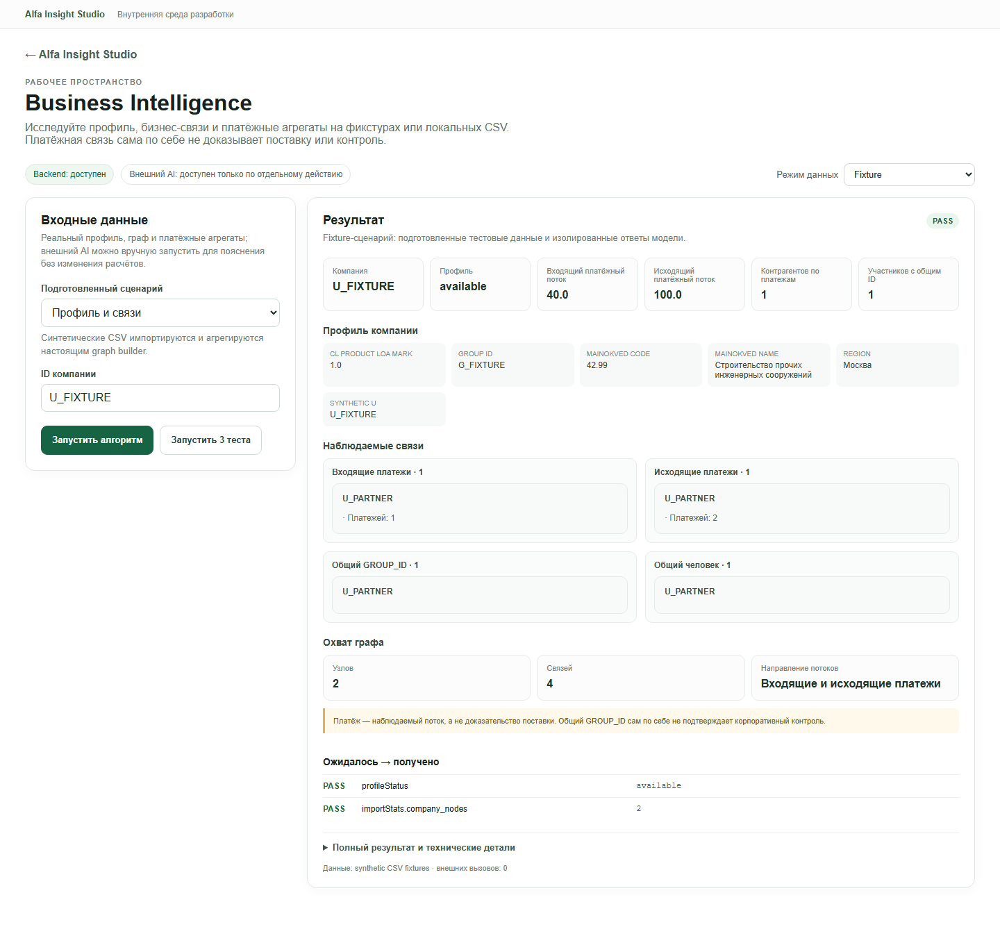
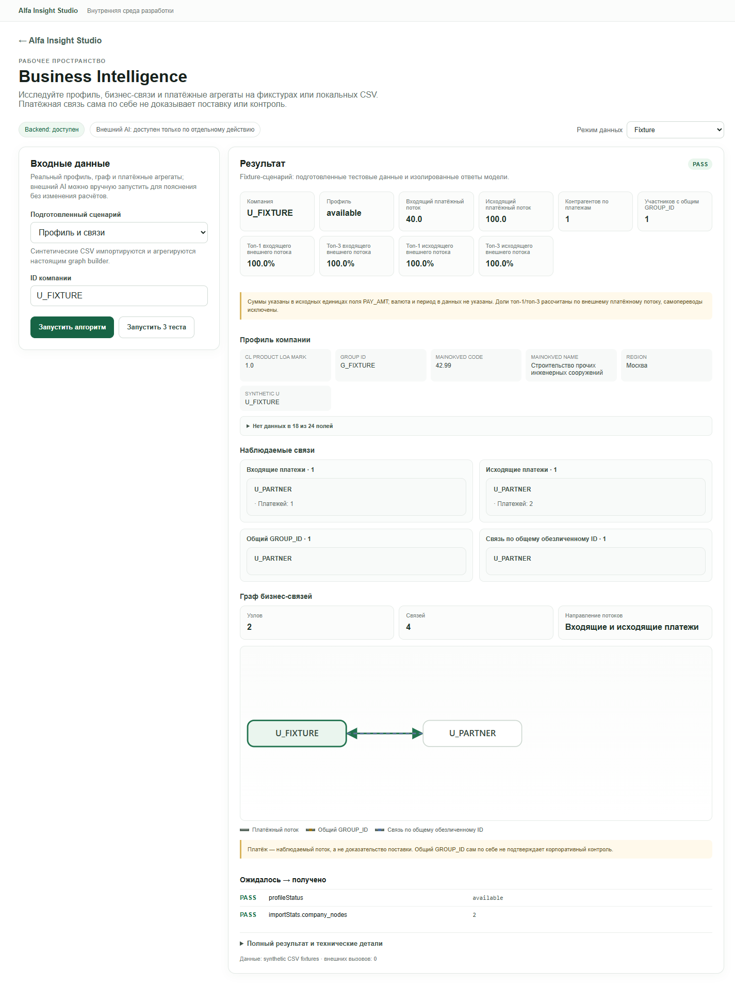
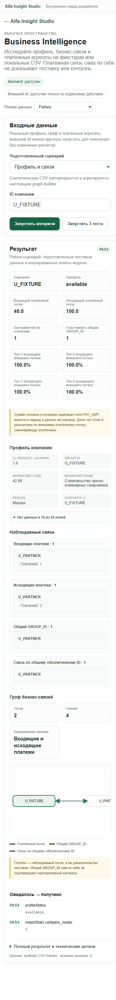

# Повторный QA: 03 — Business Intelligence

**Повторный статус: PARTIAL.** В браузере повторно проверены fixture-алгоритм, набор сценариев, два локальных профиля компаний, ввод неизвестного ID, смена сценария и ширины экрана. Fixture и Local Data отработали, External AI в этом проходе не запускался. Первоначально выбор fixture-сценария оставлял прежний ID и приводил к `FAIL`; последующая проверка общего UI-фикса подтвердила, что переход Local Data → Fixture теперь подставляет `U_FIXTURE` и даёт `PASS`. Другие UX-замечания ниже остаются.

## Повторный браузерный проход — 22 октября 2026

Проверка проведена в настоящем Chromium через Playwright CLI на `http://127.0.0.1:5173/studio/business-intelligence`. Окно проверено при ширине 1440, 1280 и 390 px. Загрузка страницы и смена режима не запускали AI. До Local Data-проверки я проверил источник и граф-кэш: API сообщал, что локальные источники доступны; clone-local `data/business_network.sqlite` существовал, все три сохранённых fingerprint совпадали с текущими CSV, активных `-wal`/`-journal` файлов не было. `ensure_database()` в таком состоянии возвращает существующий кэш без импорта и `os.replace`; после браузерного прогона размер и время изменения кэша не поменялись. Исходные CSV и SQLite не изменялись.

### Что нажимал и что получил

1. Открыл прямой маршрут; backend показал «доступен». Начально был выбран `External AI`, форма раскрывала ограниченные поля будущего запроса. Запрос не отправлялся.
2. Переключил `Fixture`, выбрал «Профиль и связи», проверил `U_FIXTURE` и запустил алгоритм. Получил `PASS`: профиль `available`, входящий/исходящий потоки, партнёр, связи по GROUP_ID и человеку, сводку графа. Результат помечен как synthetic CSV fixtures; внешних вызовов — 0.
3. Нажал «Запустить 3 теста»: все три сценария (`Профиль и связи`, `Нет профиля`, `ID по умолчанию`) показали `PASS`.
4. Выбрал «Нет профиля» и запустил. API вернул ожидаемый `missing_profile`; платежные показатели и списки связей показаны пустыми/«Нет данных», охват графа — нулевой, fixture-проверка — `PASS`.
5. Переключил `Local Data`, выполнил запуск для двух локальных компаний. Оба ответа имели `profileStatus=available`, отличающиеся показатели и графы, `externalCalls=0`; свободные локальные запуски корректно помечены `NOT_EVALUATED`, потому что для реальных строк нет независимых эталонных ожиданий. На экране локального результата выводятся суммы и длинные списки связей; конкретные значения, поля и ID контрагентов в отчёт не переношу.
6. Ввёл тестовый неизвестный ID и запустил. Сервер вернул HTTP 400, форма показала понятное сообщение «Компания не найдена или её профиль неоднозначен в локальных источниках». Traceback и сырой JSON не отображались. Chromium записал ожидаемую ошибку ответа `400 Bad Request` в console как `Failed to load resource`; необработанной JS-ошибки не было.
7. Повторил Local Data-запуск для первой из двух компаний: профиль снова загрузился, состояние `NOT_EVALUATED` осталось корректным. При вводе другого ID до повторного запуска предыдущий результат остаётся на экране и может быть принят за результат нового ID.
8. Проверил переключение обратно в Fixture после локальной формы. Выбрал «Профиль и связи» и нажал запуск: текстовое поле сохранило локальный ID, хотя выбранный сценарий требует `U_FIXTURE`; фактический результат получил `FAIL`/`missing_profile`, ожидаемое `profileStatus=available` не совпало. После ручной замены ID на `U_FIXTURE` тот же сценарий сразу прошёл. Это воспроизводимый дефект состояния формы, а не ошибка graph builder.
9. На ширинах 1440/1280/390 горизонтального переполнения не обнаружено. Но локальный профиль на 390 px создавал страницу примерно в 9,6 тыс. CSS px высотой из-за десятков карточек контрагентов; полезная сводка уходит далеко вверх страницы.

### Повторная проверка исправления состояния — 22 октября 2026

В новой сессии Chromium выполнил именно последовательность `Local Data` → запуск профиля → `Fixture` → сценарий «Профиль и связи». До запуска после выбора сценария поле ID уже содержало `U_FIXTURE`, а прежний Local Data результат был сброшен. Нажатие «Запустить алгоритм» показало `PASS`, `profileStatus=available`, ожидаемые проверки прошли; результат помечен как fixture, внешний AI не вызывался. Исправление подтверждено живым браузерным взаимодействием. Первоначальный дефект в пункте 8 таблицы ниже больше не воспроизводится на этой последовательности; рекомендация проверить аналогичный переход в остальных модулях остаётся актуальной для общего компонента.

### Что фактически делает алгоритм

`business_graph.py` читает три локальных CSV: профили, связи физических лиц с компаниями и платежные записи. Он валидирует обязательные столбцы и суммы, сохраняет денежные значения точными десятичными единицами, агрегирует профиль по `SYNTHETIC_U`, отличает однозначный профиль от неоднозначного, считает входящие/исходящие платежные агрегаты, контрагентов, концентрацию потоков и общие группы/людей. Затем `get_direct_connections` строит списки отношений, а `get_graph` возвращает ограниченный граф глубиной 2, максимумом 30 узлов и лимитом 5 связей на тип; списки прямых связей в адаптере ограничены 50 записями на тип. Fixture пишет только синтетические CSV и SQLite во временный каталог, затем вызывает тот же graph builder. Local Data вызывает то же ядро с configured CSV и может обновить `data/business_network.sqlite`, если fingerprint устарел. External AI — отдельная ветка: она вызывает Local Data, формирует сокращённый контекст из whitelisted полей/агрегатов и отправляет его в Polza; локальные расчёты графа не меняет. В этом проходе платный AI-вызов не выполнялся.

### Найденные проблемы

| Серьёзность | Наблюдение и воспроизведение | Ожидаемое поведение / рекомендация |
|---|---|---|
| **P1 — исправлено, проверено повторно** | **Ранее: Fixture-сценарий и форма расходились.** В исходном прогоне после Local Data оставался прежний локальный ID при переключении в Fixture и выборе «Профиль и связи», что давало `missing_profile`/`FAIL`. В повторной сессии после общего UI-фикса тот же путь очистил результат, подставил `U_FIXTURE` и завершился `PASS`. | Повторно проверить аналогичное переключение режимов/сценариев в остальных модулях, использующих общий `ModuleWorkbench`.
| **P2** | **Редактирование ID оставляет предыдущий результат видимым.** После успешного запуска для одной компании изменить поле на другую, до нажатия запуска на экране всё ещё видна карточка предыдущей компании. | Сбрасывать результат при изменении входов или маркировать его ID/состоянием «результат предыдущего запуска».
| **P1** | **Суммы показаны без единицы и периода.** В блоках входящего/исходящего потока отсутствуют валюта и временной охват; поле `payment_unit` из API не отображается. | Вывести рядом с суммами заметную подпись, что исходные единицы PAY_AMT, валюта и период в CSV неизвестны; не оформлять значения как ₽.
| **P2** | **Граф не визуализирован и длинный.** UI показывает перечни связей и узлов/рёбер, но не показывает саму топологию. На телефоне локальный ответ занял около 9,6 тыс. px вертикальной прокрутки. | Свернуть подробные отношения по умолчанию, показать небольшое число строк с явным «показаны первые N из M» и переходом к полному списку; добавить простой граф/табличный drill-down по запросу.
| **P2** | **Скрытые неполные поля и лимит списка недостаточно объяснены.** Пустые значения профиля в `ResultKeyValues` отфильтровываются без счётчика пропусков; в локальной записи число peers по GROUP_ID превышало показанный список из 50, но явной подписи об усечении нет. | Показывать полноту профиля/число пропусков и сообщать, что список ограничен, с действием «показать ещё».

### Итог режима

- `Fixture`: **PASS** для базового профиля и отсутствующего профиля; полный suite — 3/3. Пользовательский цикл «Local Data → Fixture → Профиль и связи» после общего UI-фикса повторно выполнен в браузере и показал `U_FIXTURE`/`PASS`.
- `Local Data`: **PASS** на чтение обоих проверенных профилей; два ответа `NOT_EVALUATED` — правильны для свободного запроса без oracle. Clone-local graph cache был актуален и после чтения не изменился.
- `External AI`: **NOT RUN в этом BI-проходе**. UI подтвердил readiness и ручной opt-in; фактическое качество пояснения и стоимость по этому модулю не подтверждены.


## Назначение и владелец кода

Модуль строит локальный профиль, агрегаты платежей, прямые связи и ограниченный граф. Каноническое ядро находится в `modules/03-business-intelligence/backend/business_graph.py`; `drive_data_analysis_2026-10-20/business_graph.py` оставлен как совместимая импортная обёртка. Studio-адаптер — `modules/03-business-intelligence/backend/adapter.py`, frontend — `modules/03-business-intelligence/frontend/ModulePage.tsx`.

- Схема профиля и единица исходного PAY_AMT: `business_graph.py:30-42`.
- Источники и импорт CSV в производный SQLite, fingerprint и атомарная подмена временного индекса: `:54-75,373-401`.
- Агрегаты входящих/исходящих потоков, концентрация и количество контрагентов: `:705-774`.
- Формирование прямых связей и ограниченного графа: `:584-666,705-786`.
- Fixture пишет синтетические CSV во временный каталог и временный SQLite, но вызывает то же ядро графа: `adapter.py:10-32`.
- Local Data читает настроенные CSV и использует локальный производный SQLite-кэш: `adapter.py:34-41`.
- External AI адаптер формирует урезанный контекст и отправляет только выбранные поля профиля, платёжные агрегаты и количества связей; расчёт графа остаётся локальным: `adapter.py:43-65`. В повторном BI-проходе этот путь не запускался.
- Экран показывает сводные метрики, поля профиля, списки связей и количества узлов/рёбер: `frontend/ModulePage.tsx:4-19`.

## API и формат данных

Контракт `1.0`: `GET /api/modules/business-intelligence/health` и `/scenarios`, `POST /run` и `/tests`; общая маршрутизация и оболочка ответа находятся в `shared/backend/modules_api.py:162-190,228-301`.

Для запуска передаются `mode`, `scenarioId` и/или `input.company_id`. Fixture допускает сценарий `unknown_company`; Local Data использует настроенный локальный профиль. Успешный `/run` возвращает `contractVersion`, `module`, `mode`, `status`, `data`, `provenance` и `validation`. Для произвольного запуска без ожиданий API корректно отвечает `status=not_evaluated`, а не PASS. Local Data помечает источник как `local source CSVs (read only)` и указывает запись только производного SQLite-кэша; External AI указывает передаваемые группы полей.

## Проверка интерфейса в Chromium

Проверка выполнена через Playwright в Chromium, `1440×1100`, адрес `http://127.0.0.1:5173/studio/business-intelligence`.

1. При открытии режим был `External AI`, но вызов не выполнялся. На странице было явное раскрытие ограниченного набора данных, который будет отправлен только после ручного запуска.
2. Переключил на `Fixture`, выбрал синтетический ID и нажал `Запустить алгоритм`. UI показал PASS, профиль доступен, два узла и четыре связи в сводке графа; присутствовали входящие/исходящие платежи и перечисления связей. Отображённые значения были только тестовыми.
3. Нажал `Запустить 3 теста`: все сценарии PASS (`Профиль и связи`, `Нет профиля`, `ID по умолчанию`).
4. Отдельно выбрал сценарий `Нет профиля` и запустил его. UI отобразил `missing_profile`, пустые метрики и нулевой охват графа, при этом ошибок выполнения и traceback не было.
5. Переключил на `Local Data`, использовал предзаполненный тестовый профиль и запустил. HTTP 200, `profileStatus=available`; ответ включал 24 поля профиля, семь групп метрик и 30 узлов/47 рёбер в ограниченной выдаче графа. Импортные счётчики источников: 85 525 профилей, 12 514 записей связей, 1 380 585 строк платежей и 204 708 узлов компаний. В отчёт не записаны ID компании, значения полей, имена контрагентов или содержимое профиля. Внешних вызовов — 0; происхождение ответа указывает read-only CSV и workspace-local SQLite-кэш.
6. Для этого произвольного Local Data запуска API/UI показал `NOT_EVALUATED`: эталонного ожидаемого результата для выбранной локальной записи не задано. Это не ошибка исполнения.

## Команда тестирования

```text
npm run test:module -- business-intelligence
```

**Результат: PASS**, exit code 0; все 3 Python-теста и все 3 сценария пройдены. Проверяются fixture-адаптер, ожидаемые результаты сценариев и Local Data-адаптер на временных CSV с отдельным кэш-каталогом (`modules/03-business-intelligence/tests/test_module.py:8-57`). Живой тест использовал существующий локальный набор; исходные CSV не редактировались. Поля профиля и содержимое связей в этот отчёт не попали.

## Режимы и ограничения

| Режим | Что подтверждено |
|---|---|
| Fixture | Полный графовый алгоритм на синтетических CSV во временной SQLite; сеть не используется. |
| Local Data | Прочитаны локальные CSV; ответ успешно получен, внешних вызовов 0. Ядро переиспользует или обновляет локальный производный SQLite-кэш. |
| External AI | В повторном BI-проходе не запускался; API сообщал о доступности только по отдельному ручному действию. Качество пояснения и стоимость не подтверждены. |

## Проблемы и приоритеты

**P2 — нет пояснения единицы суммы рядом с метриками.** Ядро возвращает `payment_unit` с оговоркой, что это единицы исходного PAY_AMT и что валюта/период не указаны (`business_graph.py:30-31,769-774`). Обычный результат UI показывает денежные значения и заголовки потоков, но `renderResult` выводит только суммы/счётчики и не показывает `payment_unit` (`frontend/ModulePage.tsx:11-17`). Значение можно найти в полном техническом JSON, если раскрыть детали, однако в основном представлении единица не видна. Рекомендация: отображать оговорку непосредственно рядом с платёжными агрегатами.

**P2 — граф в интерфейсе не визуализирован.** Экран показывает список связей по типам и счётчики узлов/рёбер, но переданный `graph.nodes`/`graph.edges` используется только для подсчёта (`frontend/ModulePage.tsx:14-17`). Для исследования графа нужно читать списки; навигации по рёбрам/уровням на экране нет. Рекомендация: добавить компактный граф/табличную альтернативу по запросу, сохраняя предупреждения о природе связей.

Реальные платежи и связи остаются наблюдаемыми данными: код/экран предупреждает, что платёж не доказывает поставку, а общий GROUP_ID не доказывает корпоративный контроль. Не запускался внешний AI, поэтому его интерпретация и стоимость не оценивались.

## Свидетельства

- UI: `http://127.0.0.1:5173/studio/business-intelligence`, ручной Playwright-сеанс Chromium.
- Локальный запуск: HTTP 200, `local_data`, `profileStatus=available`, `externalCalls=0`; опубликованы только суммарные счётчики без профиля.
- Fixture-ошибка отсутствующего профиля и test suite: PASS; команда и исходники указаны выше.

## Round 2: свежая проверка Chromium — Fixture only, 2026-10-22

В отдельном Chromium-контексте проверен маршрут `http://127.0.0.1:5173/studio/business-intelligence`. Только синтетические Fixture CSV использованы для запусков. Local Data не запускался, исходные профили/связи/платежи не читались в рамках этого прохода, graph rebuild не запрашивался; External AI не вызывался.

### Владелец, зависимости, вход/выход

Каноническое ядро — `modules/03-business-intelligence/backend/business_graph.py`. `drive_data_analysis_2026-10-20/business_graph.py` — compatibility import к модульному владельцу. `modules/03-business-intelligence/backend/adapter.py` — интерфейс API к одному graph builder, а frontend — `modules/03-business-intelligence/frontend/ModulePage.tsx`. Fixture генерирует обезличенные CSV профилей, связей физических лиц и платежей во временном каталоге, временную SQLite и вызывает `ensure_database(force=True)` плюс `get_company_network`; файлы удаляются при завершении. В Local Data тот же graph builder читает настроенные CSV и может обновить derived SQLite cache; в External AI `run_local` готовит ограниченный whitelist-профиль/агрегаты/количества связей для ручной интерпретации. Эти два режима по данным в этом прогоне не запускались.

API v1: `GET /api/modules/business-intelligence/health`, `/scenarios`, `POST /run`, `/tests`. Для Fixture передаются `mode=fixture`, `scenarioId` и `input.company_id`/`unknown_company`. Успешный контракт содержит `status`, `data` (`profileStatus`, профиль, агрегаты, связи, ограниченный граф, importStats, ограничения) и `provenance`; неизвестная компания корректно становится `missing_profile`, а произвольный запуск без oracle — `NOT_EVALUATED`, не ложный PASS.

### Фактические проверки

- Сценарий «Профиль и связи» → `POST /run` HTTP 200 / `validation=PASS`; результат полностью синтетический, `provenance.kind=synthetic CSV fixtures`, пишет только temporary data. UI показывает fixture-профиль, агрегаты, отношения, узлы/рёбра и предупреждение, что платёж не доказывает поставку, а общий GROUP_ID не доказывает контроль.
- `Запустить 3 теста`: HTTP 200, `PASS`: `success`, `unknown`, `empty-id`.
- После результата смена сценария сразу очистила карточку; смена режима на Local Data также очистила результат и набор тестов. Режим переключён назад, но Local Data-запуск не делался.
- Подготовленный сценарий `unknown` → HTTP 200 / PASS ожидаемого `missing_profile`. Произвольный синтетический ID без профиля → HTTP 200 / `NOT_EVALUATED`, `profileStatus=missing_profile`; произвольный неизвестный scenario ID → HTTP 400 `SCENARIO_NOT_FOUND`.
- GET health/scenarios → 200. На 1440, 1280 и 390 px горизонтального переполнения нет (`scrollWidth == viewport`); ошибки страницы отсутствовали.
- `npm run test:module -- business-intelligence`: PASS — 3 Python tests и 3 prepared scenarios.

### Наблюдение по представлению

Свежий синтетический результат вновь подтвердил уже указанную выше проблему P2: числовые платежные суммы видны в основных карточках без единицы и периода; оговорку `payment_unit` можно найти только в полном техническом результате. В этом проходе бизнес-правила не менялись. Рекомендация остаётся: показывать прямо у сумм единицы исходного поля и явно указывать неизвестные валюту/период. Нет графовой визуализации, хотя графические узлы и рёбра присутствуют в API; на узком экране это становится длинным списком.



## Раунд 3: свежий Chromium проход и пояснение платёжных единиц (2026-10-22)

Тест повторён в новом Chromium-контексте на `/studio/business-intelligence`, только в `Fixture`. Локальные банковские CSV и SQLite-кэш не открывались; Local Data не запускался, потому что `adapter.run_local()` вызывает `business_graph.ensure_database()` и может создать или обновить производный кэш. Внешний AI и сетевые запросы не запускались.

### Как устроен вычислительный путь

- UI находится в `modules/03-business-intelligence/frontend/ModulePage.tsx`; он передаёт выбранный режим, подготовленный сценарий и ID через общий `shared/frontend/ModuleWorkbench.tsx`.
- API-маршруты принадлежат `shared/backend/modules_api.py`: для сценариев читается manifest, `/run` вызывает адаптер, `/tests` прогоняет ожидания сценариев.
- Владелец бизнес-логики — `modules/03-business-intelligence/backend/business_graph.py`; legacy-файл `drive_data_analysis_2026-10-20/business_graph.py` служит совместимой импортной обёрткой.
- Fixture-адаптер пишет синтетические профили, связи и платежи во временные CSV, задаёт отдельный временный SQLite, затем вызывает настоящий `business_graph.ensure_database(force=True)` и `get_company_network()`. Каталог удаляется при выходе из временного контекста, глобальные пути ядра восстанавливаются в `finally`.
- Local Data использует те же агрегации на настроенных исходных CSV, однако `ensure_database()` может перестроить производный SQLite. Поэтому этот путь в третьем проходе не запускался и не называется полностью read-only на уровне файловой системы. External AI после локального расчёта вручную передаёт в Polza whitelist полей профиля, платёжные агрегаты и количества связей; этот платный путь здесь не запускался.
- Наблюдаемые платёжные связи показывают направление/сумму потока, но не подтверждают поставку. Общий `GROUP_ID` не доказывает корпоративный контроль; эти ограничения уже отрисованы в UI.

### Свежие действия и результаты

| Проверка | Действие | Результат |
|---|---|---|
| Маршрут и backend | Открыл новый Chromium-контекст, загрузил Studio route и дождался доступного backend. | Навигация HTTP 200; `GET /health` и `/scenarios` — 200; ошибок страницы нет. |
| Успешный Fixture | Выбрал `Fixture` → `Профиль и связи` → «Запустить алгоритм». | `POST /run` HTTP 200, validation `PASS`, `profileStatus=available`, synthetic `U_FIXTURE`, 2 узла и 4 ребра. Provenance указывает синтетические CSV и временные записи. |
| Повтор | Повторно запустил тот же сценарий. | Второй `POST /run` HTTP 200, тот же `PASS` и те же структурные итоги. |
| Полный набор | Нажал «Запустить 3 теста». | `POST /tests` HTTP 200; `success`, `unknown`, `empty-id` — все `PASS`. |
| Профиль отсутствует | Выбрал `Нет профиля` и запустил. | HTTP 200 / `PASS`; результат `missing_profile`, граф пустой — отсутствие профиля обработано штатно. |
| Пустой ID | Выбрал `ID по умолчанию` и запустил. | HTTP 200 / `PASS`; адаптер использовал изолированный `U_FIXTURE`. |
| Адаптивность | Проверил 1440, 1280 и 390 px на успешном результате. | `document.scrollWidth` совпал с шириной viewport на всех трёх размерах; ошибок Chromium нет. |
| Единицы суммы | После обнаруженного отсутствия оговорки проверил карточку результата. | В `ModulePage.tsx` добавлена заметка: суммы — в исходных единицах `PAY_AMT`, валюта и период не указаны. Текст виден в Chromium; production `npm run build` прошёл. |

При первом запуске тестового скрипта ожидание статуса backend было привязано к нестабильному locator, поэтому сам UI-сценарий тогда не дошёл до клика. Повтор с ожиданием фактического статуса завершился по всем строкам таблицы выше; это была ошибка тестового ожидания, не ошибка приложения.

Свежий synthetic screenshot: [03-business-intelligence-round3-fixture.png](assets/03-business-intelligence-round3-fixture.png). Изолированная команда `npm run test:module -- business-intelligence` завершилась exit code 0: 3 Python-теста и три fixture-сценария `PASS`. За этот проход код источниковых CSV, SQLite, историю и внешние API не менял.

**Текущее состояние:** Fixture и отсутствующий профиль проходят; повторяемость подтверждена, Local Data/External AI не запускались. Основная метрика теперь сопровождается предупреждением о неизвестных валюте и периоде. Ограничение остаётся: граф показывается как список/счётчики, а не как интерактивная схема; `NOT_EVALUATED` для произвольных данных корректно означает отсутствие независимого oracle, а не сбой расчёта.

## Round 4: полный независимый проход Business Intelligence (2026-10-22)

Этот раздел фиксирует более свежий результат и заменяет устаревшие ограничения предыдущего раунда: граф теперь визуализируется, а концентрация платежей и пропуски в профиле показаны в основном представлении.

### Как работает модуль

- Владелец алгоритма — `modules/03-business-intelligence/backend/business_graph.py`: `ensure_database()` проверяет fingerprints источников и переиспользует актуальный SQLite; при устаревшем индексе может собрать новый derived cache. `get_company_network()` возвращает профиль, агрегаты платежей, прямые связи и ограниченный граф; концентрации top-1/top-3 вычисляются по внешним потокам без самоплатежей. `drive_data_analysis_2026-10-20/business_graph.py` — совместимый import shim.
- `modules/03-business-intelligence/backend/adapter.py`: `run()` создаёт обезличенные профили, связи и платежи во временных CSV и временном SQLite, затем вызывает тот же graph builder; `run_local()` читает локальные CSV и производный кэш; `run_external()` вручную передаёт Polza AI ограниченные поля/агрегаты. В этом проходе `run_external()` не вызывался.
- UI: `modules/03-business-intelligence/frontend/ModulePage.tsx` рендерит профиль, метрики, концентрацию, связи, отсутствующие поля и `NetworkGraph`. Граф ограничен 15 видимыми узлами, имеет направления платёжных рёбер, различимые типы связей, легенду и внутреннюю горизонтальную прокрутку. Общий `shared/frontend/ModuleWorkbench.tsx` передаёт выбранные режим, сценарий и ID.
- API flow: при открытии UI получает `GET /api/modules/business-intelligence/health` и `/scenarios`; действие «Запустить алгоритм» отправляет `POST /api/modules/business-intelligence/run`, а кнопка suite — `POST /api/modules/business-intelligence/tests`. `shared/backend/modules_api.py` формирует контракт 1.0 с `data`, `provenance` и `validation`; в произвольном режиме без oracle ожидаем `NOT_EVALUATED`.

Источники Local Data — три локальных CSV профилей компаний, связей по обезличенному идентификатору и платежей. Внешних обращений при Local Data нет. Перед и после локального запуска fingerprint-проверка подтвердила, что `data/business_network.sqlite` уже соответствовал источникам; его mtime не изменился. Исходные CSV не редактировались. Сам `ensure_database()` вправе пересобрать производный cache, если fingerprint устарел, поэтому при таком состоянии Local Data не гарантирует отсутствие записи в cache. В отчёт и screenshots не включены реальные поля профиля, платежные значения, названия/ID контрагентов или банковские сведения.

### Действия и результаты

| Проверка | Реальное действие | Результат |
|---|---|---|
| Старт и API | Открыл `http://127.0.0.1:5173/studio/business-intelligence` в Chromium; проверил доступность backend и сценариев. | Страница открылась, Backend доступен; у режима External AI было явное ручное подтверждение, кнопку AI не нажимал. |
| Fixture UI | Запустил `Профиль и связи` через «Запустить алгоритм». | HTTP 200, `PASS`; настоящий graph builder обработал временные synthetic CSV. Получены синтетический профиль, входящий/исходящий поток, связи, концентрация и граф; provenance — synthetic CSV fixtures, external calls 0. Desktop screenshot показывает только этот сценарий. |
| Fixture suite UI | Нажал «Запустить 3 теста». | Все три строки — `PASS`: профиль и связи, профиль отсутствует, пустой ID использует тестовое значение по умолчанию; traceback не показан. |
| Нет профиля | Запустил сценарий «Нет профиля». | Штатный `missing_profile`, пустые метрики и граф, UI не падает. |
| Local Data UI | Выбрал Local Data и запустил один локальный профиль. | Результат получен примерно за 2,9 секунды wall-clock вместе с CLI/browser overhead: `profileStatus=available`, граф и агрегатные метрики присутствовали; provenance `local source CSVs (read only)`, external calls 0. Значения локальных метрик здесь опущены. Ошибки выполнения/traceback не было. |
| Неизвестная локальная компания | Ввел неизвестный ID и запустил Local Data. | HTTP 400 с сообщением «Компания не найдена или её профиль неоднозначен в локальных источниках.»; UI не показал traceback. В Chromium зафиксирован ожидаемый failed request 400. |
| Синхронизация режимов | После фикса параллельно вызвал fixture `run()` и Local Data `run_local()` в свежем Python процессе. | Оба завершились с `profileStatus=available`; fixture сохранил синтетическую топологию, локальный запуск использовал существующий граф. В адаптер добавлен lock против гонки глобальных путей ядра; результат и provenance не перепутались. |
| Мобильная ширина | Установил Chromium viewport 390×844. | `documentElement.clientWidth=375`, `scrollWidth=375`: горизонтального переполнения страницы нет. Широкая SVG-схема прокручивается внутри собственного контейнера (`311px` viewport / `650px` graph content). |

### Найденные проблемы и исправления

| Серьёзность | Наблюдение / воспроизведение | Изменение или рекомендация |
|---|---|---|
| P2, исправлено | До правки графовые `nodes`/`edges` были только числами и списками, поэтому структуру связей было трудно читать. Открыть успешный Fixture или Local Data результат. | В `ModulePage.tsx` добавлена ограниченная доступная SVG-схема, легенда и безопасная внутренняя прокрутка. На мобильном нет переполнения всей страницы. Это схема, не интерактивный исследователь графа; показ ограничен 15 узлами. |
| P2, исправлено | Входящие/исходящие концентрации рассчитывались, но UI их не показывал; пустые профильные поля молча исчезали. | Добавлены top-1/top-3 карточки и пояснение об исходной единице `PAY_AMT`, неизвестных валюте/периоде и исключении самоплатежей; отсутствующие поля свернуты под явный счетчик. |
| P2, исправлено | Fixture `run()` временно меняет глобальные пути в общем модуле графа. Параллельный Local Data request мог прочитать fixture-данные. | `adapter.py` сериализует fixture и local graph access через `_GRAPH_ACCESS_LOCK`; параллельная проверка после фикса прошла. |
| P2, исправлено в общем слое | При смене company ID после результата Workbench оставлял старое содержимое до нового запуска. | Общий Workbench теперь очищает результат, проверки, suite и ошибки при изменении входа или режима; основная логика BI не менялась. Изменение подтверждено живой формой и общим E2E. |

### Проверка и свидетельства

Команда module-specific suite после backend фикса:

```text
npm run test:module -- business-intelligence
```

Фактический вывод: `Ran 3 tests ... OK`; `business-intelligence: PASS (3 prepared scenarios)`; `success`, `unknown`, `empty-id` — `PASS`. Общая сборка ранее прошла после правок frontend; отдельный полный suite остальных модулей в этой задаче не запускался.

Fixture screenshots сняты в Chromium, не содержат локального профиля или финансовых значений:





**Вердикт:** модуль пригоден для изолированного исследования профиля, платежных агрегатов и связей на Fixture и Local Data. Необычные или отсутствующие данные объясняются, топология видна, а выводы ограничены provenance. External AI и его стоимость в этом BI проходе не проверялись; UI не раскрывает локальные клиентские значения в сохранённых доказательствах.


## Round 5 — Chromium на синтетическом графе (2026-10-22)

**Статус Round 5: PARTIAL.** Граф и агрегаты выполнены на изолированных CSV fixture; пустой профиль отработан. Local Data и External AI сознательно не запускались, чтобы не читать/передавать реальные профили и платёжные данные.

### Назначение, владелец алгоритма и поток данных/API

Модуль собирает профиль компании, агрегирует наблюдаемые связи и строит граф. Владелец аналитического ядра — `drive_data_analysis_2026-10-20/business_graph.py`; модульная папка владеет Studio adapter и экраном (`modules/03-business-intelligence/backend/adapter.py`, `frontend/ModulePage.tsx`). Общая оболочка обслуживает `GET /api/modules/business-intelligence/health`, `/scenarios`, `POST /api/modules/business-intelligence/run` и `/tests`.

При Fixture запуске adapter создаёт обезличенные synthetic CSV во временной папке, временно направляет graph builder на эту папку и временную SQLite, вызывает обычные `business_graph.ensure_database` и `get_company_network`, возвращает graph/profile/metrics с provenance `synthetic CSV fixtures`, `writes=temporary only`, `externalCalls=0`. Рабочие CSV и локальная SQLite в Round 5 не читались и не изменялись.

### Что реально нажато и получено

В Chromium открыл `/studio/business-intelligence`. Начальное состояние было External AI с заранее заполненным локальным идентификатором компании; значение не включено в этот отчёт и не отправлялось. Переключил в **Fixture**, выбрал **«Профиль и связи»**, убедился, что поле содержит только synthetic fixture ID, нажал **«Запустить алгоритм»**.

Результат: PASS; synthetic profile доступен, graph builder создал 2 company nodes и 4 связи. UI разделил входящие/исходящие платежи, общий GROUP_ID и связь по обезличенному идентификатору, показал легенду графа, концентрацию потоков и ограничение «платёж не доказывает поставку; общий GROUP_ID не подтверждает контроль». Никакого клиентского содержимого в результат не попадало.

Нажал **«Запустить 3 теста»**: PASS 3/3 — success, unknown, empty-id. Затем выбрал **«Нет профиля»**, заменил автоматически показывавшийся fallback ID на синтетический `U_MISSING_FIXTURE` и вручную запустил сценарий. Получено `missing_profile`, пустые профиль и список связей, 0 узлов и 0 рёбер; пустое состояние объяснено, traceback не было. `npm run test:module -- business-intelligence`: exit 0; **3 tests**, все три prepared scenarios PASS.

### Внешний режим, безопасность и ограничения

**External AI: BLOCKED для этого теста; запрос не запускался, стоимость 0 ₽.** UI описывает отправляемые поля, но не предоставляет synthetic-profile input. Код `run_external` сначала вызывает `run_local` по выбранному идентификатору, получает профиль/платёжные агрегаты из локального CSV, затем отправляет в Polza сводку вместе с идентификатором выбранной компании. В форме по умолчанию выбран реальный локальный идентификатор; поэтому безопасный синтетический payload в имеющемся UI собрать нельзя. Лимит стоимости и ручное действие не меняют этот факт. Для проверки External AI нужна изолированная синтетическая запись/путь, который не вызывает локальное чтение.

**P2 — риск ошибки выбора профиля в режимах Fixture/External AI.** При загрузке формы виден преднастроенный локальный идентификатор; при выборе fixture-сценария без собственного `company_id` UI может показать fallback из спецификации. В текущем прогоне я подменил его synthetic ID до запуска. Рекомендация: не заполнять рабочий ID в Fixture/External AI по умолчанию, показывать происхождение идентификатора и полный список полей перед внешней отправкой.

**Синтетические screenshots:** [профиль и граф](assets/03-business-intelligence-round5-fixture.png), [пустой профиль](assets/03-business-intelligence-round5-missing-fixture.png). Локальные профили/платежи в них отсутствуют.
