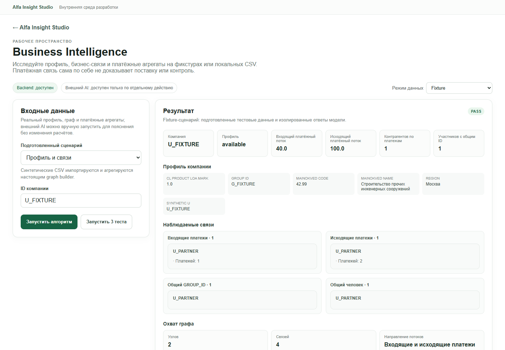

# Повторный QA: 03 — Business Intelligence

**Повторный статус: PARTIAL.** В браузере повторно проверены fixture-алгоритм, набор сценариев, два локальных профиля компаний, ввод неизвестного ID, смена сценария и ширины экрана. Fixture и Local Data отработали, External AI в этом проходе не запускался. Первоначально выбор fixture-сценария оставлял прежний ID и приводил к `FAIL`; последующая проверка общего UI-фикса подтвердила, что переход Local Data → Fixture теперь подставляет `U_FIXTURE` и даёт `PASS`. Другие UX-замечания ниже остаются.

## Повторный браузерный проход — 22 октября 2026

Проверка проведена в настоящем Chromium через Playwright CLI на `http://127.0.0.1:5173/studio/business-intelligence`. Окно проверено при ширине 1440, 1280 и 390 px. Загрузка страницы и смена режима не запускали AI. До Local Data-проверки я проверил источник и граф-кэш: API сообщал, что локальные источники доступны; clone-local `data/business_network.sqlite` существовал, все три сохранённых fingerprint совпадали с текущими CSV, активных `-wal`/`-journal` файлов не было. `ensure_database()` в таком состоянии возвращает существующий кэш без импорта и `os.replace`; после браузерного прогона размер и время изменения кэша не поменялись. Исходные CSV и SQLite не изменялись.

### Что нажимал и что получил

1. Открыл прямой маршрут; backend показал «доступен». Начально был выбран `External AI`, форма раскрывала ограниченные поля будущего запроса. Запрос не отправлялся.
2. Переключил `Fixture`, выбрал «Профиль и связи», проверил `U_FIXTURE` и запустил алгоритм. Получил `PASS`: профиль `available`, входящий/исходящий потоки, партнёр, связи по GROUP_ID и человеку, сводку графа. Результат помечен как synthetic CSV fixtures; внешних вызовов — 0.
3. Нажал «Запустить 3 теста»: все три сценария (`Профиль и связи`, `Нет профиля`, `ID по умолчанию`) показали `PASS`.
4. Выбрал «Нет профиля» и запустил. API вернул ожидаемый `missing_profile`; платежные показатели и списки связей показаны пустыми/«Нет данных», охват графа — нулевой, fixture-проверка — `PASS`.
5. Переключил `Local Data`, выполнил запуск для двух локальных компаний. Оба ответа имели `profileStatus=available`, отличающиеся показатели и графы, `externalCalls=0`; свободные локальные запуски корректно помечены `NOT_EVALUATED`, потому что для реальных строк нет независимых эталонных ожиданий. На экране локального результата выводятся суммы и длинные списки связей; конкретные значения, поля и ID контрагентов в отчёт не переношу.
6. Ввёл тестовый неизвестный ID и запустил. Сервер вернул HTTP 400, форма показала понятное сообщение «Компания не найдена или её профиль неоднозначен в локальных источниках». Traceback и сырой JSON не отображались. Chromium записал ожидаемую ошибку ответа `400 Bad Request` в console как `Failed to load resource`; необработанной JS-ошибки не было.
7. Повторил Local Data-запуск для первой из двух компаний: профиль снова загрузился, состояние `NOT_EVALUATED` осталось корректным. При вводе другого ID до повторного запуска предыдущий результат остаётся на экране и может быть принят за результат нового ID.
8. Проверил переключение обратно в Fixture после локальной формы. Выбрал «Профиль и связи» и нажал запуск: текстовое поле сохранило локальный ID, хотя выбранный сценарий требует `U_FIXTURE`; фактический результат получил `FAIL`/`missing_profile`, ожидаемое `profileStatus=available` не совпало. После ручной замены ID на `U_FIXTURE` тот же сценарий сразу прошёл. Это воспроизводимый дефект состояния формы, а не ошибка graph builder.
9. На ширинах 1440/1280/390 горизонтального переполнения не обнаружено. Но локальный профиль на 390 px создавал страницу примерно в 9,6 тыс. CSS px высотой из-за десятков карточек контрагентов; полезная сводка уходит далеко вверх страницы.

### Повторная проверка исправления состояния — 22 октября 2026

В новой сессии Chromium выполнил именно последовательность `Local Data` → запуск профиля → `Fixture` → сценарий «Профиль и связи». До запуска после выбора сценария поле ID уже содержало `U_FIXTURE`, а прежний Local Data результат был сброшен. Нажатие «Запустить алгоритм» показало `PASS`, `profileStatus=available`, ожидаемые проверки прошли; результат помечен как fixture, внешний AI не вызывался. Исправление подтверждено живым браузерным взаимодействием. Первоначальный дефект в пункте 8 таблицы ниже больше не воспроизводится на этой последовательности; рекомендация проверить аналогичный переход в остальных модулях остаётся актуальной для общего компонента.

### Что фактически делает алгоритм

`business_graph.py` читает три локальных CSV: профили, связи физических лиц с компаниями и платежные записи. Он валидирует обязательные столбцы и суммы, сохраняет денежные значения точными десятичными единицами, агрегирует профиль по `SYNTHETIC_U`, отличает однозначный профиль от неоднозначного, считает входящие/исходящие платежные агрегаты, контрагентов, концентрацию потоков и общие группы/людей. Затем `get_direct_connections` строит списки отношений, а `get_graph` возвращает ограниченный граф глубиной 2, максимумом 30 узлов и лимитом 5 связей на тип; списки прямых связей в адаптере ограничены 50 записями на тип. Fixture пишет только синтетические CSV и SQLite во временный каталог, затем вызывает тот же graph builder. Local Data вызывает то же ядро с configured CSV и может обновить `data/business_network.sqlite`, если fingerprint устарел. External AI — отдельная ветка: она вызывает Local Data, формирует сокращённый контекст из whitelisted полей/агрегатов и отправляет его в Polza; локальные расчёты графа не меняет. В этом проходе платный AI-вызов не выполнялся.

### Найденные проблемы

| Серьёзность | Наблюдение и воспроизведение | Ожидаемое поведение / рекомендация |
|---|---|---|
| **P1 — исправлено, проверено повторно** | **Ранее: Fixture-сценарий и форма расходились.** В исходном прогоне после Local Data оставался прежний локальный ID при переключении в Fixture и выборе «Профиль и связи», что давало `missing_profile`/`FAIL`. В повторной сессии после общего UI-фикса тот же путь очистил результат, подставил `U_FIXTURE` и завершился `PASS`. | Повторно проверить аналогичное переключение режимов/сценариев в остальных модулях, использующих общий `ModuleWorkbench`.
| **P2** | **Редактирование ID оставляет предыдущий результат видимым.** После успешного запуска для одной компании изменить поле на другую, до нажатия запуска на экране всё ещё видна карточка предыдущей компании. | Сбрасывать результат при изменении входов или маркировать его ID/состоянием «результат предыдущего запуска».
| **P1** | **Суммы показаны без единицы и периода.** В блоках входящего/исходящего потока отсутствуют валюта и временной охват; поле `payment_unit` из API не отображается. | Вывести рядом с суммами заметную подпись, что исходные единицы PAY_AMT, валюта и период в CSV неизвестны; не оформлять значения как ₽.
| **P2** | **Граф не визуализирован и длинный.** UI показывает перечни связей и узлов/рёбер, но не показывает саму топологию. На телефоне локальный ответ занял около 9,6 тыс. px вертикальной прокрутки. | Свернуть подробные отношения по умолчанию, показать небольшое число строк с явным «показаны первые N из M» и переходом к полному списку; добавить простой граф/табличный drill-down по запросу.
| **P2** | **Скрытые неполные поля и лимит списка недостаточно объяснены.** Пустые значения профиля в `ResultKeyValues` отфильтровываются без счётчика пропусков; в локальной записи число peers по GROUP_ID превышало показанный список из 50, но явной подписи об усечении нет. | Показывать полноту профиля/число пропусков и сообщать, что список ограничен, с действием «показать ещё».

### Итог режима

- `Fixture`: **PASS** для базового профиля и отсутствующего профиля; полный suite — 3/3. Пользовательский цикл «Local Data → Fixture → Профиль и связи» после общего UI-фикса повторно выполнен в браузере и показал `U_FIXTURE`/`PASS`.
- `Local Data`: **PASS** на чтение обоих проверенных профилей; два ответа `NOT_EVALUATED` — правильны для свободного запроса без oracle. Clone-local graph cache был актуален и после чтения не изменился.
- `External AI`: **NOT RUN в этом BI-проходе**. UI подтвердил readiness и ручной opt-in; фактическое качество пояснения и стоимость по этому модулю не подтверждены.



## Назначение и владелец кода

Модуль строит локальный профиль, агрегаты платежей, прямые связи и ограниченный граф. Каноническое ядро находится в `modules/03-business-intelligence/backend/business_graph.py`; `drive_data_analysis_2026-10-20/business_graph.py` оставлен как совместимая импортная обёртка. Studio-адаптер — `modules/03-business-intelligence/backend/adapter.py`, frontend — `modules/03-business-intelligence/frontend/ModulePage.tsx`.

- Схема профиля и единица исходного PAY_AMT: `business_graph.py:30-42`.
- Источники и импорт CSV в производный SQLite, fingerprint и атомарная подмена временного индекса: `:54-75,373-401`.
- Агрегаты входящих/исходящих потоков, концентрация и количество контрагентов: `:705-774`.
- Формирование прямых связей и ограниченного графа: `:584-666,705-786`.
- Fixture пишет синтетические CSV во временный каталог и временный SQLite, но вызывает то же ядро графа: `adapter.py:10-32`.
- Local Data читает настроенные CSV и использует локальный производный SQLite-кэш: `adapter.py:34-41`.
- External AI адаптер формирует урезанный контекст и отправляет только выбранные поля профиля, платёжные агрегаты и количества связей; расчёт графа остаётся локальным: `adapter.py:43-65`. В повторном BI-проходе этот путь не запускался.
- Экран показывает сводные метрики, поля профиля, списки связей и количества узлов/рёбер: `frontend/ModulePage.tsx:4-19`.

## API и формат данных

Контракт `1.0`: `GET /api/modules/business-intelligence/health` и `/scenarios`, `POST /run` и `/tests`; общая маршрутизация и оболочка ответа находятся в `shared/backend/modules_api.py:162-190,228-301`.

Для запуска передаются `mode`, `scenarioId` и/или `input.company_id`. Fixture допускает сценарий `unknown_company`; Local Data использует настроенный локальный профиль. Успешный `/run` возвращает `contractVersion`, `module`, `mode`, `status`, `data`, `provenance` и `validation`. Для произвольного запуска без ожиданий API корректно отвечает `status=not_evaluated`, а не PASS. Local Data помечает источник как `local source CSVs (read only)` и указывает запись только производного SQLite-кэша; External AI указывает передаваемые группы полей.

## Проверка интерфейса в Chromium

Проверка выполнена через Playwright в Chromium, `1440×1100`, адрес `http://127.0.0.1:5173/studio/business-intelligence`.

1. При открытии режим был `External AI`, но вызов не выполнялся. На странице было явное раскрытие ограниченного набора данных, который будет отправлен только после ручного запуска.
2. Переключил на `Fixture`, выбрал синтетический ID и нажал `Запустить алгоритм`. UI показал PASS, профиль доступен, два узла и четыре связи в сводке графа; присутствовали входящие/исходящие платежи и перечисления связей. Отображённые значения были только тестовыми.
3. Нажал `Запустить 3 теста`: все сценарии PASS (`Профиль и связи`, `Нет профиля`, `ID по умолчанию`).
4. Отдельно выбрал сценарий `Нет профиля` и запустил его. UI отобразил `missing_profile`, пустые метрики и нулевой охват графа, при этом ошибок выполнения и traceback не было.
5. Переключил на `Local Data`, использовал предзаполненный тестовый профиль и запустил. HTTP 200, `profileStatus=available`; ответ включал 24 поля профиля, семь групп метрик и 30 узлов/47 рёбер в ограниченной выдаче графа. Импортные счётчики источников: 85 525 профилей, 12 514 записей связей, 1 380 585 строк платежей и 204 708 узлов компаний. В отчёт не записаны ID компании, значения полей, имена контрагентов или содержимое профиля. Внешних вызовов — 0; происхождение ответа указывает read-only CSV и workspace-local SQLite-кэш.
6. Для этого произвольного Local Data запуска API/UI показал `NOT_EVALUATED`: эталонного ожидаемого результата для выбранной локальной записи не задано. Это не ошибка исполнения.

## Команда тестирования

```text
npm run test:module -- business-intelligence
```

**Результат: PASS**, exit code 0; все 3 Python-теста и все 3 сценария пройдены. Проверяются fixture-адаптер, ожидаемые результаты сценариев и Local Data-адаптер на временных CSV с отдельным кэш-каталогом (`modules/03-business-intelligence/tests/test_module.py:8-57`). Живой тест использовал существующий локальный набор; исходные CSV не редактировались. Поля профиля и содержимое связей в этот отчёт не попали.

## Режимы и ограничения

| Режим | Что подтверждено |
|---|---|
| Fixture | Полный графовый алгоритм на синтетических CSV во временной SQLite; сеть не используется. |
| Local Data | Прочитаны локальные CSV; ответ успешно получен, внешних вызовов 0. Ядро переиспользует или обновляет локальный производный SQLite-кэш. |
| External AI | В повторном BI-проходе не запускался; API сообщал о доступности только по отдельному ручному действию. Качество пояснения и стоимость не подтверждены. |

## Проблемы и приоритеты

**P2 — нет пояснения единицы суммы рядом с метриками.** Ядро возвращает `payment_unit` с оговоркой, что это единицы исходного PAY_AMT и что валюта/период не указаны (`business_graph.py:30-31,769-774`). Обычный результат UI показывает денежные значения и заголовки потоков, но `renderResult` выводит только суммы/счётчики и не показывает `payment_unit` (`frontend/ModulePage.tsx:11-17`). Значение можно найти в полном техническом JSON, если раскрыть детали, однако в основном представлении единица не видна. Рекомендация: отображать оговорку непосредственно рядом с платёжными агрегатами.

**P2 — граф в интерфейсе не визуализирован.** Экран показывает список связей по типам и счётчики узлов/рёбер, но переданный `graph.nodes`/`graph.edges` используется только для подсчёта (`frontend/ModulePage.tsx:14-17`). Для исследования графа нужно читать списки; навигации по рёбрам/уровням на экране нет. Рекомендация: добавить компактный граф/табличную альтернативу по запросу, сохраняя предупреждения о природе связей.

Реальные платежи и связи остаются наблюдаемыми данными: код/экран предупреждает, что платёж не доказывает поставку, а общий GROUP_ID не доказывает корпоративный контроль. Не запускался внешний AI, поэтому его интерпретация и стоимость не оценивались.

## Свидетельства

- UI: `http://127.0.0.1:5173/studio/business-intelligence`, ручной Playwright-сеанс Chromium.
- Локальный запуск: HTTP 200, `local_data`, `profileStatus=available`, `externalCalls=0`; опубликованы только суммарные счётчики без профиля.
- Fixture-ошибка отсутствующего профиля и test suite: PASS; команда и исходники указаны выше.
