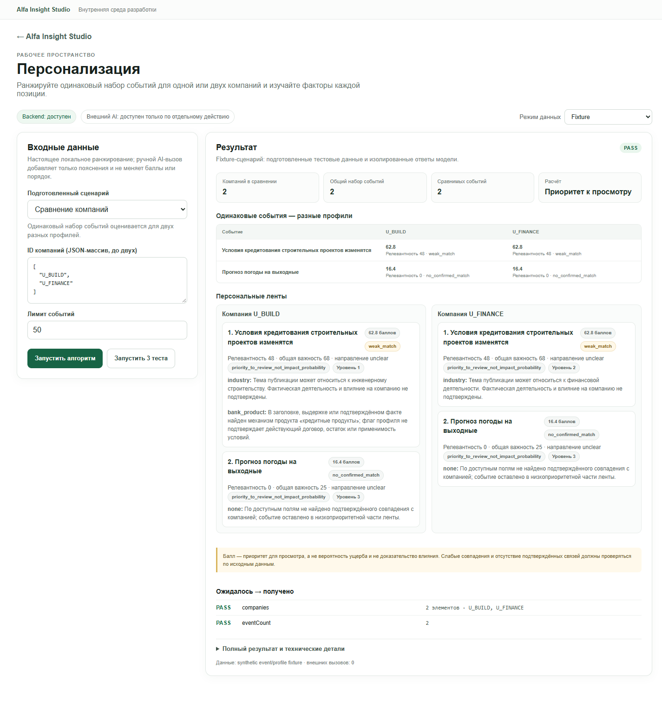

# 04 — Personalization Engine: повторный аудит

**Дата:** 22 октября 2026 г.
**Проверка:** Chromium через Playwright CLI, адрес `/studio/personalization`.
**Границы:** fixture-сценарии и безопасный отказ Local Data; без внешнего AI и без успешного Local Data запуска.

## Вердикт

**Fixture: PASS как проверка исполнения детерминированного алгоритма и формы ответа. Качество ранжирования: NOT EVALUATED. Local Data: BLOCKED для успешного сценария из-за возможной перезаписи локальной SQLite-графа. External AI: NOT RUN.**

Fixture не подменяет ранжировщик: адаптер вызывает канонический `rank_personalized_events`. Однако профиль и две новости в этом режиме синтетические. Набор PASS проверяет наличие и количество результатов, но не правильность персонального ранжирования. Независимых gold labels для метрик Precision@K, Recall@K или NDCG@K в модуле не найдено.

## Владение логикой и фактический поток данных

- **Владелец алгоритма:** `modules/04-personalization/backend/personalization.py`. Совместимый `drive_data_analysis_2026-10-20/personalization.py` загружает этот файл; второй реализации ранжирования нет.
- **Адаптер:** `modules/04-personalization/backend/adapter.py`. `run()` создаёт synthetic-профиль/события и вызывает владельца алгоритма с временным SQLite-кэшем. Фикстурный provenance сообщает `externalCalls: 0`.
- **API:** `shared/backend/modules_api.py`. UI отправляет `POST /api/modules/personalization/run` с `mode`, `scenarioId` и `input`; маршрут загружает адаптер, объединяет данные сценария с формой и оборачивает ответ контрактом `1.0`. `GET /health`, `GET /scenarios` и `POST /tests` доступны независимо от AI.
- **UI:** `modules/04-personalization/frontend/ModulePage.tsx` рендерит персональные ленты и сравнение. Общая форма/статусы принадлежат `shared/frontend/ModuleWorkbench.tsx`.
- **Фикстуры:** `modules/04-personalization/fixtures/scenarios.json`; модульные тесты находятся в `modules/04-personalization/tests/test_module.py`.

Ядро формирует сигналы точного упоминания ID, ID из графа связей, отрасли, региона, банковского продукта и внешней торговли. Оно отдельно считает максимальную силу связи, важность события, экспозицию компании, качество подтверждения и давность. Итоговый балл складывается с весами `0.35 / 0.25 / 0.20 / 0.15 / 0.05` соответственно. Статус определяется качеством и силой связи; отдельный `ranking_tier` продвигает точное совпадение, специфический отраслевой/продуктовый сигнал и слабый матч. Результаты сортируются по возрастанию tier, затем по убыванию балла, дате и ID события.

Код прямо маркирует результат как `priority_to_review_not_impact_probability`; направление влияния выставляется `unclear`. Цепочки последствий условны и сохраняют неизвестные данные. Графовая связь трактуется как платежное/групповое упоминание, но сама по себе не доказывает роль контрагента или контроль. Флаг банковского продукта не подтверждает действующий договор, остаток или применимость условий. Отраслевое совпадение не утверждает фактическую деятельность компании.

### Local Data и риск записи

`run_local()` загружает профиль через `stage1_analyzer.load_companies()`, затем проверяет, что каждый ID найден однозначно. Далее он загружает обработанные события, проверяет три исходных CSV и при наличии всех трёх вызывает `business_graph.ensure_database()`, после чего читает граф и запускает тот же ранжировщик. Ранжировщик получает временный cache path, но графовый индекс — нет. `ensure_database()` пересчитывает fingerprint, а при устаревшем индексе строит временную БД и заменяет `data/business_network.sqlite` через `os.replace`.

В рабочем клоне уже есть `data/business_network.sqlite` размером **310,079,488 байт**. Поэтому валидный Local Data запуск мог бы заменить существующий индекс; из-за ограничения на сохранение локальных данных он не выполнялся. Проверенный несуществующий ID отклонён до загрузки событий и вызова `ensure_database()`. В исходную CSV, архив новостей, историю и графовая SQLite этим тестом запись не производилась. Проверка отсутствия записи основана на порядке вызовов в коде и на отказе до ветки графа; валидный сценарий специально не запускался.

### External AI

При загрузке страницы интерфейс выбрал `External AI` как предпочитаемый режим и показал явное раскрытие: только ручной запуск передаст профильные признаки и пять верхних событий/факторов в Polza. Кнопка не нажималась. В `run_external()` сначала считается локальное ранжирование, затем выполняется один `chat_json` запрос для текстовых пояснений; адаптер явно запрещает AI менять баллы или порядок. Реальное поведение/стоимость провайдера в этом прогоне не проверялись.

## Живые действия и результаты

Все приведённые ниже результаты получены через UI в Chromium; данные ленты — синтетические сценарии модуля.

1. Открыл `/studio/personalization`. Backend был доступен; External AI показывался как ручное действие. Переключил режим на Fixture.
2. Нажал **«Запустить 3 теста»**. UI показал `PASS` для «Ранжирование событий», «Сравнение компаний» и «Неполный профиль». Это реальные POST-запуски адаптера, но ожидания сценариев — только наличие компаний/событий и их количество.
3. Запустил «Ранжирование событий». Получил две карточки: кредитная тема — `62.8`, `weak_match`, релевантность `48`, важность события `68`, направление `unclear`; погода — `16.4`, `no_confirmed_match`, релевантность `0`, важность `25`. Видимы тип балла, tier и текстовые сигналы; интерфейс отдельно поясняет, что балл не является вероятностью ущерба.
4. Выбрал «Сравнение компаний». Первоначально, до общего исправления формы, прежний однокомпанейный результат оставался на экране при уже изменившихся входах. После исправления `ModuleWorkbench` повторил переход `success → compare`: старый результат, проверки и ошибка очистились, а ID сменились на два сценарных synthetic-профиля. Запустил сравнение: обе компании и две одинаковые фикстурные новости отображены.
5. На новости о строительном кредитовании профили `U_BUILD` и `U_FINANCE` получили одинаковые `62.8` и релевантность `48`, но разные отраслевые объяснения и tier (1 против 2). Для `U_BUILD` показан также слабый банковский продуктовый сигнал с оговоркой, что флаг не подтверждает договор. Погода у обеих компаний получила одинаковые `16.4` и `no_confirmed_match`. Это осмысленный пример разницы объяснений, но не доказательство качества персонализации: profiles/events synthetic, а для чисел нет независимого эталона.
6. Выбрал **«Свои данные»**, ввёл synthetic ID `U_CUSTOM_TEST` и запустил fixture. Алгоритм выполнился на тех же двух встроенных событиях; UI/контракт показали `NOT_EVALUATED` и пояснили отсутствие эталонной проверки. Это корректное состояние, не PASS.
7. В Local Data ввёл несуществующий `TEST_NONEXISTENT_04`. UI показал понятную ошибку «Компания … не найдена или профиль неоднозначен»; запрос остановился до графового индекса. Успешное Local Data ранжирование не запускал по указанному выше риску.
8. Не вызывал External AI. В fixture provenance браузерного результата указывал `externalCalls: 0`.
9. Дополнительно проверил окно 390×844 CSS px: `documentElement.scrollWidth` был 375 px при `clientWidth` 375 px; горизонтального переполнения не обнаружено. Это замер ширины DOM, не полноценный визуальный аудит мобильного вида.

Один раз во время проверки Chromium получил 502 для Vite proxy запросов `health/scenarios` и UI показывал Backend недоступен. Прямой health API на `:8097` и повторный запрос через Vite позже вернули 200; после перезагрузки UI восстановился. Совпало с обновлениями общего компонента через HMR; устойчивый отказ не воспроизвёлся.

## Объяснимость и ограничения интерфейса

Карточки показывают итоговый балл, relevance, общую важность, направление, тип балла, tier и текстовые причины. Это помогает увидеть, почему правило сработало, и отличить `weak_match` от отсутствия найденного совпадения. При этом числовые `components`, `weights` и `contributions`, а также дата, издатель, URL, статус полноты текста, подтверждённые факты, цепочки последствий и missing data находятся только в свёрнутом блоке **«Полный результат и технические детали»** в виде полного JSON. Ссылка на публикацию из карточки не открывается, пока пользователь не разбирает JSON.

Форма **«Свои данные»** не содержит поля профиля или набора событий. Адаптер принимает `events` в API, но форма посылает только ID компаний/лимит; если события не переданы, используются два встроенных fixture. Произвольный ID в fixture — метка синтетического профиля, а не поиск локальной компании. В текущей реализации специальный ID `U_FINANCE` выбирает ещё один встроенный профиль. Поэтому этот запуск нельзя трактовать как свободную подачу своего тестового набора.

`PASS` prepared suite не оценивает релевантность: `scenarios.json` ожидает лишь количество компаний/событий. В модуле не найдено независимой разметки для ранжирования; метрики качества из текущих тестов вычислить нельзя.

## Проблемы и рекомендации

| Серьёзность | Наблюдение и воспроизведение | Ожидаемое поведение / рекомендация | Статус |
|---|---|---|---|
| **P2** | При `success` → выбор `compare` до общего исправления результат PASS для одной компании оставался под новой формой сравнения. | Сбрасывать результат, проверки и ошибку при смене сценария/режима. `ModuleWorkbench` теперь делает это; повторный браузерный переход подтверждён. | Исправлено в текущей рабочей ветке, проверено повторно. |
| **P2** | В «Своих данных» можно изменить ID, но нельзя задать реальный профиль или новый набор событий; произвольный ID использует synthetic профиль и встроенные события. | Либо переименовать режим в «Параметры фикстуры», либо дать безопасные входные поля для обезличенного профиля и JSON-событий с проверкой схемы. | Открыто. |
| **P2** | Карточка не показывает численное разложение балла и не даёт открыть источник обычной ссылкой; данные есть только в полном JSON. | Показать компактные вклад/вес факторов и видимые дату, источник, полноту текста и ссылку; детали/цепочки оставить раскрываемыми. | Открыто. |
| **P2** | Сценарии помечаются PASS по форме/количеству; нет независимой gold-разметки, поэтому одинаковые оценки двух профилей не позволяют судить о точности. | Подготовить версионируемую независимую оценочную выборку и метрики Precision@K/Recall@K/NDCG@K; не оценивать алгоритм его же правилами. | Открыто. |
| **P2** | Валидный Local Data запрос может вызвать `ensure_database()` и заменить существующую графовую SQLite при устаревшем fingerprint. Условие — наличие всех трёх source CSV; успешный запрос не запускался. | Для эксперимента ранжирования читать уже существующий граф в read-only режиме и отказывать при отсутствии/устаревании; rebuild вынести в отдельное явное действие с уведомлением. | Не проверялось на успешном пути из-за риска записи. |
| **P3** | Один раз UI временно показывал недоступность из-за 502 health/scenario proxy во время HMR; после reload запросы вернулись к 200. | При transient health ошибке дать повторную проверку/обновление статуса; проверить отдельно от HMR, если повторится. | Непостоянно; причина не доказана. |
| **P3, статический риск** | Tie-break после tier и score сортирует `published_at` по возрастанию; при полном равенстве это ставит более старое событие первым. В фикстуре такой tie не возник. | Явно выбрать правило для равных оценок; если свежесть важнее, сортировать дату по убыванию и покрыть тестом. | Не подтверждён live-кейсом. |

## Статусы и доказательства

| Путь | Статус | Основание |
|---|---|---|
| Fixture `success` | **PASS** | Реальный вызов алгоритма; API/UI вернули 1 synthetic-профиль и 2 события, checks `companies` и `rankedEvents` прошли. |
| Fixture compare | **PASS, качество NOT EVALUATED** | Реальный общий набор из 2 событий для двух synthetic-профилей; `companies` и `eventCount` прошли. Оценка алгоритма независимыми labels отсутствует. |
| Fixture custom | **NOT_EVALUATED** | Собственный synthetic ID запустился на встроенных событиях; UI явно обозначил отсутствие эталонных проверок. |
| Fixture suite | **PASS** | Через браузер нажато «Запустить 3 теста», все три сценария показали PASS. Автоматический тестовый CLI отдельно в этом повторном аудите не запускался. |
| Local Data invalid ID | **PASS для отказа** | Пользовательское сообщение об ошибке до `ensure_database()`. |
| Local Data happy path | **BLOCKED** | Не запускался, чтобы не допустить условную замену существующей `data/business_network.sqlite`. |
| External AI | **NOT RUN** | Провайдер не вызывался, стоимость — 0 ₽ в рамках этого аудита. |
| Мобильная ширина 390 px | **PASS по переполнению** | `scrollWidth == clientWidth == 375`; полный визуальный осмотр мобильной версии не проводился. |

## Скриншот

Снимок Chromium 1440×1000 показывает сравнение только на подготовленных synthetic-профилях/событиях; банковские записи не включены.

