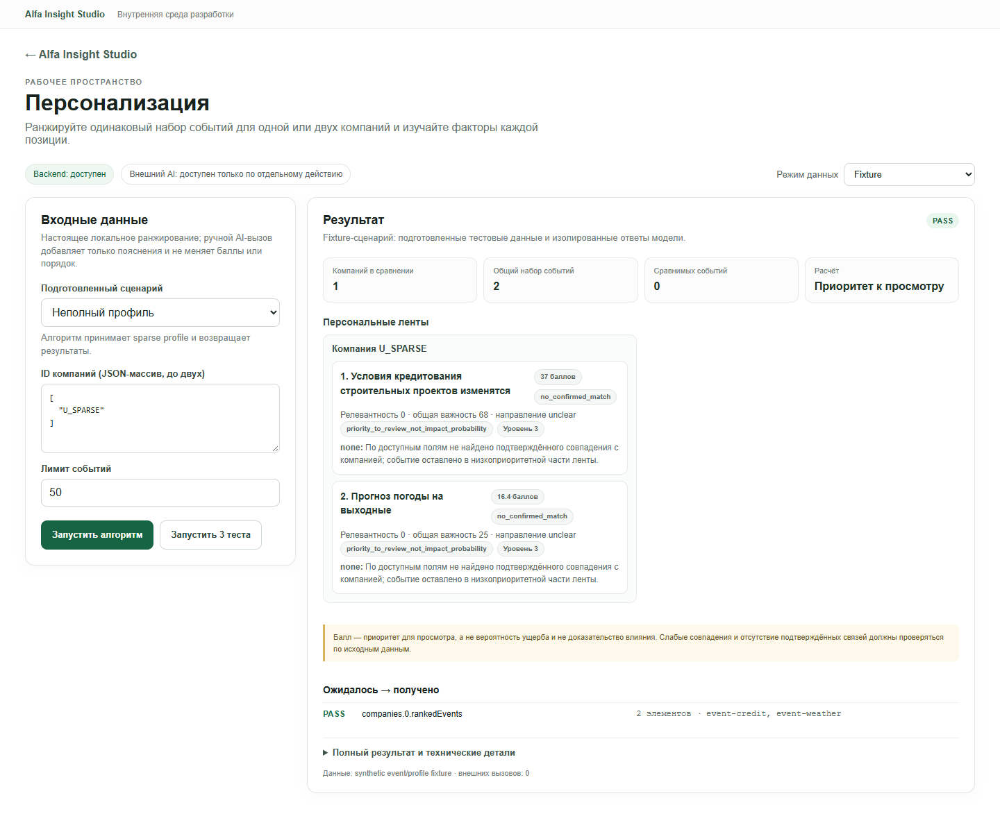
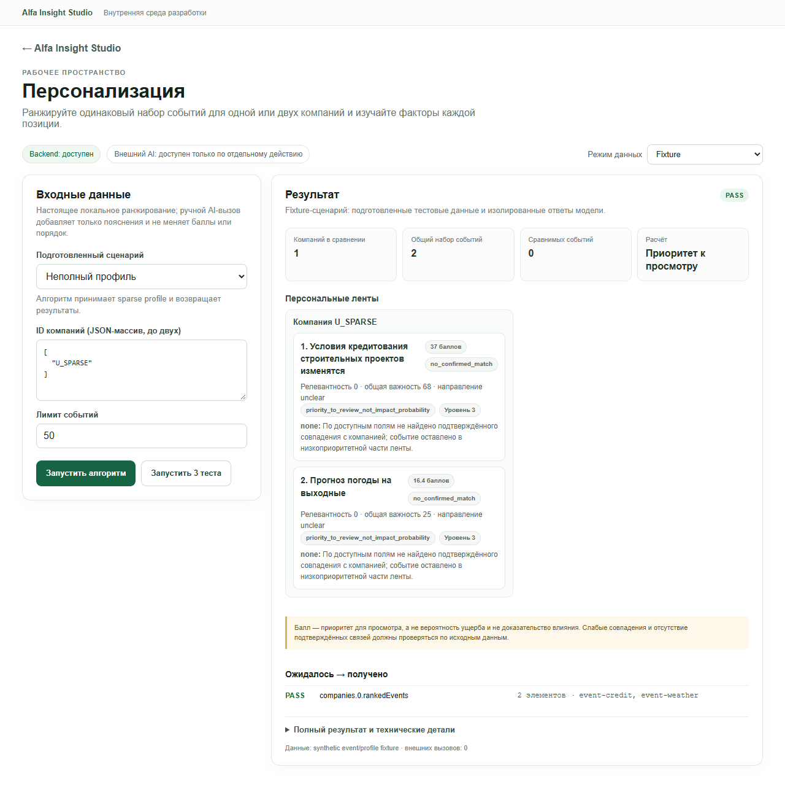
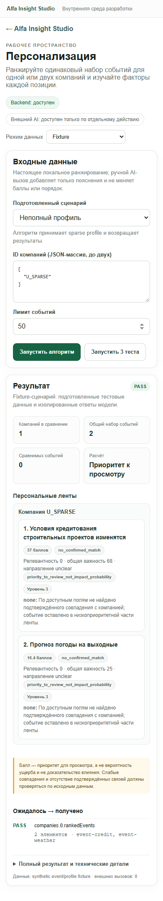
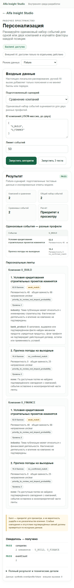
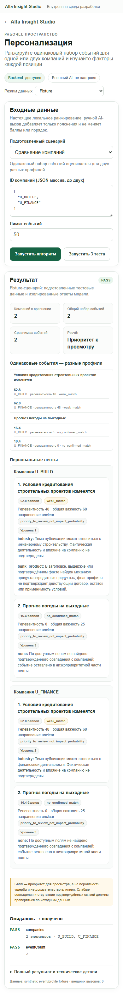

# 04 — Personalization Engine: повторный аудит

**Дата:** 22 октября 2026 г.
**Проверка:** Chromium через Playwright CLI, адрес `/studio/personalization`.
**Границы:** fixture-сценарии и безопасный отказ Local Data; без внешнего AI и без успешного Local Data запуска.

## Вердикт

**Fixture: PASS как проверка исполнения детерминированного алгоритма и формы ответа. Качество ранжирования: NOT EVALUATED. Local Data: BLOCKED для успешного сценария из-за возможной перезаписи локальной SQLite-графа. External AI: NOT RUN.**

Fixture не подменяет ранжировщик: адаптер вызывает канонический `rank_personalized_events`. Однако профиль и две новости в этом режиме синтетические. Набор PASS проверяет наличие и количество результатов, но не правильность персонального ранжирования. Независимых gold labels для метрик Precision@K, Recall@K или NDCG@K в модуле не найдено.

## Владение логикой и фактический поток данных

- **Владелец алгоритма:** `modules/04-personalization/backend/personalization.py`. Совместимый `drive_data_analysis_2026-10-20/personalization.py` загружает этот файл; второй реализации ранжирования нет.
- **Адаптер:** `modules/04-personalization/backend/adapter.py`. `run()` создаёт synthetic-профиль/события и вызывает владельца алгоритма с временным SQLite-кэшем. Фикстурный provenance сообщает `externalCalls: 0`.
- **API:** `shared/backend/modules_api.py`. UI отправляет `POST /api/modules/personalization/run` с `mode`, `scenarioId` и `input`; маршрут загружает адаптер, объединяет данные сценария с формой и оборачивает ответ контрактом `1.0`. `GET /health`, `GET /scenarios` и `POST /tests` доступны независимо от AI.
- **UI:** `modules/04-personalization/frontend/ModulePage.tsx` рендерит персональные ленты и сравнение. Общая форма/статусы принадлежат `shared/frontend/ModuleWorkbench.tsx`.
- **Фикстуры:** `modules/04-personalization/fixtures/scenarios.json`; модульные тесты находятся в `modules/04-personalization/tests/test_module.py`.

Ядро формирует сигналы точного упоминания ID, ID из графа связей, отрасли, региона, банковского продукта и внешней торговли. Оно отдельно считает максимальную силу связи, важность события, экспозицию компании, качество подтверждения и давность. Итоговый балл складывается с весами `0.35 / 0.25 / 0.20 / 0.15 / 0.05` соответственно. Статус определяется качеством и силой связи; отдельный `ranking_tier` продвигает точное совпадение, специфический отраслевой/продуктовый сигнал и слабый матч. Результаты сортируются по возрастанию tier, затем по убыванию балла, дате и ID события.

Код прямо маркирует результат как `priority_to_review_not_impact_probability`; направление влияния выставляется `unclear`. Цепочки последствий условны и сохраняют неизвестные данные. Графовая связь трактуется как платежное/групповое упоминание, но сама по себе не доказывает роль контрагента или контроль. Флаг банковского продукта не подтверждает действующий договор, остаток или применимость условий. Отраслевое совпадение не утверждает фактическую деятельность компании.

### Local Data и риск записи

`run_local()` загружает профиль через `stage1_analyzer.load_companies()`, затем проверяет, что каждый ID найден однозначно. Далее он загружает обработанные события, проверяет три исходных CSV и при наличии всех трёх вызывает `business_graph.ensure_database()`, после чего читает граф и запускает тот же ранжировщик. Ранжировщик получает временный cache path, но графовый индекс — нет. `ensure_database()` пересчитывает fingerprint, а при устаревшем индексе строит временную БД и заменяет `data/business_network.sqlite` через `os.replace`.

В рабочем клоне уже есть `data/business_network.sqlite` размером **310,079,488 байт**. Поэтому валидный Local Data запуск мог бы заменить существующий индекс; из-за ограничения на сохранение локальных данных он не выполнялся. Проверенный несуществующий ID отклонён до загрузки событий и вызова `ensure_database()`. В исходную CSV, архив новостей, историю и графовая SQLite этим тестом запись не производилась. Проверка отсутствия записи основана на порядке вызовов в коде и на отказе до ветки графа; валидный сценарий специально не запускался.

### External AI

При загрузке страницы интерфейс выбрал `External AI` как предпочитаемый режим и показал явное раскрытие: только ручной запуск передаст профильные признаки и пять верхних событий/факторов в Polza. Кнопка не нажималась. В `run_external()` сначала считается локальное ранжирование, затем выполняется один `chat_json` запрос для текстовых пояснений; адаптер явно запрещает AI менять баллы или порядок. Реальное поведение/стоимость провайдера в этом прогоне не проверялись.

## Живые действия и результаты

Все приведённые ниже результаты получены через UI в Chromium; данные ленты — синтетические сценарии модуля.

1. Открыл `/studio/personalization`. Backend был доступен; External AI показывался как ручное действие. Переключил режим на Fixture.
2. Нажал **«Запустить 3 теста»**. UI показал `PASS` для «Ранжирование событий», «Сравнение компаний» и «Неполный профиль». Это реальные POST-запуски адаптера, но ожидания сценариев — только наличие компаний/событий и их количество.
3. Запустил «Ранжирование событий». Получил две карточки: кредитная тема — `62.8`, `weak_match`, релевантность `48`, важность события `68`, направление `unclear`; погода — `16.4`, `no_confirmed_match`, релевантность `0`, важность `25`. Видимы тип балла, tier и текстовые сигналы; интерфейс отдельно поясняет, что балл не является вероятностью ущерба.
4. Выбрал «Сравнение компаний». Первоначально, до общего исправления формы, прежний однокомпанейный результат оставался на экране при уже изменившихся входах. После исправления `ModuleWorkbench` повторил переход `success → compare`: старый результат, проверки и ошибка очистились, а ID сменились на два сценарных synthetic-профиля. Запустил сравнение: обе компании и две одинаковые фикстурные новости отображены.
5. На новости о строительном кредитовании профили `U_BUILD` и `U_FINANCE` получили одинаковые `62.8` и релевантность `48`, но разные отраслевые объяснения и tier (1 против 2). Для `U_BUILD` показан также слабый банковский продуктовый сигнал с оговоркой, что флаг не подтверждает договор. Погода у обеих компаний получила одинаковые `16.4` и `no_confirmed_match`. Это осмысленный пример разницы объяснений, но не доказательство качества персонализации: profiles/events synthetic, а для чисел нет независимого эталона.
6. Выбрал **«Свои данные»**, ввёл synthetic ID `U_CUSTOM_TEST` и запустил fixture. Алгоритм выполнился на тех же двух встроенных событиях; UI/контракт показали `NOT_EVALUATED` и пояснили отсутствие эталонной проверки. Это корректное состояние, не PASS.
7. В Local Data ввёл несуществующий `TEST_NONEXISTENT_04`. UI показал понятную ошибку «Компания … не найдена или профиль неоднозначен»; запрос остановился до графового индекса. Успешное Local Data ранжирование не запускал по указанному выше риску.
8. Не вызывал External AI. В fixture provenance браузерного результата указывал `externalCalls: 0`.
9. Дополнительно проверил окно 390×844 CSS px: `documentElement.scrollWidth` был 375 px при `clientWidth` 375 px; горизонтального переполнения не обнаружено. Это замер ширины DOM, не полноценный визуальный аудит мобильного вида.

Один раз во время проверки Chromium получил 502 для Vite proxy запросов `health/scenarios` и UI показывал Backend недоступен. Прямой health API на `:8097` и повторный запрос через Vite позже вернули 200; после перезагрузки UI восстановился. Совпало с обновлениями общего компонента через HMR; устойчивый отказ не воспроизвёлся.

## Объяснимость и ограничения интерфейса

Карточки показывают итоговый балл, relevance, общую важность, направление, тип балла, tier и текстовые причины. Это помогает увидеть, почему правило сработало, и отличить `weak_match` от отсутствия найденного совпадения. При этом числовые `components`, `weights` и `contributions`, а также дата, издатель, URL, статус полноты текста, подтверждённые факты, цепочки последствий и missing data находятся только в свёрнутом блоке **«Полный результат и технические детали»** в виде полного JSON. Ссылка на публикацию из карточки не открывается, пока пользователь не разбирает JSON.

Форма **«Свои данные»** не содержит поля профиля или набора событий. Адаптер принимает `events` в API, но форма посылает только ID компаний/лимит; если события не переданы, используются два встроенных fixture. Произвольный ID в fixture — метка синтетического профиля, а не поиск локальной компании. В текущей реализации специальный ID `U_FINANCE` выбирает ещё один встроенный профиль. Поэтому этот запуск нельзя трактовать как свободную подачу своего тестового набора.

`PASS` prepared suite не оценивает релевантность: `scenarios.json` ожидает лишь количество компаний/событий. В модуле не найдено независимой разметки для ранжирования; метрики качества из текущих тестов вычислить нельзя.

## Проблемы и рекомендации

| Серьёзность | Наблюдение и воспроизведение | Ожидаемое поведение / рекомендация | Статус |
|---|---|---|---|
| **P2** | При `success` → выбор `compare` до общего исправления результат PASS для одной компании оставался под новой формой сравнения. | Сбрасывать результат, проверки и ошибку при смене сценария/режима. `ModuleWorkbench` теперь делает это; повторный браузерный переход подтверждён. | Исправлено в текущей рабочей ветке, проверено повторно. |
| **P2** | В «Своих данных» можно изменить ID, но нельзя задать реальный профиль или новый набор событий; произвольный ID использует synthetic профиль и встроенные события. | Либо переименовать режим в «Параметры фикстуры», либо дать безопасные входные поля для обезличенного профиля и JSON-событий с проверкой схемы. | Открыто. |
| **P2** | Карточка не показывает численное разложение балла и не даёт открыть источник обычной ссылкой; данные есть только в полном JSON. | Показать компактные вклад/вес факторов и видимые дату, источник, полноту текста и ссылку; детали/цепочки оставить раскрываемыми. | Открыто. |
| **P2** | Сценарии помечаются PASS по форме/количеству; нет независимой gold-разметки, поэтому одинаковые оценки двух профилей не позволяют судить о точности. | Подготовить версионируемую независимую оценочную выборку и метрики Precision@K/Recall@K/NDCG@K; не оценивать алгоритм его же правилами. | Открыто. |
| **P2** | Валидный Local Data запрос может вызвать `ensure_database()` и заменить существующую графовую SQLite при устаревшем fingerprint. Условие — наличие всех трёх source CSV; успешный запрос не запускался. | Для эксперимента ранжирования читать уже существующий граф в read-only режиме и отказывать при отсутствии/устаревании; rebuild вынести в отдельное явное действие с уведомлением. | Не проверялось на успешном пути из-за риска записи. |
| **P3** | Один раз UI временно показывал недоступность из-за 502 health/scenario proxy во время HMR; после reload запросы вернулись к 200. | При transient health ошибке дать повторную проверку/обновление статуса; проверить отдельно от HMR, если повторится. | Непостоянно; причина не доказана. |
| **P3, статический риск** | Tie-break после tier и score сортирует `published_at` по возрастанию; при полном равенстве это ставит более старое событие первым. В фикстуре такой tie не возник. | Явно выбрать правило для равных оценок; если свежесть важнее, сортировать дату по убыванию и покрыть тестом. | Не подтверждён live-кейсом. |

## Статусы и доказательства

| Путь | Статус | Основание |
|---|---|---|
| Fixture `success` | **PASS** | Реальный вызов алгоритма; API/UI вернули 1 synthetic-профиль и 2 события, checks `companies` и `rankedEvents` прошли. |
| Fixture compare | **PASS, качество NOT EVALUATED** | Реальный общий набор из 2 событий для двух synthetic-профилей; `companies` и `eventCount` прошли. Оценка алгоритма независимыми labels отсутствует. |
| Fixture custom | **NOT_EVALUATED** | Собственный synthetic ID запустился на встроенных событиях; UI явно обозначил отсутствие эталонных проверок. |
| Fixture suite | **PASS** | Через браузер нажато «Запустить 3 теста», все три сценария показали PASS. Автоматический тестовый CLI отдельно в этом повторном аудите не запускался. |
| Local Data invalid ID | **PASS для отказа** | Пользовательское сообщение об ошибке до `ensure_database()`. |
| Local Data happy path | **BLOCKED** | Не запускался, чтобы не допустить условную замену существующей `data/business_network.sqlite`. |
| External AI | **NOT RUN** | Провайдер не вызывался, стоимость — 0 ₽ в рамках этого аудита. |
| Мобильная ширина 390 px | **PASS по переполнению** | `scrollWidth == clientWidth == 375`; полный визуальный осмотр мобильной версии не проводился. |

## Скриншот

Снимок Chromium 1440×1000 показывает сравнение только на подготовленных synthetic-профилях/событиях; банковские записи не включены.

## Свежий round-two прогон (2026-10-22)

Проверка выполнена в новом изолированном Chromium-контексте по адресу `/studio/personalization`, с реальными кликами по интерфейсу. API-вызовы прошли через приложение; HTTP статусы подтверждены в браузере. Внешний AI не запускался.

| Проверка | Действие и результат |
|---|---|
| Доступность и контракт | `GET /health` и `GET /scenarios` — HTTP 200; backend доступен, доступны 3 сценария. |
| Обычный Fixture | Выбран `success`, нажата «Запустить алгоритм»: HTTP 200, validation `PASS`, 1 synthetic-профиль и 2 события; provenance `synthetic event/profile fixture`, `externalCalls=0`. |
| Повтор | Повторный запуск того же сценария — HTTP 200 / `PASS`, без дублирования истории или внешнего вызова. |
| Переключение | После результата выбран `compare`: предыдущий результат очистился. Новый запуск — HTTP 200 / `PASS`, два synthetic-профиля оценены по одним двум событиям. |
| Полный набор | Нажата «Запустить 3 теста»: HTTP 200; `success`, `compare`, `sparse-profile` — все `PASS` (2, 2 и 1 проверка соответственно). |
| Некорректный JSON | В поле ID внесён некорректный JSON: показана локальная ошибка «Проверьте JSON…»; сетевой `POST /run` не отправлялся. |
| Безопасная ошибка Local Data | Для заведомо несуществующего тестового ID отправлен `POST /run`: HTTP 400 `INVALID_INPUT`, внешних вызовов 0. Ошибка возникла при поиске профиля до загрузки архива/вызова graph rebuild. Валидный Local Data намеренно не запускается: `run_local()` вызывает `business_graph.ensure_database()`, способный заменить рабочую SQLite-графа при устаревшем индексе. |
| Адаптивность и ошибки браузера | При ширине 1440, 1280 и 390 px горизонтального переполнения нет; `pageerror` — 0. |

Изолированная команда `npm run test:module -- personalization` завершилась с кодом 0: 3 Python-теста и все 3 сценария прошли. Скриншоты после синтетического Fixture-прогона: [1440 px](assets/04-personalization-round2-desktop.png) и [390 px](assets/04-personalization-round2-mobile.png). В снимках нет локальных профилей или банковских материалов.

**Свежий статус:** Fixture `PASS`; Local Data безопасный отказ `PASS`, успешный локальный путь `BLOCKED` из-за риска перестроения SQLite; качество ранжирования `NOT_EVALUATED` без независимой разметки; External AI `NOT RUN`. Владелец расчёта остаётся `modules/04-personalization/backend/personalization.py`; API-контракт `1.0`, адаптер fixture вызывает канонический ranker с временным cache path. Local Data зависит от `stage1_analyzer`, архива обработанных новостей и `business_graph`; отдельный вызов только профиля не запускает анализ и не создаёт историю.

## Раунд 3 (2026-10-22)

Новый Chromium-контекст `r3p20261022a`; маршрут `/studio/personalization`. Перед первым запуском режим явно переключён с выбранного по умолчанию External AI на Fixture. Внешние модели не вызывались. Все профили и публикации в этом проходе синтетические.

### Свежие действия и подтверждения

| Проверка | Действие и наблюдение | Статус |
|---|---|---|
| Backend/UI | Открыл маршрут; `GET /health` и `GET /scenarios` прошли с HTTP 200, интерфейс показал backend доступным и три сценария. | **PASS** |
| Fixture `success` | Нажал «Запустить алгоритм»: `POST /api/modules/personalization/run` — HTTP 200. UI показал `U_BUILD`, два события (`event-credit`, `event-weather`), баллы `62.8` (`weak_match`) и `16.4` (`no_confirmed_match`); направление обоих событий `unclear`. | **PASS исполнения; качество NOT EVALUATED** |
| Fixture `compare` | Выбрал «Сравнение компаний»; предыдущий результат очистился. HTTP 200; два synthetic-профиля получили один и тот же набор из двух событий. Для кредитного события оценки обеих компаний равны `62.8` и relevance `48`, но у `U_BUILD` показаны отраслевой и продуктовый сигналы / tier 1, у `U_FINANCE` — отраслевой сигнал / tier 2. | **PASS исполнения; точность NOT EVALUATED** |
| Fixture `sparse-profile` | Запустил «Неполный профиль»: HTTP 200; оба события возвращены без найденных совпадений, с relevance `0` и статусом `no_confirmed_match`. Проверка сценария требует только хотя бы одну запись. | **PASS контракта; качество NOT EVALUATED** |
| Набор сценариев в UI | Нажал «Запустить 3 теста»: `POST /api/modules/personalization/tests` — HTTP 200; `success`, `compare`, `sparse-profile` отображены как PASS. | **PASS исполнения** |
| Повтор | Повторно запустил `success` дважды; оба `POST /run` вернули HTTP 200 и PASS, без переключения режима. | **PASS** |
| Некорректный JSON | В поле ID ввёл незакрытый JSON и нажал запуск. Интерфейс показал понятное предупреждение «Проверьте JSON…»; в списке сетевых запросов не появился дополнительный `POST /run`. | **PASS валидации** |
| Браузер | Chromium console: 0 ошибок и 0 предупреждений; единственная запись уровня info — стандартное сообщение React DevTools. | **PASS** |
| Адаптивность | На 1440×1000, 1280×900 и 390×844 CSS px `documentElement.scrollWidth` совпал с шириной viewport: 1440, 1280 и 390 px. | **PASS по внешнему переполнению** |
| Local Data / External AI | Успешный Local Data сценарий не запускался из-за возможного `business_graph.ensure_database()`; External AI-кнопка не нажималась. | **BLOCKED / NOT RUN** |

Команда `npm run test:module -- personalization` завершилась с **exit code 0**: 3 Python unit-теста и все 3 подготовленных fixture-сценария прошли. Unit-тест `run_local` использует подменённые загрузчики профиля/событий и фиктивные отсутствующие CSV пути; он не является проверкой рабочей базы. Детерминированные fixture-проверки подтверждают исполнение и форму ответа, но не качество ранжирования — независимых эталонных labels нет.

### Поток данных и границы достоверности

В Fixture UI отправляет `mode: "fixture"` и `scenarioId` в `POST /api/modules/personalization/run`. Адаптер `modules/04-personalization/backend/adapter.py` создаёт синтетические профиль и события, вызывает единственный владелец алгоритма `personalization.rank_personalized_events` из `modules/04-personalization/backend/personalization.py` и передаёт ему cache path внутри `TemporaryDirectory`. Ответ явно содержит provenance `synthetic event/profile fixture`, источник `personalization.rank_personalized_events` и `externalCalls: 0`. Поэтому Fixture здесь запускает настоящий детерминированный ранжировщик, а не заглушку алгоритма; фиктивны входные данные, а не расчёт. AI-пояснений в этом результате нет.

Кнопка полного набора сценариев проверяет ожидаемые поля и минимальные количества результатов. `PASS` не означает, что совпадение верно для бизнеса. В частности, два профиля в `compare` получили одинаковые числовые оценки по одной synthetic-новости; различались объяснения и tier. Это демонстрация поведения правил на тестовых полях, а не доказательство полезной персонализации.

Валидный Local Data UI-запуск намеренно не делался: `run_local()` при наличии всех трёх source CSV вызывает `business_graph.ensure_database()`, способный заменить `data/business_network.sqlite`, если fingerprint устарел. Нельзя подтвердить безопасный read-only путь по текущему адаптеру. Fixture-кэш временный; в этой проверке рабочие CSV, SQLite и историю не открывали для записи и не изменяли. Внешних вызовов и расходов Polza — 0.

### Свежие замечания интерфейса

- В Fixture после результата общий текст гласит «подготовленные тестовые данные и изолированные ответы модели», хотя provenance подтверждает реальный локальный ранжировщик и `externalCalls: 0`. Такая формулировка создаёт впечатление, что результат алгоритма замокан. Рекомендация: для этого модуля сказать прямо, что тестовые входы проходят через настоящий локальный алгоритм. **P2, открыто.**
- На ширине 390 px вся страница помещается без горизонтального переполнения. Однако таблица сравнения имеет внутреннюю ширину 560 px при видимой области 326 px (`overflow-x: auto`); одновременно в кадре остаётся только часть колонок, и нужно горизонтально прокрутить таблицу, чтобы увидеть второго участника. Это рабочее, но плохо заметное действие для сравнения. Рассмотреть складывание сравнения в две карточки по компаниям или явный индикатор прокрутки. **P2, открыто.**
- UI показывает `PASS` рядом с числом результатов, включая sparse-профиль с `no_confirmed_match`; это соответствует проверке контракта, но легко принять за оценку правильности ранжирования. Сохраняется ограничение без независимой разметки; лучше показывать `PASS — формат/исполнение`, а качество помечать отдельно. **P2, открыто.**

### Артефакты раунда

Снимки сделаны после fixture-ранжирования. На них только synthetic-профили и события; реальных банковских данных нет.

**Итог раунда:** Fixture и браузерный набор сценариев — **PASS как выполнение**; алгоритмическое качество — **NOT EVALUATED**; внешний AI — **NOT RUN**; Local Data happy path — **BLOCKED из-за риска записи графовой SQLite**. Код и алгоритм модуля в этом раунде не менялись; обновлён только этот отчёт и добавлены четыре скриншота.

## Повторная проверка мобильного сравнения после исправления (2026-10-22)

Браузерный третий раунд выявил, что внутренняя таблица оставалась шириной 560 px в контейнере 326 px при viewport 390 px. Исправил только представление: на телефоне сравнение складывается в вертикальные строки, а у каждой строки явно подписан ID компании. Повторно запустил сценарий compare в Chromium на 390×844: обе компании и их баллы видны без внутренней горизонтальной прокрутки; сравнение измерено как `clientWidth=326`, `scrollWidth=326`. Ошибок браузера нет.

`npm run test:module -- personalization` проходит (3 Python-теста, 3 fixture-сценария). Финальные `npm run test:all` и `npm run test:e2e:studio` завершились кодом 0; общий E2E подтверждает 9 модулей и ширины 1440/1280/390. Рабочее ранжирование Local Data намеренно не запускалось: `business_graph.ensure_database()` может пересобрать локальный производный SQLite. Gold-разметки для оценки точности нет.

## Раунд 4 — живое Local Data сравнение (2026-10-22)

В Chromium запустил настоящий Local Data ranker на одном архивном наборе из 20 событий для двух локальных профилей. Выбранное событие получило слабый отраслевой сигнал для одного профиля и не получило подтверждённого совпадения для другого; объяснение не приписывало событию факт или гарантированный ущерб. Остальные верхние позиции показывали неопределённость и требовали проверки. Профильные значения и идентификаторы в этот публичный отчёт не включены. `externalCalls=0`.

Отдельной эталонной разметки релевантности нет, поэтому качество ранжирования — **NOT_EVALUATED**; локальный запуск доказывает исполнение алгоритма, но не бизнес-точность. Внешний AI не вызывался. Проверка fixture и общие тесты зафиксированы в сводном отчёте. Статус **PARTIAL**.

## Раунд 5 — свежая проверка Studio в Chromium (2026-10-22)

**Стенд:** HEAD `9afdcca373a45db414b7260749c51415f90c879d`, рабочее дерево было чистым в начале прогона; Studio `http://127.0.0.1:5173`, API `http://127.0.0.1:8097` (корневой `/` отвечает 404, но модульные API доступны через Vite proxy). Отдельная Chromium-сессия Playwright `round5-046`. В этой сессии внешних AI-запросов не было, стоимость — **0 ₽**.

**Владелец и поток:** единственная реализация правил ранжирования — `modules/04-personalization/backend/personalization.py::rank_personalized_events` (совместимый импорт из старого дерева). `modules/04-personalization/backend/adapter.py::run` строит синтетические профили/события и вызывает этот же алгоритм, используя временный SQLite cache. UI `modules/04-personalization/frontend/ModulePage.tsx` и общий `shared/frontend/ModuleWorkbench.tsx` отправляют запросы в `shared/backend/modules_api.py`: `GET /api/modules/personalization/health`, `/scenarios`, затем `POST /api/modules/personalization/run` или `/tests`. Успешный fixture-ответ помечен `synthetic event/profile fixture`, `externalCalls=0`; балл обозначен как приоритет просмотра, не вероятность ущерба.

| Действие в UI / API | Результат |
|---|---|
| Открыл `/studio/personalization`; переключил режим `External AI` → `Fixture`; выбрал «Сравнение компаний» и нажал «Запустить алгоритм». | HTTP 200, PASS по контракту; два синтетических профиля, два общих события, два сопоставления. Для первого события обе оценки совпали (62.8, `weak_match`, relevance 48), для второго — 16.4 / `no_confirmed_match`; формулировки отраслевых сигналов отличаются. Алгоритм не показывает влияние как доказанное. Это демонстрирует исполнение, но совпадение баллов само по себе не оценивает точность. |
| Нажал «Запустить 3 теста». | `POST /tests` HTTP 200; `Ранжирование событий`, `Сравнение компаний`, `Неполный профиль` — PASS. |
| Команда `npm run test:module -- personalization`. | Exit 0; 3 Python-теста и 3 подготовленных сценария (`success`, `compare`, `sparse-profile`) PASS. |
| Проверил Local Data preflight. | **Не запускал.** В текущем worktree отсутствует профильный CSV, необходимый адаптеру; кроме того, Local Data может вызвать `business_graph.ensure_database()`, который при устаревшем fingerprint пересобирает derived SQLite. Без доказанного безопасного reuse запуск запрещён границами этого QA. Никаких CSV/SQLite не изменял. |

**Проверено:** выбор режима, подготовленного сравнения, основной запуск алгоритма, карточки и причины, пояснение о статусе балла, кнопка набора тестов, API health/scenarios/run/tests. Fixture provenance подтверждает ноль внешних вызовов. Отдельная эталонная разметка и метрики качества отсутствуют; качество ранжирования — **NOT EVALUATED**. Local Data — **BLOCKED в этом стенде** из-за отсутствующего CSV и потенциальной пересборки графового SQLite. External AI — **NOT RUN**, расходы 0 ₽.

Скриншот только с синтетическими профилями/событиями: [Round 5 comparison, Chromium 1440×1200](assets/04-personalization-round5-fixture-compare.png).
