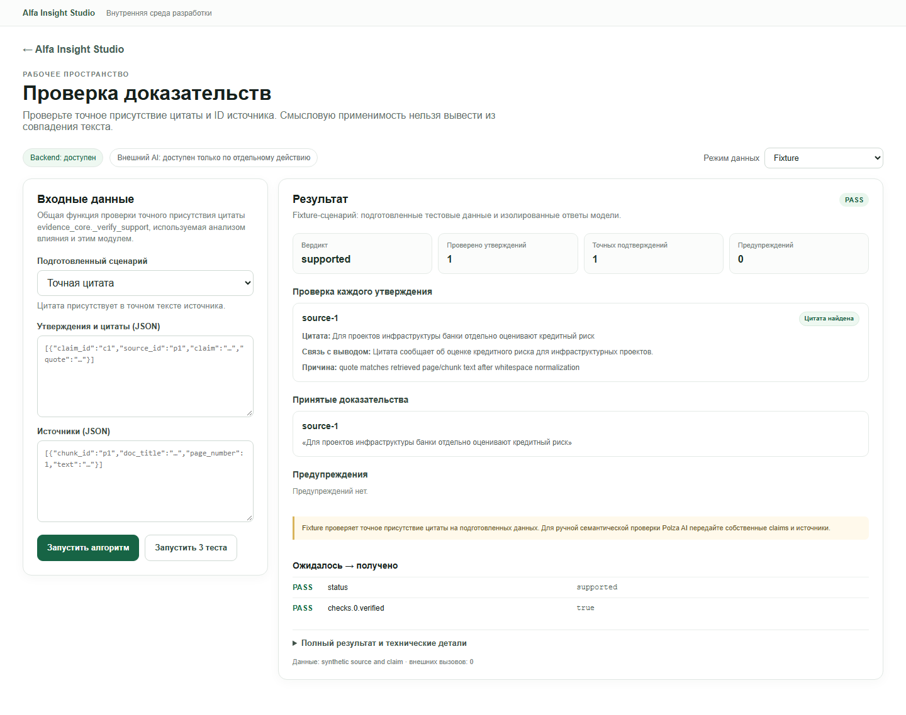

# Module 08 — Evidence Verification

**Проверено:** 22 октября 2026 г.
**Worktree / branch:** `alfa-insight-product-staging-2026-10-21` / `codex/qa-verification-2026-10-22`
**Общий результат:** `PARTIAL` — точная сверка источника/цитаты проверена в браузере на mismatch fixture и синтетическом Local Data input. Смысловая проверка Polza не запускалась.

## Назначение и владелец кода

Модуль отделяет проверку точного присутствия цитаты от суждения о том, подтверждает ли её смысл конкретное утверждение.

- `modules/08-evidence-verification/backend/evidence_core.py:1-36` — единственный владелец deterministic `_verify_support`: сопоставление `source_id`, нормализация регистра/`ё`/мягкого дефиса/пробелов, требование не менее 35 буквенно-цифровых символов и проверка вхождения нормализованной цитаты в текст источника.
- `modules/08-evidence-verification/backend/adapter.py:9-14,16-47,49-58` — fixture, External AI и Local Data адаптеры. External вариант сначала выполняет ту же локальную точную сверку, затем отдельный вызов `chat_json` для смыслового review.
- `modules/05-impact-analysis/backend/stage2_analyzer.py:11-23,518-519` импортирует `_norm` и `_verify_support` из модуля 08. Второй реализации exact quote checker не найдено.
- `modules/08-evidence-verification/frontend/ModulePage.tsx:4-14,17-66` — отдельные представления точных checks, принятых цитат, предупреждений и semantic review. При отсутствии semantic review UI показывает ограничение.
- `modules/08-evidence-verification/fixtures/scenarios.json:1`, `tests/test_module.py:7-17` — три подготовленных сценария и тесты.

## Алгоритм и зависимости

Точный checker строит индекс источников по `chunk_id`, требует существующий `source_id`, достаточную длину цитаты и нормализованное подстрочное совпадение (`evidence_core.py:8-36`). Результат сообщает `verified` и объясняет, найден ли текст; он **не** подтверждает смысл, причинность, применимость цитаты, правильность чисел либо отсутствие противоречий.

Fixture `adapter.py:9-14` использует синтетический источник/утверждение и детерминированную exact-check функцию. Local Data (`:49-58`) принимает переданные пользователем массивы `claims`/`sources`, запускает только exact check, а в `limitations` прямо говорит, что semantics и numbers не анализировались. External AI (`:16-47`) принимает эти массивы, строит отдельный контекст утверждения, цитаты и соответствующего фрагмента до 4 000 знаков (`:25-35`), затем вызывает общий Polza `chat_json` (`:33-36`). В его ответе `independentReview: false` и `semanticReview.independent: false` (`:37-47`): повторная оценка одной моделью не является независимой экспертизой.

## API-контракт

Используется общий module API v1 (`shared/contracts/module-api.ts:1-33`, `shared/contracts/module_api.py:1-30`):

- `GET /api/modules/evidence-verification/health` и `/scenarios`.
- `POST /api/modules/evidence-verification/run` с `{ mode, scenarioId?, input? }`, где входные данные содержат `claims` и `sources`; режимы — `fixture`, `local_data`, `external_ai`.
- `POST /api/modules/evidence-verification/tests` запускает три fixture-сценария.
- Ответ содержит `contractVersion: "1.0"`, `module`, `mode`, `status`, `data`, `provenance`, `validation`; ошибки имеют `error.code/message/detail` (`shared/backend/modules_api.py:162-303`).
- `data` в exact modes включает `status`, `checks`, `verified`, `warnings`, `limitations`; external добавляет `semanticReview`, `model`, `tokenUsage`.

External запуск требует общего opt-in/key/allowlist и ручного нажатия кнопки. В режиме Local Data и fixture внешних вызовов нет (`ModuleWorkbench.tsx:150-185,199-243`).

## Живой UI-проход

1. Открыт `/studio/evidence-verification`; backend доступен.
2. Режим был явно выставлен в `Fixture`; выбран **«Цитата не совпадает»**, затем нажата **«Запустить алгоритм»**. Результат данных — `unsupported`, цитата не принята. Верхний `PASS` означает, что mismatch fixture прошёл ожидаемые проверки (`unsupported`, `verified=false`), а не что утверждение получило поддержку.
3. Режим переключён в `Local Data`; в форму введены **синтетические** утверждение и источник; нажата **«Запустить алгоритм»**. UI показал `supported`, одну найденную цитату и отсутствие semantic review. `provenance` обозначил `exact local source check`, `externalCalls=0`; общий validation для свободного входа показан как `NOT_EVALUATED` из-за отсутствия эталонных ожиданий.
4. Скриншот показывает только синтетический текст: `assets/08-evidence-verification-local.png`. После исправления подписи результат повторно снят в браузере.
5. Внешний режим не запускался и внешних origin в браузере не было.

## Команды и фактические результаты

`npm run test:module -- evidence-verification` — **PASS**: 2 Python unit tests и 3 fixture-сценария: `supported`, `mismatch`, `unknown-source`.

Внешняя semantic ветка, поведение при отказе/таймауте Polza и выставление provider usage не проверялись. После этого `npm run test:all` и общий Playwright E2E-набор были запущены: сборка, все модульные наборы и девять маршрутов прошли. Отдельный браузерный сценарий подтвердил подпись Local Data и очистку старого результата при смене режима.

## Режимы и статус

| Режим | Статус | Подтверждение |
|---|---|---|
| Fixture | `PASS` | UI mismatch fixture вернул ожидаемое `unsupported`; CLI проверил success/mismatch/unknown-source. |
| Local Data | `PASS` для exact quote | Синтетический текст был найден по source ID; semantic status отсутствовал как предусмотрено. Свободный запуск отмечен `NOT_EVALUATED` относительно тестовых ожиданий. Подпись результата теперь различает Local Data и Fixture. |
| External AI | `NOT RUN` | Внешний semantic endpoint этого модуля не вызывался в текущем тестовом бюджете. Алгоритм и качество ответа модели не подтверждены. |

## Ошибки и ограничения

| Severity | Наблюдение и воспроизведение | Ожидаемое поведение / рекомендация |
|---|---|---|
| `FIXED` | После Local Data exact quote пояснение раньше говорило `Fixture проверяет точное присутствие цитаты`. Рендер результата теперь получает текущий режим и сообщает, что Local Data выполнил локальную точную сверку. |
| `P2` | Свободный Local Data запуск может показать domain result `supported`, но общий validation badge `NOT_EVALUATED`; это корректно, потому что нет ожидаемого oracle, однако два статуса легко спутать. | Явно подписать их как «результат exact-проверки» и «оценка тестового ожидания»; сохранить нейтральный `NOT_EVALUATED`, не превращать его в PASS. |
| `P2` | `run_local` требует непустые списки, но не полностью проверяет форму каждого вложенного claim/source до обращения к `_verify_support` (`adapter.py:49-58`, `evidence_core.py:17-23`). Малформированный объект может дать непрозрачный `INVALID_INPUT`/`MODULE_RUN_FAILED` вместо адресного сообщения. Это обнаружено чтением кода, отдельно в UI не воспроизводилось. | Валидировать объектную форму и обязательные `chunk_id`, `source_id`, `quote`, `text`; возвращать безопасное поле/строку с ошибкой до запуска checker. |
| `INFO` | Точная проверка не является смысловым доказательством. External AI review остаётся той же модельной оценкой, а не независимой экспертизой. | Сохранять разделение exact/semantic и явный флаг `independent=false`; не объединять их в единый «подтверждённый» статус. |
| `INFO` | Внешняя семантическая проверка не запускалась в этом проходе. | Перед использованием в качестве проверки качества модели провести отдельный контролируемый live run на синтетических данных с явным бюджетом. |

## Повторный пользовательский проход в Chromium — 2026-10-22

Повторно открыл `http://127.0.0.1:5173/studio/evidence-verification` в настоящем Chromium. Backend health — HTTP 200, `available=true`, `externalAiAvailable=true`, `externalAiRequiresManualRun=true`. Режим External AI не запускал; браузер не отправлял запросов на Polza/DeepSeek, и проверенные сценарии не меняли исходные данные.

### Нажатые элементы и фактические ответы

1. Переключил режим `Fixture`, выбрал «Точная цитата» и нажал «Запустить алгоритм». `POST /api/modules/evidence-verification/run` ответил HTTP 200. Данные вернули `status=supported`, `checks=1`, `verified=1`, дословное совпадение после нормализации пробелов и `externalCalls=0`; контрактная оценка — `PASS` по двум ожиданиям. Интерфейс показал саму цитату, `source-1`, связь с выводом и причину совпадения. Этот PASS означает прохождение проверки фикстуры, не смысловую оценку.
2. Нажал «Запустить 3 теста»: UI показал `PASS` у `supported`, `mismatch`, `unknown-source` и общий `PASS` набора.
3. Вручную выбрал «Цитата не совпадает». Результат — `unsupported`, цитата не принята, показано предупреждение; HTTP 200 / validation `PASS` по ожидаемым `unsupported` и `verified=false`.
4. Выбрал «Неизвестный источник». Результат — `unsupported`, неизвестный ID `missing` не подтвердил цитату; HTTP 200 / validation `PASS`.
5. Перешёл в `Local Data`, ввёл синтетические JSON-утверждение и источник, нажал запуск. Результат `supported`, HTTP 200, validation `NOT_EVALUATED`, provenance `exact local source check`, внешних вызовов `0`.
6. Передал два synthetic claims к одному synthetic source: одна цитата совпала, вторая заявляла о конкретном кредите и сумме, которой в источнике нет. UI показал доменный `partial`, 1 точную цитату из 2, предупреждение для второй. HTTP 200, общий oracle `NOT_EVALUATED`, `externalCalls=0`.
7. Передал пустой массив claims в Local Data. UI показал HTTP 400 / alert `Для локальной сверки передайте непустые массивы claims и sources.` — сообщение без traceback и локального пути. После правки общего empty-state исчезло обещание «готово к запуску», но описание панели пока всё ещё говорит «Результат обработки подключённых локальных данных без внешнего AI»; нужен текст, явно сообщающий об ошибке.
8. Проверил невалидный JSON на мобильной ширине. Клиент остановил запуск с сообщением `Проверьте JSON в поле «Утверждения и цитаты (JSON)».`; никаких внешних запросов не было.

Проверка ширин через `documentElement`: 1440/1440, 1280/1280, 390/390 — горизонтального переполнения не обнаружено. Playwright page errors — 0; внешние запросы — 0. Полный безопасный скриншот fixture `supported` находится в `assets/08-evidence-verification-retest.png`; на нём только синтетические данные.

### Текущие замечания после повторного прохода

| Приоритет | Наблюдение и воспроизведение | Рекомендация |
|---|---|---|
| `P2` | Пустой список claims нельзя представить как `unclear`: fixture adapter подставляет demo claim для falsy-массива, а Local Data требует непустые массивы. `unclear` есть в расчёте, но пользовательским путём недостижим. | Различить отсутствие входа и явно переданный пустой массив. Для пустого/отсутствующего набора возвращать явный `unclear` либо адресную валидацию без фиктивной подстановки. |
| `P2` | В модуле нет списка/истории прошлых проверок: после нового запуска отображается только текущий результат; общая session history не включена для `evidence-verification`. | Добавить историю проверок с датой, режимом, кратким вердиктом и возможностью повторно открыть результат, не сохраняя клиентский текст без необходимости. |
| `FIXED` | После HTTP 400 правая панель раньше сохраняла строку про обработку локальных данных. После общего исправления повторно проверено в Chromium при 390 px: панель показывает «Запуск завершился ошибкой; сообщение и учёт вызовов показаны рядом с формой», ложного готового/успешного результата нет. |
| `P3` | Предупреждение для неизвестного источника говорит про «PDF-фрагмент», хотя UI принимает любые тексты и в проверке использовался synthetic source. | Сделать формулировку нейтральной («фрагмент источника»), чтобы не заявлять тип документа, которого алгоритм не проверял. |
| `P2` | External AI UI называет `max_cost_rub` «лимитом стоимости», но этот модуль вызывает одну модельную операцию, а API тарифицирует после ответа; приложение не может гарантировать жёсткий потолок на один запрос. | Переименовать в «порог расходов» и явно пояснить, что фактическую сумму сообщает провайдер и один запрос может превысить порог. До такой оговорки внешний режим не запускался. |

## Команда тестирования и свидетельства

`npm run test:module -- evidence-verification` — **PASS**: 2 unit-теста и 3 fixture-сценария. Дополнительно живой UI подтвердил точную цитату, mismatch, неизвестный источник, смешанный `partial`, validation `NOT_EVALUATED`, invalid JSON и пустой claims. Это не покрывает смысловую применимость, числа или противоречия.

Снимок UI: .
