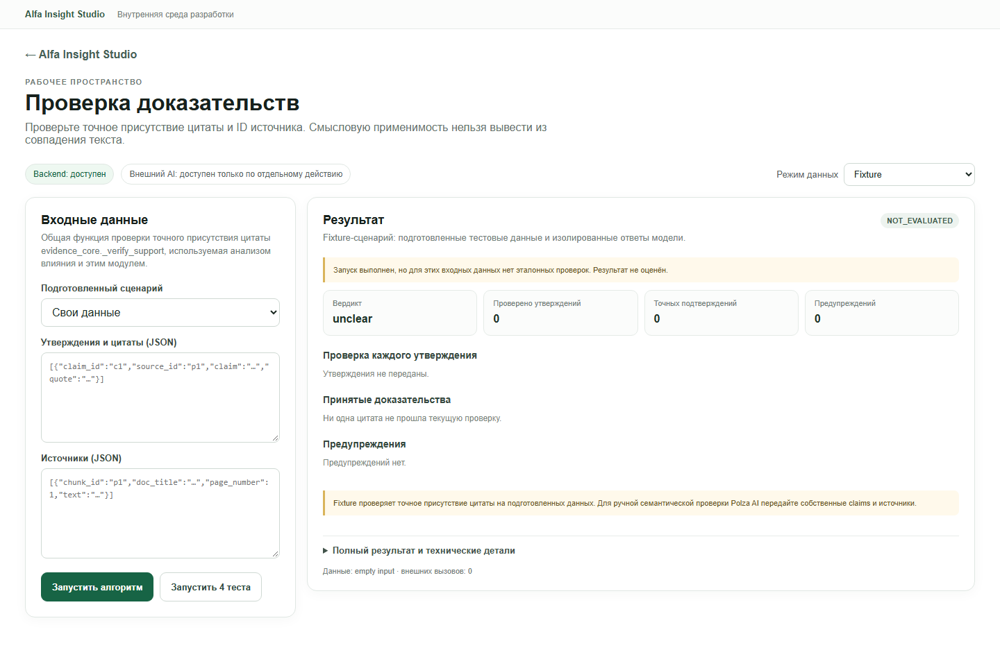
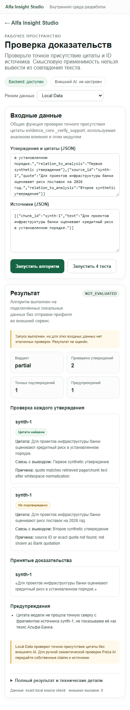

# Module 08 — Evidence Verification

**Проверено:** 22 октября 2026 г.
**Worktree / branch:** `alfa-insight-product-staging-2026-10-21` / `codex/qa-verification-2026-10-22`
**Общий результат:** `PARTIAL` — точная сверка источника/цитаты проверена в браузере на mismatch fixture и синтетическом Local Data input. Смысловая проверка Polza не запускалась.

## Назначение и владелец кода

Модуль отделяет проверку точного присутствия цитаты от суждения о том, подтверждает ли её смысл конкретное утверждение.

- `modules/08-evidence-verification/backend/evidence_core.py:1-36` — единственный владелец deterministic `_verify_support`: сопоставление `source_id`, нормализация регистра/`ё`/мягкого дефиса/пробелов, требование не менее 35 буквенно-цифровых символов и проверка вхождения нормализованной цитаты в текст источника.
- `modules/08-evidence-verification/backend/adapter.py:9-14,16-47,49-58` — fixture, External AI и Local Data адаптеры. External вариант сначала выполняет ту же локальную точную сверку, затем отдельный вызов `chat_json` для смыслового review.
- `modules/05-impact-analysis/backend/stage2_analyzer.py:11-23,518-519` импортирует `_norm` и `_verify_support` из модуля 08. Второй реализации exact quote checker не найдено.
- `modules/08-evidence-verification/frontend/ModulePage.tsx:4-14,17-66` — отдельные представления точных checks, принятых цитат, предупреждений и semantic review. При отсутствии semantic review UI показывает ограничение.
- `modules/08-evidence-verification/fixtures/scenarios.json:1`, `tests/test_module.py:7-17` — три подготовленных сценария и тесты.

## Алгоритм и зависимости

Точный checker строит индекс источников по `chunk_id`, требует существующий `source_id`, достаточную длину цитаты и нормализованное подстрочное совпадение (`evidence_core.py:8-36`). Результат сообщает `verified` и объясняет, найден ли текст; он **не** подтверждает смысл, причинность, применимость цитаты, правильность чисел либо отсутствие противоречий.

Fixture `adapter.py:9-14` использует синтетический источник/утверждение и детерминированную exact-check функцию. Local Data (`:49-58`) принимает переданные пользователем массивы `claims`/`sources`, запускает только exact check, а в `limitations` прямо говорит, что semantics и numbers не анализировались. External AI (`:16-47`) принимает эти массивы, строит отдельный контекст утверждения, цитаты и соответствующего фрагмента до 4 000 знаков (`:25-35`), затем вызывает общий Polza `chat_json` (`:33-36`). В его ответе `independentReview: false` и `semanticReview.independent: false` (`:37-47`): повторная оценка одной моделью не является независимой экспертизой.

## API-контракт

Используется общий module API v1 (`shared/contracts/module-api.ts:1-33`, `shared/contracts/module_api.py:1-30`):

- `GET /api/modules/evidence-verification/health` и `/scenarios`.
- `POST /api/modules/evidence-verification/run` с `{ mode, scenarioId?, input? }`, где входные данные содержат `claims` и `sources`; режимы — `fixture`, `local_data`, `external_ai`.
- `POST /api/modules/evidence-verification/tests` запускает три fixture-сценария.
- Ответ содержит `contractVersion: "1.0"`, `module`, `mode`, `status`, `data`, `provenance`, `validation`; ошибки имеют `error.code/message/detail` (`shared/backend/modules_api.py:162-303`).
- `data` в exact modes включает `status`, `checks`, `verified`, `warnings`, `limitations`; external добавляет `semanticReview`, `model`, `tokenUsage`.

External запуск требует общего opt-in/key/allowlist и ручного нажатия кнопки. В режиме Local Data и fixture внешних вызовов нет (`ModuleWorkbench.tsx:150-185,199-243`).

## Живой UI-проход

1. Открыт `/studio/evidence-verification`; backend доступен.
2. Режим был явно выставлен в `Fixture`; выбран **«Цитата не совпадает»**, затем нажата **«Запустить алгоритм»**. Результат данных — `unsupported`, цитата не принята. Верхний `PASS` означает, что mismatch fixture прошёл ожидаемые проверки (`unsupported`, `verified=false`), а не что утверждение получило поддержку.
3. Режим переключён в `Local Data`; в форму введены **синтетические** утверждение и источник; нажата **«Запустить алгоритм»**. UI показал `supported`, одну найденную цитату и отсутствие semantic review. `provenance` обозначил `exact local source check`, `externalCalls=0`; общий validation для свободного входа показан как `NOT_EVALUATED` из-за отсутствия эталонных ожиданий.
4. Скриншот показывает только синтетический текст: `assets/08-evidence-verification-local.png`. После исправления подписи результат повторно снят в браузере.
5. Внешний режим не запускался и внешних origin в браузере не было.

## Команды и фактические результаты

`npm run test:module -- evidence-verification` — **PASS**: 2 Python unit tests и 3 fixture-сценария: `supported`, `mismatch`, `unknown-source`.

Внешняя semantic ветка, поведение при отказе/таймауте Polza и выставление provider usage не проверялись. После этого `npm run test:all` и общий Playwright E2E-набор были запущены: сборка, все модульные наборы и девять маршрутов прошли. Отдельный браузерный сценарий подтвердил подпись Local Data и очистку старого результата при смене режима.

## Режимы и статус

| Режим | Статус | Подтверждение |
|---|---|---|
| Fixture | `PASS` | UI mismatch fixture вернул ожидаемое `unsupported`; CLI проверил success/mismatch/unknown-source. |
| Local Data | `PASS` для exact quote | Синтетический текст был найден по source ID; semantic status отсутствовал как предусмотрено. Свободный запуск отмечен `NOT_EVALUATED` относительно тестовых ожиданий. Подпись результата теперь различает Local Data и Fixture. |
| External AI | `NOT RUN` | Внешний semantic endpoint этого модуля не вызывался в текущем тестовом бюджете. Алгоритм и качество ответа модели не подтверждены. |

## Ошибки и ограничения

| Severity | Наблюдение и воспроизведение | Ожидаемое поведение / рекомендация |
|---|---|---|
| `FIXED` | После Local Data exact quote пояснение раньше говорило `Fixture проверяет точное присутствие цитаты`. Рендер результата теперь получает текущий режим и сообщает, что Local Data выполнил локальную точную сверку. |
| `P2` | Свободный Local Data запуск может показать domain result `supported`, но общий validation badge `NOT_EVALUATED`; это корректно, потому что нет ожидаемого oracle, однако два статуса легко спутать. | Явно подписать их как «результат exact-проверки» и «оценка тестового ожидания»; сохранить нейтральный `NOT_EVALUATED`, не превращать его в PASS. |
| `P2` | `run_local` требует непустые списки, но не полностью проверяет форму каждого вложенного claim/source до обращения к `_verify_support` (`adapter.py:49-58`, `evidence_core.py:17-23`). Малформированный объект может дать непрозрачный `INVALID_INPUT`/`MODULE_RUN_FAILED` вместо адресного сообщения. Это обнаружено чтением кода, отдельно в UI не воспроизводилось. | Валидировать объектную форму и обязательные `chunk_id`, `source_id`, `quote`, `text`; возвращать безопасное поле/строку с ошибкой до запуска checker. |
| `INFO` | Точная проверка не является смысловым доказательством. External AI review остаётся той же модельной оценкой, а не независимой экспертизой. | Сохранять разделение exact/semantic и явный флаг `independent=false`; не объединять их в единый «подтверждённый» статус. |
| `INFO` | Внешняя семантическая проверка не запускалась в этом проходе. | Перед использованием в качестве проверки качества модели провести отдельный контролируемый live run на синтетических данных с явным бюджетом. |

## Повторный пользовательский проход в Chromium — 2026-10-22

Повторно открыл `http://127.0.0.1:5173/studio/evidence-verification` в настоящем Chromium. Backend health — HTTP 200, `available=true`, `externalAiAvailable=true`, `externalAiRequiresManualRun=true`. Режим External AI не запускал; браузер не отправлял запросов на Polza/DeepSeek, и проверенные сценарии не меняли исходные данные.

### Нажатые элементы и фактические ответы

1. Переключил режим `Fixture`, выбрал «Точная цитата» и нажал «Запустить алгоритм». `POST /api/modules/evidence-verification/run` ответил HTTP 200. Данные вернули `status=supported`, `checks=1`, `verified=1`, дословное совпадение после нормализации пробелов и `externalCalls=0`; контрактная оценка — `PASS` по двум ожиданиям. Интерфейс показал саму цитату, `source-1`, связь с выводом и причину совпадения. Этот PASS означает прохождение проверки фикстуры, не смысловую оценку.
2. Нажал «Запустить 3 теста»: UI показал `PASS` у `supported`, `mismatch`, `unknown-source` и общий `PASS` набора.
3. Вручную выбрал «Цитата не совпадает». Результат — `unsupported`, цитата не принята, показано предупреждение; HTTP 200 / validation `PASS` по ожидаемым `unsupported` и `verified=false`.
4. Выбрал «Неизвестный источник». Результат — `unsupported`, неизвестный ID `missing` не подтвердил цитату; HTTP 200 / validation `PASS`.
5. Перешёл в `Local Data`, ввёл синтетические JSON-утверждение и источник, нажал запуск. Результат `supported`, HTTP 200, validation `NOT_EVALUATED`, provenance `exact local source check`, внешних вызовов `0`.
6. Передал два synthetic claims к одному synthetic source: одна цитата совпала, вторая заявляла о конкретном кредите и сумме, которой в источнике нет. UI показал доменный `partial`, 1 точную цитату из 2, предупреждение для второй. HTTP 200, общий oracle `NOT_EVALUATED`, `externalCalls=0`.
7. Передал пустой массив claims в Local Data. UI показал HTTP 400 / alert `Для локальной сверки передайте непустые массивы claims и sources.` — сообщение без traceback и локального пути. После правки общего empty-state исчезло обещание «готово к запуску», но описание панели пока всё ещё говорит «Результат обработки подключённых локальных данных без внешнего AI»; нужен текст, явно сообщающий об ошибке.
8. Проверил невалидный JSON на мобильной ширине. Клиент остановил запуск с сообщением `Проверьте JSON в поле «Утверждения и цитаты (JSON)».`; никаких внешних запросов не было.

Проверка ширин через `documentElement`: 1440/1440, 1280/1280, 390/390 — горизонтального переполнения не обнаружено. Playwright page errors — 0; внешние запросы — 0. Полный безопасный скриншот fixture `supported` находится в `assets/08-evidence-verification-retest.png`; на нём только синтетические данные.

### Текущие замечания после повторного прохода

| Приоритет | Наблюдение и воспроизведение | Рекомендация |
|---|---|---|
| `P2` | Пустой список claims нельзя представить как `unclear`: fixture adapter подставляет demo claim для falsy-массива, а Local Data требует непустые массивы. `unclear` есть в расчёте, но пользовательским путём недостижим. | Различить отсутствие входа и явно переданный пустой массив. Для пустого/отсутствующего набора возвращать явный `unclear` либо адресную валидацию без фиктивной подстановки. |
| `P2` | В модуле нет списка/истории прошлых проверок: после нового запуска отображается только текущий результат; общая session history не включена для `evidence-verification`. | Добавить историю проверок с датой, режимом, кратким вердиктом и возможностью повторно открыть результат, не сохраняя клиентский текст без необходимости. |
| `FIXED` | После HTTP 400 правая панель раньше сохраняла строку про обработку локальных данных. После общего исправления повторно проверено в Chromium при 390 px: панель показывает «Запуск завершился ошибкой; сообщение и учёт вызовов показаны рядом с формой», ложного готового/успешного результата нет. |
| `P3` | Предупреждение для неизвестного источника говорит про «PDF-фрагмент», хотя UI принимает любые тексты и в проверке использовался synthetic source. | Сделать формулировку нейтральной («фрагмент источника»), чтобы не заявлять тип документа, которого алгоритм не проверял. |
| `P2` | External AI UI называет `max_cost_rub` «лимитом стоимости», но этот модуль вызывает одну модельную операцию, а API тарифицирует после ответа; приложение не может гарантировать жёсткий потолок на один запрос. | Переименовать в «порог расходов» и явно пояснить, что фактическую сумму сообщает провайдер и один запрос может превысить порог. До такой оговорки внешний режим не запускался. |

## Команда тестирования и свидетельства

`npm run test:module -- evidence-verification` — **PASS**: 2 unit-теста и 3 fixture-сценария. Дополнительно живой UI подтвердил точную цитату, mismatch, неизвестный источник, смешанный `partial`, validation `NOT_EVALUATED`, invalid JSON и пустой claims. Это не покрывает смысловую применимость, числа или противоречия.

Снимок UI: .

## Изолированный Chromium-ретест 22 октября 2026

Маршрут проверен в отдельном свежем Chromium context на `/studio/evidence-verification`. Внешний режим не выбирался; в health API он отображался доступным по ручному действию, но ни одного provider request не отправлялось. В поля Local Data вводились только синтетические утверждение и источник.

- `GET /api/modules/evidence-verification/health` и `/scenarios`, `POST /api/modules/evidence-verification/tests` вернули HTTP 200. Все три suite-сценария (`supported`, `mismatch`, `unknown-source`) получили PASS.
- Запуск `supported` через форму вернул HTTP 200, `status=supported`, точный check `verified=true`, отсутствие `semanticReview`, provenance `synthetic source and claim`, `externalCalls=0`.
- В `Local Data` переданы синтетическая цитата и документ. `POST /api/modules/evidence-verification/run` ответил HTTP 200 и вернул `status=supported`, точное совпадение `true`, `semanticReview` отсутствует, `externalCalls=0`; общий validator выставил `NOT_EVALUATED`, потому что произвольный локальный ввод не сопоставляется с эталонным fixture. Повтор вернул тот же verdict. Переключение режима очистило результат.
- В поле JSON введён некорректный синтаксис. Форма показала понятное русское сообщение «Проверьте JSON…» до запроса к API; никаких некорректных данных в backend не отправлено.
- Исправлена нейтральность предупреждения в `modules/08-evidence-verification/backend/evidence_core.py`: вместо неподтверждённого типа «PDF-фрагмент» используется «фрагмент источника». Новый unit-тест проверяет эту формулировку на синтетическом неизвестном/несовпадающем фрагменте. Также общий fetch-error переводчик покрывается тестом, который запускают команды всех модулей 07–09.
- На 1440, 1280 и 390 px горизонтального переполнения нет. Артефакты содержат только synthetic fixture и синтетический Local Data: [fixture](assets/08-evidence-verification-round2-fixture.png), [локальная точная сверка синтетического источника](assets/08-evidence-verification-round2-local-synthetic.png).

Команда `npm run test:module -- evidence-verification` проходит: 3 Python unit tests, 3 browser-independent helper tests и 3/3 fixture сценария. Остаточный риск: точное вхождение цитаты не подтверждает смысловую применимость, числа или отсутствие противоречий; ни Local Data, ни deterministic fixture это не оценивают. External semantic review намеренно не выполнялся.

## Раунд 3 — fixture-проверка в свежем Chromium (2026-10-22)

Маршрут заново открыт в headed Chromium (`evidence_r3`) по адресу `http://127.0.0.1:5173/studio/evidence-verification`; health API ответил HTTP 200, состояние Backend — «доступен». Начальный режим был `External AI — по выбору`; до любых запусков переключил его на Fixture. Provider request не отправлялся, внешние клиентские или банковские данные не использовались.

### Реализация и значение статусов

- Единственный владелец точной проверки — `modules/08-evidence-verification/backend/evidence_core.py::_verify_support`. `modules/05-impact-analysis/backend/stage2_analyzer.py` использует ту же функцию; второго алгоритма проверки цитаты не найдено.
- Проверка связывает claim `source_id` с `sources[].chunk_id`, затем проверяет, что нормализованная цитата длиной не менее 35 буквенно-цифровых символов входит в `source.text`. Нормализация приводит регистр, `ё`, мягкий дефис и последовательности пробелов. Claim body, числа, смысловая поддержка, противоречия и применимость не сравниваются.
- `adapter.run` строит Fixture из synthetic source/claim и выдаёт точные статусы `supported` / `partial` / `unsupported`; выражение для `unclear` написано в коде, но пустой набор claims до него не доходит: `payload.get("claims") or [demo claim]` подставляет демо. `run_local` и `run_external` вместо этого требуют непустые списки. Для непустого утверждения с отсутствующим source или цитатой точный checker возвращает `unsupported`.
- В API v1 поле `data.status` — результат точной сверки. `validation.status=PASS` говорит, что выполнено ожидание подготовленного fixture-сценария; `NOT_EVALUATED` означает, что у произвольного ввода нет эталонного ожидания. Это отдельные уровни, и ни один из них не является семантическим заключением.
- `semanticReview.reviews[].status` (`supported`, `partial`, `unsupported`, `unclear`) появляется только после отдельного ручного запуска External AI. Оно не было получено в этом раунде. External AI-код помечает его `independentReview=false`; модельная оценка не была бы независимой проверкой.

### Действия и результаты Chromium

| Сценарий | Результат живого UI / HTTP |
|---|---|
| Подготовленная точная цитата (`supported`) | `POST /api/modules/evidence-verification/run` — HTTP 200, validation `PASS`, `data.status=supported`, одна точная цитата принята; provenance `synthetic source and claim`, `externalCalls=0`. Затем повторил запуск дважды: оба ответа HTTP 200 с тем же fixture-результатом. |
| Набор fixture-тестов | Нажал «Запустить 3 теста»: `POST /tests` — HTTP 200 / `PASS`; `supported`, `mismatch`, `unknown-source` каждый получил PASS по своему ожидаемому статусу. |
| Неверная цитата / неподтверждённое число | На synthetic источнике проверил два claims: цитата про 12% присутствует, цитата про 19% отсутствует. HTTP 200, доменный статус `partial`, точное подтверждение 1 из 2, одно предупреждение; общий oracle `NOT_EVALUATED`, поскольку это ручной ввод. |
| Source ID неизвестен | Подготовленный `unknown-source` вернул `unsupported`, `verified=false`, предупреждение, что цитата не прошла точную сверку. HTTP 200, suite-ожидание PASS. Живой UI при этом показал старую формулировку «PDF-фрагмент», хотя файл `evidence_core.py` на диске уже содержит нейтральное «фрагмент источника»; см. runtime-расхождение ниже. |
| Непустое неразрешимое утверждение | `source_id=missing` с длинной цитатой, которой нет в synthetic source, дало `unsupported`, не `unclear`. |
| Пустой ввод | В «Своих данных» оставил оба поля пустыми; затем отдельно подал `claims=[]` и `sources=[]`. Оба Fixture запуска ответили HTTP 200 и молча использовали встроенные demo claim/source: `data.status=supported`, validation `NOT_EVALUATED`. Пустой ввод не сформировал `unclear` и не был отклонён. Это воспроизводимое поведение адаптера, а не утверждение пользователя. |
| Число расходится с точной цитатой | Synthetic claim говорил о 19% годовых, его точная цитата из synthetic source — о 12%. Интерфейс вернул `data.status=supported`, `Цитата найдена`, `verified=true`; это подтверждает точное вхождение цитаты, а не числа из claim. Смысловая/числовая проверка без External AI отсутствует. |

Все GET `health`/`scenarios`, fixture POST `run` и `tests` видны в сетевом журнале только на localhost. Пустой запрос не вызывает traceback; внешнего origin и provider request не было. При `partial` с двумя утверждениями, ссылающимися на один и тот же `source_id`, Chromium записал React console warning: `Encountered two children with the same key, test-1` в списке проверок; обе карточки в этой отрисовке отображались.

`npm run test:module -- evidence-verification` — **exit 0**: 3 Python-теста, 3 helper-теста и все три подготовленных fixture-сценария прошли. Это не покрывает смысл и числа; ручные `partial`/numeric/empty кейсы были дополнительно прогнаны через UI.

Скриншоты сделаны только на синтетических данных: [точная цитата, 1440 px](assets/08-evidence-verification-round3-supported.png) и [точная цитата при конфликтующем числе, 1440 px](assets/08-evidence-verification-round3-number-fixture.png). Ни реальные документы, ни клиентские сведения в скриншоты или отчёт не включались.

### Вывод и обнаруженные проблемы

1. **P2 — пустые claims превращаются в demo PASS-похожий вывод.** В Fixture пустые поля или явные `[]` незаметно заменяются встроенным synthetic claim/source, поэтому UI показывает domain `supported` при общей оценке `NOT_EVALUATED`. Ожидается адресная валидация пустого входа либо явный `unclear`; фиктивный анализ нельзя выдавать за проверку переданных данных. `unclear` сейчас недостижим всеми пользовательскими режимами.
2. **P2 — числовое противоречие получает `supported` в exact checker.** Claim о 19% с точной цитатой о 12% считается `supported`, потому что контракт проверяет только наличие цитаты. Отдельная семантическая модель не запускалась; domain-статус и метрика должны быть однозначно подписаны как точное совпадение цитаты, а числовая верификация остаётся отдельной функцией.
3. **P2/P3 — повторяющийся source ID даёт React key warning.** Ручной `partial` с двумя claims к одному source ID выдал warning о двух детях с ключом `test-1`. Карточки показались, но React reconciliation с неуникальными ключами ненадёжен.
4. **Runtime divergence — живая служба показывает прежний PDF-текст.** `evidence_core.py` в текущей рабочей копии формирует нейтральное «фрагмент источника», однако свежий Chromium получил «PDF-фрагмент» для `unknown-source`. Backend не перезапускал, чтобы не прерывать совместный тестовый сервер; вероятно, процесс держит старую импортированную версию. Проверка именно текущего дискового кода проходит через `rg`; живое состояние требует повторной проверки после контролируемого перезапуска.

`Fixture` подтверждён на точном совпадении, частичном результате и двух видах неподдержанного claim. `unclear` через текущие UI/API пути не подтверждён и фактически недостижим. Общий `PASS` fixture-теста означает только совпадение с ожидаемым сценарием, а `data.status=supported` не говорит о смысловой или числовой поддержке. В рамках этого раунда я код не менял и backend не перезапускал; параллельное состояние общей рабочей копии отражено отдельно владельцу основного прохода.

## Результат после исправлений и перезапуска API (2026-10-22)

После round-3 аудита внесены три узкие правки в адаптер/фикстуры и общий список результатов:

- Пустой payload больше не получает скрытые demo claim/source. `{}` и явно заданные `claims: []`, `sources: []` возвращают доменный статус `unclear`, пустые `checks`/`verified` и provenance `empty input`. Успешный preset теперь явно передаёт собственные synthetic claim/source. В fixture manifest добавлен `empty-claims`.
- `ResultList` добавляет индекс к ключу элемента, чтобы несколько claims с одинаковым `source_id` не вызывали React warning.
- После контролируемого перезапуска backend запущен заново в Chromium сценарий `unknown-source`: API вернул `unsupported` / validation `PASS`; UI показал «фрагментом источника» и больше не показывал устаревшую формулировку про PDF.

### Финальная браузерная проверка

- В prepared `empty-claims` UI показал `unclear`, 0 проверенных утверждений и suite `PASS` по явным ожиданиям.
- В «Своих данных» оставил оба JSON-поля пустыми: HTTP 200, доменный `unclear`, validation `NOT_EVALUATED`, provenance `empty input`, ни одного подставленного доказательства.
- В Fixture переданы два synthetic claims с одним `source_id`: один прошёл точную проверку, второй нет; UI показал `partial`, обе строки отображены, console duplicate-key warning отсутствует.
- Новый модульный прогон: 4 Python unit-теста, 3 общих helper-теста, 4 fixture-сценария — PASS. Общий `npm run test:all` и `npm run test:e2e:studio` также завершились кодом 0; E2E открыл все девять модулей. Мобильное сравнение Personalization в том же E2E имеет 326/326 px. Для Evidence Verification на 1440/1280/390 px горизонтального overflow нет.

**Ограничение на момент раунда 3:** checker доказывал только точное присутствие цитаты. Synthetic claim о 19% с точной цитатой, где сказано 12%, тогда получал `supported`; исправление этого случая и его ограничения описаны в следующем разделе.

## Раунд 5 — точная проверка synthetic evidence в браузере (2026-10-22)

### Владелец и поток данных

- Каноническая предметная логика находится в `modules/08-evidence-verification/backend/evidence_core.py`. Адаптер `modules/08-evidence-verification/backend/adapter.py` передаёт входы в общий checker; модуль 05 Impact Analysis также использует этот владеющий механизм вместо копии алгоритма.
- UI: `modules/08-evidence-verification/frontend/ModulePage.tsx`; API запуска/сценариев — `shared/backend/modules_api.py`; режимы и общий lifecycle запроса — `shared/frontend/ModuleWorkbench.tsx`.
- Fixture/local flow: claims + source IDs/quotes → API validation → adapter → `evidence_core._verify_support` → checks и итоговый статус. Проверка нормализует регистр/пробелы/ё/soft hyphen, ищет точную цитату в переданном источнике, сопоставляет source ID и проверяет числовой процент. Это проверяемая детерминированная валидация присутствия цитаты и чисел; semantic applicability здесь не выводится.
- External AI adapter может передать только вручную введённые claims/quote/source excerpt в Polza через `shared/backend/polza_client.py::chat_json`; его же семантическое мнение маркируется как не независимая оценка. В Раунде 5 этот режим не запускался.

### Действия и результат

В Chromium открыт `/studio/evidence-verification`, режим переключён на Fixture, выбран synthetic `supported` preset, запущен алгоритм; затем кнопкой UI запущены четыре сценария. Вход не содержал профилей/клиентских сведений. Интерфейс показал один claim, одну точную цитату из synthetic source, `supported`, совпадение quote/source ID и отсутствие warnings; пояснение корректно ограничило результат точным совпадением и сообщило, что смысл не оценивался. `externalCalls=0`, стоимость 0 ₽. Скриншот: [synthetic exact-match результат](assets/round5/08-evidence-supported.png).

Ожидалось, что корректная цитата из указанного источника даст точное подтверждение, а UI не превратит его в независимое смысловое доказательство. Наблюдаемое поведение этому соответствует. Проведена только позитивная точная цитата; новые ручные numeric/mismatch/error случаи в браузере Раунда 5 не запускались, но они остаются в fixture suite и предшествующих раундах отчёта.

`npm run test:module -- evidence-verification` — exit code 0: 6 Python unit tests, 3 frontend error-helper tests, 4 adapter fixtures (supported, mismatch, unknown-source, empty-claims) PASS. Команда не является независимой semantic validation: fixtures сверяют детерминированное ожидание с известным входом. Внешний AI не вызывался, поскольку в этом прогоне было достаточно проверяемого fixture и не было разрешённого дополнительного внешнего вызова для этого модуля.

### Ограничения и статус

Сильная сторона алгоритма — различает наличие цитаты, принадлежность source ID и несовпадение процентов; предыдущая ручная проверка 19% против 12% описана выше. Граница остаётся существенной: совпавшая цитата сама по себе не доказывает, что она по смыслу применима к утверждению, что units/контекст не искажены, или что утверждение целиком подтверждено. Семантический режим и противоречия в Раунде 5 с внешней моделью не проверялись. `supported` следует читать как статус детерминированных checks, а не как независимый экспертный вывод.

| Область | Статус | Подтверждение |
|---|---|---|
| Модульный suite | PASS | Команда выше, exit code 0 |
| Fixture algorithm через реальный UI/API | PASS | Synthetic source/claim, quote found, `supported`, 0 external calls |
| Числовой конфликт и неизвестный источник | PASS в suite; не повторялись руками | Предыдущие раунды и текущие четыре fixtures |
| Смысловая применимость и противоречия | NOT RUN | Нет независимой semantic проверки в этом режиме; External AI в этом раунде не запускался |
| Стоимость/провайдер | 0 ₽ / 0 вызовов | Только Fixture |
| Изменения кода | Нет | В Раунде 5 модульный код не менялся |

## Раунд 4 — исправлена проверка процентов (2026-10-22)

В живом интерфейсе на синтетическом claim `19%` и цитате `12%` воспроизвёл ложный `supported`. Добавил узкую детерминированную проверку процентов в `evidence_core`: точная цитата остаётся отмеченной как присутствующая, но несовпадающий процент ставит `numeric_consistent=false`, `verified=false` и общий статус `unsupported`. Тот же UI запрос был направлен в свежий экземпляр API с текущим кодом; UI отобразил предупреждение о числовом конфликте. Скриншот содержит только синтетический пример: [числовой конфликт после исправления](assets/08-evidence-verification-round4-numeric-conflict.png).

`npm run test:module -- evidence-verification`: 6 Python unit-тестов, 3 общих helper-теста и 4 fixture-сценария — **PASS**. Изменение проверяет проценты, а не все числа, единицы или логическую совместимость утверждения с цитатой; независимая смысловая оценка по-прежнему отсутствует. В диагностике результата осталось англоязычное техническое предложение — UX-долг. Итог **PARTIAL**; внешний AI не вызывался.
