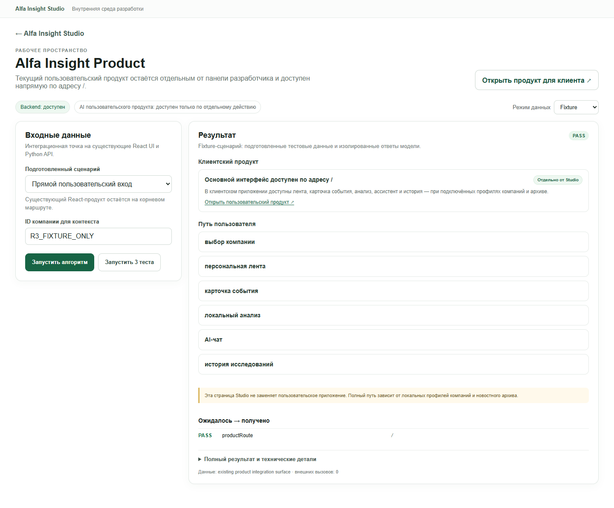

# Module 09 — Alfa Insight Product

**Проверено:** 22 октября 2026 г.
**Worktree / branch:** `alfa-insight-product-staging-2026-10-21` / `codex/qa-verification-2026-10-22`
**Общий результат:** `PARTIAL` — клиентский путь выбора локальной компании, ленты, события, источников, профиля/связей и истории пройден в браузере. AI chat и research в этом проходе не запускались.

## Назначение и владелец кода

Модуль 09 подключает существующий продукт для руководителей к Studio и оставляет его самостоятельным клиентским маршрутом.

- `modules/09-alfa-product/frontend/product/InsightApp.tsx:94-221,261-300,543-729` — состояние компании/события, чтение рабочей области, лента, карточка события, источники, бизнес-профиль, история, chat UI.
- `modules/09-alfa-product/frontend/product/InsightApp.tsx:303-348,762-868` — явные действия запуска исследования/чата и чтение сохранённой истории.
- `modules/09-alfa-product/frontend/product/api.ts:5-55` — клиентские запросы и error handling.
- `modules/09-alfa-product/frontend/product/types.ts:1-135` — TypeScript response shapes для профиля, ленты, бизнес-связей, research, chat и history.
- `modules/09-alfa-product/backend/react_api.py:148-189,244-353,356-415,430-460` — поиск профиля, проектирование события, сбор workspace и локальный retrieval банковских материалов.
- `modules/09-alfa-product/backend/react_api.py:795-890,892-941` — HTTP GET маршруты чтения и POST маршруты, создающие явные chat/research jobs.
- `drive_data_analysis_2026-10-20/insight_history.py:16-23,86-137` — реализация локальной истории; GET-функции выполняют SELECT, общий connect открывает SQLite как read-write и включает WAL.
- `modules/09-alfa-product/backend/adapter.py:1-20` и `frontend/ModulePage.tsx:4-45` — Studio integration surface, fixture и локальная проверка доступности данных; это не дубликат клиентского интерфейса.
- `src/App.tsx:76-79` и `apps/product/ProductApp.tsx` — `/product` и корневой маршрут используют существующий `InsightApp`.

Основные зависимости: `stage1_analyzer` (локальные профили), `personalization` (обработанный архив и ранжирование), `business_graph` (локальные связи), `stage2_rag` (локальный поиск банковских материалов), history store и существующий orchestration/Polza provider для явно отправленных AI-действий. Workspace строит feed до 40 ranked events и возвращает агрегированные profile/network данные (`react_api.py:356-415`). UI ограничивает отображаемые карточки 20 событиями (`InsightApp.tsx:252-259`).

## API-контракт

Studio-адаптер использует module API версии `1.0` (`shared/contracts/module-api.ts:1-33`, `shared/backend/modules_api.py:162-303`): `GET /api/modules/alfa-product/health|scenarios`, `POST /api/modules/alfa-product/run|tests`. Fixture-проверка удостоверяет прямой маршрут, передачу ID и наличие перечня пользовательских потоков (`modules/09-alfa-product/fixtures/scenarios.json:1`). Local Data adapter только читает число доступных профилей/событий и отдаёт provenance `writes=none` (`backend/adapter.py:5-20`).

Клиентский API сохраняет исторические JSON-маршруты без `contractVersion`:

- `GET /api/companies?q=…` → `{ companies: CompanyCard[] }`.
- `GET /api/workspace?companyId=…` → `{ company, profile, feed, business, status, aiMode }`.
- `GET /api/event?companyId=…&eventId=…` → `{ event, bankResearch, company, aiMode }`.
- `GET /api/history?companyId=…&eventId=…` → `{ research, messages }`.
- `POST /api/research` → job snapshot; `POST /api/chat` → job snapshot с idempotency key. Эти POST-маршруты на этом проходе не использовались.

Frontend API-типы находятся в `product/types.ts`, маршруты и методы — в `product/api.ts:24-55`; маршрутизация HTTP — `backend/react_api.py:795-941`. Ошибки возвращаются с общим `error` message в legacy product API, а недоступность workspace отображается через пустое состояние/повтор (`InsightApp.tsx:449-454`).

## Живой UI-проход

Проверка проводилась в отдельном headless Chromium. Для приватности отчёт не включает ID компании, тексты профиля, заголовок события, историю или банковские выдержки.

1. На `/studio/alfa-product` backend отображался доступным; выбран `Fixture`, запущена интеграционная проверка, видна ссылка **«Открыть пользовательский продукт»**. Studio-маршрут и клиентский маршрут разделены.
2. Открыт корень `/`, в picker введён заранее заданный тестовый ID, выбрана одна найденная локальная компания. GET запросы загрузили workspace и ленту; отрисовано 20 видимых карточек, первая карточка открылась как событие.
3. Открыта секция **«Источники и обоснование»**: отображён один кликабельный source link. Ссылка на первоисточник замечена, но не переходил по ней; содержимое не переносил в отчёт.
4. Открыта секция **«Профиль и связи»**. Содержимое реально отобразилось, но в отчёт не сохранено и не процитировано.
5. Открыта **«История проверок»**: интерфейс показал десять записей (верхний предел ответа истории). Детали записей не раскрывались и не копировались.
6. Во время пути не нажимались **«Начать исследование»**, **«Спросить…»** или **«Отправить»**. В browser request log нет `POST /api/research` или `POST /api/chat`; внешних origin не зафиксировано. Поиск/выбор компании, загрузка события, раскрытие источников, профиля и истории вызвали только localhost обращения.
7. На 390 px горизонтального overflow нет; открытие event view и кнопка возврата к ленте сработали. На 1440 px основной маршрут также отобразился. Скриншот продуктового экрана с реальными локальными сведениями намеренно не сохранялся.

## Команды и фактические результаты

`npm run test:module -- alfa-product` — **PASS**: 2 Python unit tests, 3 fixture scenarios (`direct-route`, `company-context`, `flows`). Эти проверки не являются компонентным или end-to-end тестом продукта; подтверждение настоящего UI — ручной Chromium проход выше.

В этой проверке не выполнялись `npm run test:all`, общий `npm run test:e2e:studio`, чат, исследование, повторное исследование и переход на внешние источники. На 1280 px клиентский продукт отдельно не измерялся.

## Режимы и статус

| Режим/путь | Статус | Подтверждение |
|---|---|---|
| Studio Fixture | `PASS` | Интеграционная карточка запущена, backend доступен, прямая ссылка на продукт отображается. |
| Product Local Data — read-only | `PASS` | Реальный поиск компании, workspace/feed/event, раскрытие источников и профиля, read history. Внешние вызовы 0. |
| AI chat | `PARTIAL` | UI и API маршрут есть; в описанном проходе не отправлялся. Качество контекста/ответа не подтверждено. |
| Deep research | `PARTIAL` | Панель и history доступны; кнопка запуска не нажималась. Реальное выполнение в этом отчёте не подтверждено. |
| Responsive | `PARTIAL` | 1440 и 390 px проверены; на 390 px нет горизонтального overflow и переход detail/back работает. 1280 px не проверен. |

## Ошибки и ограничения

| Severity | Наблюдение и воспроизведение | Ожидаемое поведение / рекомендация |
|---|---|---|
| `P2` | API `GET /api/history` вызывает `research_history` и `chat_messages` (`react_api.py:841-879`). Эти helper-функции возвращаются без открытия DB только если файл отсутствует; иначе используют `_database` → `_connect`, который открывает обычный read-write SQLite handle и выставляет `PRAGMA journal_mode=WAL` (`insight_history.py:16-34,86-137`). Браузерный GET не добавлял entries; точный delta файлов/WAL для этой проверки не замерялся. | Для требования «просмотр истории не меняет данные» читать историю через SQLite `mode=ro` и не менять journal mode; отдельно проверить, что просмотр существующей/пустой истории не меняет SQLite/WAL timestamps или строки. Старый файл agent history в `react_api.py:854-875` уже открывается `mode=ro`. |
| `P2` | Клиентский API имеет typed shapes, но direct `/api/companies`, `/api/workspace`, `/api/event`, `/api/history` не содержат номера контракта/схемы; это legacy поверхность, отличная от versioned `/api/modules/...`. Обнаружено чтением кода, совместимость не ломалась в UI проходе. | Документировать и версионировать direct API при следующем изменении ответа; не менять legacy форму без параллельного обновления UI/клиентов. |
| `INFO` | Кнопки внешнего AI chat/research присутствуют, но их поведение не проверено в этом отчёте. История содержит существующие записи, поэтому запуск мог бы создать/обновить состояние или вызвать модель. | Возвращаться к live-проверке только после сверки расходов предыдущих вызовов и появления надёжного ограничения стоимости; использовать отдельный синтетический или clone-local сценарий и фиксировать usage/idempotency. |
| `INFO` | Внешние ссылки на публикацию/банковский материал не открывались. Видимый source link подтверждает представление ссылки в UI, но не доступность целевого сайта. | Проверять источники в отдельном контролируемом проходе; сохранять только публичный URL и статус открытия, не копировать конфиденциальные сведения. |
| `INFO` | Ошибочные состояния (профиль не найден, пустая лента, archive/RAG недоступны) в браузере не воспроизводились. Код содержит безопасные сообщения для этих веток (`react_api.py:808-840`, `InsightApp.tsx:449-460`). | Добавить/выполнить e2e сценарии недоступности зависимостей отдельно от основного локального happy path. |

## Актуализация: повторный браузерный ретест — 22.10.2026

Проверка выполнена повторно в Chromium на живом локальном приложении (`5173` → API `8097`). Работа шла только через локальные профили; чат и Deep AI не отправлялись, внешних AI-вызовов — 0. Тексты компании, новостей, чата и истории не сохранялись в артефакты.

### Проверенные действия и результат

1. Открыл `/` в новом браузерном контексте без выбранной компании. Пустое состояние объясняет, как начать, и содержит действие **«Выбрать компанию»**. Безопасный скриншот этого первого экрана — `assets/09-alfa-product-retest.png`.
2. В picker ввёл ID тестовой локальной компании и выбрал найденное совпадение. `/api/companies` и `/api/workspace` ответили `200`; загружено 20 карточек событий. Сначала видны две карточки с сигналом по профилю, общие события находятся в свёрнутой секции. Раскрыл её и проверил первые пять карточек: у каждой видны источник, дата, объяснение и метка приоритета. Подпись ленты отдельно говорит, что приоритет не является вероятностью ущерба.
3. Открыл первую карточку, затем вторую. `/api/event` ответил `200`; выбранное событие появилось в URL и контекст компании сохранился. В деталях показаны краткое описание, условный приоритет, возможные каналы влияния, что проверить и ограничение о неподтверждённых договорах/проектах.
4. Открыл **«Источники и обоснование»** и **«Профиль и связи»**. Источники раскрылись, платёжные/групповые связи сопровождались оговоркой о том, что это не подтверждение поставки, контроля или критической зависимости.
5. Нажал ссылку первоисточника в отдельной вкладке. Публичный сайт Банка России открылся, HTTP `200`; URL содержит только публичную публикацию, referrer не передавался (`rel=noreferrer`).
6. Открыл **«История проверок»**. `GET /api/history` ответил `200`, в интерфейсе раскрылось 10 сохранённых записей. Новое исследование или чат не отправлялись и записи не создавались.
7. Видны чат и кнопка **«Глубокий AI-анализ»**; текущий режим отображался как **«AI включён»**. Поля не отправлял: оценка качества ответов, контекстной памяти и защиты от повтора для внешнего запуска остаётся `PARTIAL`.
8. Переключил компанию, затем обновил страницу. URL и верхняя панель сохранили новый выбор; событие загрузилось заново в контексте выбранной компании. Поиск несуществующего синтетического ID показал понятное «Совпадений нет. Проверьте ID или запрос.» без traceback.
9. На `1440`, `1280` и `390` px горизонтального переполнения нет (`scrollWidth == clientWidth`). В мобильном режиме переход к событию и действие **«Вернуться к ленте»** проверены.

Во время клиентского сценария `GET /api/companies`, `/api/workspace`, `/api/event` и `/api/history` вернули `200`; ошибок страницы/консоли не было. Не вызывались `POST /api/research` и `POST /api/chat`. Ошибки недоступности архива/индекса и повторный платный запуск не форсировались.

### Актуальный статус

| Путь | Результат |
|---|---|
| Первый вход и выбор компании | `PASS` — пустое состояние объясняет действие, picker и URL работают. |
| Персональная лента и карточка события | `PASS` для локального read-only потока; видимость 20 записей, первые 5 имеют источник/дату/объяснение/приоритет. |
| Источники | `PASS` для одной публичной ссылки Банка России (HTTP 200); банковский URL отдельно не открывался. |
| Профиль и связи | `PASS` для открытия локальных сведений с оговорками о границах доказательств. |
| История | `PASS` как чтение 10 записей; создание/сохранение нового результата не проверялось. |
| Chat / Deep AI | `PARTIAL` — интерфейс есть, но отправка отключена в этом ретесте, качество модели и duplicate guard не проверены. |
| Адаптивность | `PASS` — 1440/1280/390 px, без горизонтального overflow; mobile back работает. |
| Модульный набор | `PASS` — `npm run test:module -- alfa-product`, 2 Python теста и 3 fixture-сценария. |

Новый прогон уточняет предыдущий отчёт: ширина `1280px` теперь проверена, а публичный первоисточник реально открыт. Отчёт остаётся `PARTIAL`, потому что в этом контролируемом проходе не запускались чат и глубокое исследование.

Чат и глубокое исследование намеренно не запускались после того, как внешний T08/T09 прогон превысил согласованный предел расходов. Для этого модуля не было дополнительных платных вызовов; доступность режима в UI не считается доказательством успешной работы или стоимости.

## Изолированный Chromium-ретест 22 октября 2026

Модуль Studio `/studio/alfa-product` проверен в отдельном Chromium context, а конечный продукт `/` — в новом отдельном context без выбранной компании. Использовались только синтетический fixture и Local Data запрос с пустым ID (проверка доступности, без выбора профиля). Чат, deep research, история и внешние ссылки не открывались.

- `GET /api/modules/alfa-product/health`, `/scenarios` и `GET /api/health` ответили HTTP 200; `POST /api/modules/alfa-product/tests` вернул PASS для 3/3 (`direct-route`, `company-context`, `flows`). Fixture-запуск `direct-route` через UI вернул HTTP 200, validation `PASS`, маршрут `/` и `externalCalls=0`.
- Повтор fixture-запуска с явной тестовой меткой контекста вернул тот же маршрут и контекст с HTTP 200. Переключение режима очистило результат. Искусственно прерванный локальный `run` показал общее русское сообщение о недоступности backend; после снятия перехвата Local Data повторился успешно с HTTP 200.
- Local Data с пустым ID вернул HTTP 200, `NOT_EVALUATED`, `companyAvailable=false`, `externalCalls=0`, `writes=none`. Это read-only проверка наличия локальных наборов без вывода профильных данных в отчёт.
- В чистом пользовательском маршруте `/` показано понятное пустое состояние с действием «Выбрать компанию». В этом контексте браузер не выполнил запрос workspace/event/history, и в логе не было POST `/api/chat` или `/api/research`. Поэтому результат подтверждает первый вход и пустое состояние, а не полный персонализированный путь.
- Оба маршрута — Studio и продукт — проверены на 1440, 1280 и 390 px; `scrollWidth` равен ширине viewport на всех размерах. Скриншоты безопасны для передачи и не содержат локальных компаний: [Studio с synthetic context](assets/09-alfa-product-round2-studio-fixture.png), [пустое состояние продукта](assets/09-alfa-product-round2-empty.png).
- Общий сетевой error helper теперь показывает русское объяснение отсутствия локального API вместо браузерного `Failed to fetch`. Его покрытие подключено к `npm run test:module -- alfa-product` вместе с тестами модуля 07 и 08.

`npm run test:module -- alfa-product` проходит: 2 Python unit tests, 3 общих helper tests и 3/3 fixture-сценария. `npm run build` также прошёл (`tsc` + Vite production build). Статус продукта остаётся `PARTIAL`: свежий проход подтвердил отдельный маршрут, ясный empty state, Fixture и безопасную локальную проверку; выбор реальной компании, просмотр ленты/источников и чтение истории здесь намеренно не повторялись, а chat/research не запускались. Качество их ответов, обновление истории и duplicate guard этим прогоном не сертифицированы.

## Последующий read-only продуктовый проход — 2026-10-22

После контролируемых Studio-тестов дополнительно открыт клиентский маршрут `/` в Chromium. Использованы два локальных профиля, указанные для проверки. Внешние хосты блокировались на уровне браузерного маршрута; кнопки чата и исследования не нажимались. Скриншот этого прохода с локальными данными оставлен только в игнорируемой папке `output/playwright/` и в репозиторий не включён.

- До выбора компании показано пустое состояние с кнопкой «Выбрать компанию».
- Для каждой выбранной компании `/api/companies`, `/api/workspace` и `/api/history` вернули HTTP 200; `/api/event` для выбранных событий тоже вернул HTTP 200. В ленте отрисовано 20 карточек, первые пять доступны для просмотра.
- Открыты карточка события, раскрытие источников и профиль компании. После выбора второго профиля компания сохранилась в URL и верхней панели; обновление страницы сохранило выбор.
- На ширине 390 px `documentElement.scrollWidth == clientWidth`. За весь проход были только GET-запросы; `/api/chat` и `/api/research` не вызывались, сетевых запросов к внешним хостам не было.

Этот проход уточняет предыдущий вывод о пустой клиентской странице: причина была в том, что компания ещё не выбрана. Read-only путь от picker до ленты и карточки события подтверждён; AI-чат и глубокое исследование остаются `NOT RUN` в этой повторной проверке.

## Раунд 3 (2026-10-22)

Свежий Chromium-контекст `r3product20261022` проверил модуль Studio и переход в клиентский корень. В ходе этого прохода не открывались валидные профили и события. Скриншот сделан только после синтетического Fixture-сценария.

### Команда и изолированный suite

`npm run test:module -- alfa-product` — **exit code 0**:

- 2 Python unit-теста;
- 3 общих frontend error-helper теста;
- 3 подготовленных сценария: `direct-route`, `company-context`, `flows` — все PASS.

Этот результат покрывает адаптер интеграции и форму сценариев, но не открывает пользовательский профиль или ленту. Сценарий product fixture проверяет метаданные существующего клиентского маршрута и список рабочих путей.

### Живой браузерный проход

| Проверка | Действие и наблюдение | Статус |
|---|---|---|
| Studio route | Открыл `/studio/alfa-product`; backend и сценарии доступны. Studio изначально выбрал `Local Data`, перед любым запуском режим переключён на `Fixture`. | **PASS** |
| Fixture route | Ввёл синтетическую метку контекста и запустил `direct-route` два раза. Оба `POST /api/modules/alfa-product/run` вернули HTTP 200 и `PASS`; результат — клиентский маршрут `/`, доступные пути, `externalCalls: 0`. | **PASS** |
| Main navigation | Нажал «Открыть продукт для клиента» в Studio. Открылся корневой маршрут `/`, адрес Studio отделён от клиентского продукта. | **PASS** |
| Пустое состояние | Без выбранной компании продукт ясно предлагает «Выбрать компанию» и объясняет, что лента будет учитывать её профиль. Блок анализа сообщает, что сначала нужно выбрать компанию. | **PASS** |
| Picker / product GET | Открыл picker. `GET /api/companies?q=` ответил HTTP 200, в меню появилось 16 вариантов; содержимое карточек не копировалось в отчёт и не снималось. | **PASS для навигации и доступности списка** |
| Reload | Перезагрузил `/` без выбранной компании. Продукт остался в том же ясном empty state; профиль, лента, событие и история не загружались. | **PASS** |
| Synthetic missing profile | Открыл маршрут с заведомо синтетическим несуществующим ID. `GET /api/workspace` вернул ожидаемый HTTP 404 до ранжирования; UI показал «Компания не найдена в справочнике» без traceback. Chromium зафиксировал resource 404 и первый отменённый повтор запроса (`ERR_ABORTED`). | **PASS для пользовательской ошибки; console/network noise замечен** |
| Чат / глубокое исследование | В сетевом журнале нет `POST /api/chat` или `POST /api/research`; наружные AI-запросы не выполнялись. | **NOT RUN** |

За всё время браузерного прохода ответы `200` получили `GET /api/health`, `/api/modules/alfa-product/health`, `/api/modules/alfa-product/scenarios`, `/api/modules` и `/api/companies?q=`; два fixture `POST /api/modules/alfa-product/run` тоже вернули `200`. Product UI после выбора списка не переходил к реальному профилю. Скриншот рабочего экрана сохранён только с synthetic marker и без банковских значений.

### Владение и путь данных

- **Клиентский интерфейс-владелец:** `modules/09-alfa-product/frontend/product/InsightApp.tsx`; вызовы GET/POST типизированы в `frontend/product/api.ts`.
- **API-владелец:** `modules/09-alfa-product/backend/react_api.py`; старый `drive_data_analysis_2026-10-20/react_api.py` — compatibility wrapper. `GET /api/companies` строит picker из уже загруженного справочника. `GET /api/workspace` собирает профиль, граф и новости, ранжирует события; `/api/event` сначала повторно строит workspace и затем ищет банковскую аналитику; `/api/history` читает историю.
- **Studio-адаптер:** `modules/09-alfa-product/backend/adapter.py`. `run()` возвращает интеграционные метаданные и `externalCalls: 0`, но не рендерит клиентскую ленту. `run_local()` только читает CSV-профили и обработанные новости для проверки наличия; это availability check, а не пользовательский продуктовый Fixture.
- **Персонализация:** единственный ranker — `modules/04-personalization/backend/personalization.py`. Вызываемый API workspace использует его с cache path по умолчанию.

Полный synthetic fixture profile/feed для конечного продукта в UI отсутствует. Studio fixture проверяет маршрут, сценарные метаданные и контекст, но не заменяет данные `InsightApp`. Поэтому по требованию использовать только синтетический Fixture нельзя безопасно пройти профиль и ленту.

### Read-only ограничения и результат

Валидный `GET /api/workspace` или `/api/event` не запускался: первый вызывает `rank_personalized_events()` без временного cache path, который записывает результаты в persistent `personalization_cache.sqlite3`; второй сначала проходит тот же workspace-путь. Валидный `GET /api/history` также не запускался: `research_history()` и `chat_messages()` используют `_database()` с обычным SQLite handle и `PRAGMA journal_mode=WAL`. Эти маршруты нельзя подтвердить как read-only до отдельного безопасного режима. Проверены только безусловно читающие health/list endpoints и synthetic 404 workspace, который останавливается при отсутствии профиля до ранжирования. CSV, SQLite, история и кэш этим проходом не изменялись намеренно; чат и research не запускались.

В Fixture UI после результата отображается общий текст «подготовленные тестовые данные и изолированные ответы модели». В этом сценарии AI-ответы не генерировались: адаптер только возвращает интеграционную информацию. Такая подпись снова создаёт ощущение mock AI; стоит уточнить, что сценарий проверяет существующий маршрут и метаданные продукта. **P2, открыто.**

**Итог раунда: PARTIAL.** Модульный suite, Studio fixture и переход на `/` — **PASS**; пустое состояние и выбор списка компаний — **PASS**; fixture-профиль и fixture-лента в клиентском продукте — **NOT_IMPLEMENTED**; валидный read-only профиль/лента/история — **BLOCKED**, поскольку соответствующие GET могут менять SQLite-кэш или журнал; AI chat и deep research — **NOT RUN**. Отрицательный `404` для синтетического несуществующего ID ожидаем и обработан понятным empty/error state. Обновлён только этот отчёт; код не менялся.

## Раунд 5 — живой продукт, переключение компании и источники (2026-10-22)

### Владелец и data flow

- Конечный продукт: `modules/09-alfa-product/frontend/product/InsightApp.tsx`; HTTP-клиент и контракты: `modules/09-alfa-product/frontend/product/api.ts`; API: `modules/09-alfa-product/backend/react_api.py`. Старый путь в `drive_data_analysis_2026-10-20/react_api.py` остаётся совместимым thin wrapper.
- Studio-представление: `modules/09-alfa-product/frontend/ModulePage.tsx`, backend adapter `modules/09-alfa-product/backend/adapter.py`. Это интеграционная/availability проверка; Studio adapter не запускает пользовательскую ленту и не является AI-product simulation.
- Пользовательский workspace запрашивает компании/профиль/события и граф через product API; ранжирование делегируется единственному алгоритму-владельцу `modules/04-personalization/backend/personalization.py`. Просмотр события использует event API и доступный bank research, источники отображаются в карточке. История обслуживается отдельным product API. Чат и глубокое исследование используют свои backend endpoints и могут вызывать разрешённый внешний провайдер.

### Свежие действия в браузере

| Действие | Ожидание | Фактическое наблюдение | Статус |
|---|---|---|---|
| Studio `/studio/alfa-product` | Отдельная карточка модуля должна быть доступна | UI открылся; режим Local Data показал `NOT_EVALUATED`, как и должно быть для проверки наличия входов без oracle/аналитического запуска. Нажата кнопка module test; suite прошёл. | PASS для маршрута/availability, не доказательство полного customer journey |
| Клиентский `/` без выбранной компании | Понятный стартовый шаг | Показан выбор компании и краткое объяснение персональной ленты; пустая аналитика попросила сначала выбрать компанию. Сохранён безопасный screenshot без клиентских данных: [пустое состояние продукта](assets/round5/09-alfa-product-empty.png). | PASS |
| Выбор компании и лента | После выбора появляются персональные новости | В picker выбрана доступная локальная компания, загружена лента, открыто событие. Реальные локальные значения не копировались в отчёт и не снимались. | PASS для живой навигации/данных; смысловая точность не переоценивалась |
| Источник | Ссылка должна вести к материалу | Ссылка источника открыла публикацию в новой вкладке. В отчёт не включены её заголовок, выдержка или идентификатор. | PASS для перехода |
| Переключение компании | Контекст события должен смениться | В product UI выбрана другая локальная компания; новый контекст/событие загрузились. В старый контекст возврата не произошло. Идентификаторы/поля профиля не записаны. | PASS для сохранения текущего контекста |
| История | Историю можно открыть без потери контекста | Открыта секция «История проверок» для текущего события; отобразилось пустое состояние. Данные не удалялись. В ранее сохранённых чат-сообщениях отображались похожие повторяющиеся пары реплик; неизвестно, это валидная история или повторный рендер, поэтому не помечаю как подтверждённый дефект. | PARTIAL; причина повторов не установлена |
| Live chat / deep research | Проверить полезный AI ответ, источники и стоимость | Не запускал: до отправки в UI нельзя увидеть полный server-side payload и проверить, какие именно профильные поля/контекст будут переданы провайдеру. Сохраняю контроль над данными; отсутствует безопасный preview перед внешним вызовом. | NOT RUN, ограничение UI |

В текущем проходе `npm run test:module -- alfa-product` завершилась с exit code 0: 2 Python unit tests, 3 frontend error-helper tests и 3 module fixtures (direct-route, company-context, flows) PASS. Studio `Local Data` при этом имеет статус NOT_EVALUATED: это корректно отражает отсутствие oracle и само по себе не означает, что все пользовательские функции проверены. Прямой product UI действительно загрузил локальную ленту; маршруты workspace/event могут читать локальные данные и обновлять personalization cache, поэтому этот браузерный проход не называется строго read-only. Никакие CSV, записи истории или пользовательские данные вручную не менялись и не очищались.

### Provenance, ошибки и стоимость

Product UI работал на доступных локальных данных; идентификаторы выбранных компаний, заголовок/текст события, поля профиля и скриншоты с ними не сохранялись. Источник открывался пользователем из карточки. Внешняя модель не вызывалась: за этот модуль AI calls = 0, externalCalls = 0, стоимость = 0 ₽. Проверка не подтверждает качество полного AI ответа.

Наблюдаемое ограничение для безопасного тестирования: продуктовый server endpoint сам собирает provider context, но UI не показывает полный payload и его provenance до нажатия/отправки. Из-за этого невозможно безопасно проверить состав контекста перед live вызовом. Следующее полезное исправление для QA — локальный preview перед отправкой с перечнем полей/источников и их происхождением, не требующий раскрытия содержания банковских значений в отчётах.

Адаптивность не переоценивалась в этом раунде: сохранён только desktop empty-state screenshot; мобайл/1280/1440 остаются подтверждениями предыдущих разделов, а не свежей проверкой Раунда 5. Обнаруженных новых traceback или неожиданного состояния в проверенных маршрутах не было.

### Статус Раунда 5

| Область | Статус | Основание |
|---|---|---|
| Изолированный module suite | PASS | Все 3 подготовленных сценария и соответствующие unit/helper tests прошли |
| Studio Local Data | PASS как availability check; NOT_EVALUATED как аналитический результат | Не запускает продуктовый алгоритм и не имеет oracle |
| Реальная продуктовая лента и переключение | PASS для UI/data navigation | Две доступные локальные компании, событие открыто и контекст сменился; значения не сохранялись |
| Переход к источнику | PASS | Открылась новая вкладка источника |
| История | PARTIAL | Секция открылась; повторяющиеся на вид прежние чат-реплики оставлены без изменений, причина не установлена |
| Внешний чат / глубокое исследование | NOT RUN | Нет предварительного просмотра полного server-side payload |
| Стоимость и внешние вызовы | 0 ₽, 0 | Внешний AI не вызывался |
| Изменения кода | Нет | В Раунде 5 обновлён только отчёт; скриншот содержит только пустое состояние |

## Раунд 4 — живой локальный путь и переключение компании (2026-10-22)

В браузере выбрал локальную компанию, открыл её 20-событийную ленту и карточку события. На странице были видны источник и тип выдержки, условная связь с отраслью и банковским сигналом, оговорка об отсутствии доказательств фактического участия или займа, конкретные проверки для пользователя и пустой статус подходящей банковской аналитики. Переключил компанию: контекст и событие обновились, профиль старой компании не остался в объяснении. Идентификаторы, поля профиля и выдержки в отчёт не записывались. Chat/deep research в этом раунде не запускались; новых внешних запросов не было.

На мобильном экране обнаружено, что после выбора новой компании сохранялся флаг detail view, поэтому автоматически выбранное событие другой компании сразу открывалось вместо ленты. Исправлено в `InsightApp.tsx`: смена компании сбрасывает mobile detail. В E2E добавлена проверка перехода назад в список; локальные product screenshots и значения профилей исключены из сохраняемых E2E артефактов/результатов. Результат регрессионной проверки приводится после полного прогона.
